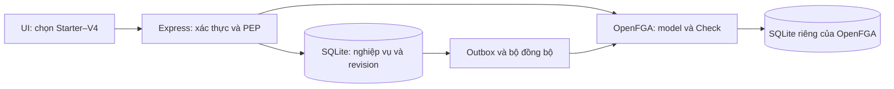

# Kế hoạch tích hợp OpenFGA vào Task Authorization Minilab

Ngày lập: 02/11/2026. Trạng thái: **đã triển khai local trên Block-6-Advance**. Model và HTTP chạy qua OpenFGA thật; xem kết quả tại `evidence/openfga/manifest.json`. Chưa có hosted deployment hoặc nghiệm thu giảng viên.

Mục tiêu: giữ bộ chọn Starter → V1 → V2 → V3 → V4; chuyển việc đánh giá quyền của V1–V4 sang OpenFGA thật. SQLite tiếp tục lưu nghiệp vụ và là nguồn dữ liệu gốc; OpenFGA lưu mô hình và bản chiếu quan hệ quyền. Backend Express thực thi quyết định trước khi trả dữ liệu hoặc ghi thay đổi.

## 1. Căn cứ và phạm vi

Đã đối chiếu mã nguồn `src/app.js`, `src/policy.js`, `src/db.js`, `src/auth.js`, schema, fixture và các điểm liên quan trong test/UI/evidence. Hiện tại `authorize()` và wrapper `endpoint()` chạy đồng bộ; `transaction()` gọi callback rồi COMMIT ngay. Vì vậy không được chỉ thêm `async` vào authorize và giữ nguyên transaction hiện tại.

Giữ nguyên API `/api/:version`, token demo, dữ liệu seed, SQLite persistence/reset và ngoại lệ danh mục project chỉ có ID/tên. Giữ quy tắc Owner cố định, validation và cách phân biệt quyền với kết quả nghiệp vụ. Chưa mở rộng tạo project/task, đổi assignee, chuyển Owner hoặc authentication thật.

Baseline trước sửa đạt 52/52 tests và browser smoke. Graph có báo metadata thay đổi; luồng chính đã được kiểm tra bằng source trực tiếp. Các phần dưới giữ thiết kế/tiêu chí ban đầu; thực thi hiện tại được ghi trong README/POLICY và evidence mới.

## 2. Quyết định kiến trúc

| Quyết định | Cách thực hiện | Lý do và đánh đổi |
| --- | --- | --- |
| Dùng OpenFGA cho V1–V4 | Backend gọi Check; Starter ghi SKIPPED như hiện tại | Giữ so sánh policy; không fallback về policy yếu khi engine lỗi |
| Một model chứa quyền theo version | Các relation suy ra có hậu tố `_v1` đến `_v4`; mapping version/action cố định ở server | Chung dữ liệu quan hệ, khác quy tắc; model lớn hơn một policy đơn |
| Lưu quan hệ trong OpenFGA | Chiếu membership, tenant, admin, task–project và assignee từ SQLite | Thể hiện cả lưu quan hệ lẫn suy luận quyền; phải xử lý đồng bộ hai hệ thống |
| SQLite là nguồn gốc | Không cho UI/browser ghi trực tiếp vào OpenFGA | Giữ API quản lý members và reset; cần outbox và reconciliation |
| Trạng thái task là context tin cậy | Backend đọc trạng thái hiện tại và truyền vào condition OpenFGA | Không phải đồng bộ tuple mỗi lần đổi Open/Closed; cần kiểm tra lại snapshot trước ghi |
| Cố định model ID | Check/Write luôn chỉ rõ store ID và authorization model ID | Không bị đổi policy ngoài ý muốn khi có model mới |
| Local trước | Express chạy Node trên máy; OpenFGA + SQLite chạy Docker Compose | Hai database SQLite riêng; OpenFGA giữ tuple trên volume, vẫn cần Docker cho engine |

Chốt phiên bản cụ thể của OpenFGA và SDK khi triển khai; pin image/package đã kiểm tra, không dùng `latest` trong bản bàn giao. OpenFGA HTTP bind loopback, không trùng app port 3000; không cần mở Playground. Kiểm tra Docker Engine trước khi cài dependencies hoặc dựng services. Nếu máy chưa có Docker, ghi rõ blocker môi trường, không báo tích hợp hoàn tất bằng mock.

OpenFGA model version khác với version bài học: một model ID chứa đồng thời policy V1–V4. Đổi selector chỉ chọn relation cần Check, không viết lại model hoặc seed lại dữ liệu.



## 3. Policy cần giữ và cách ánh xạ

| Version | Read project/task | Edit task | Delete project / quản lý members |
| --- | --- | --- | --- |
| Starter | Token hợp lệ | Token hợp lệ | Token hợp lệ |
| V1 | Có Owner/Member/Viewer trong project | Như read | Như read |
| V2 | Có Owner/Member/Viewer | Owner hoặc Member | Owner |
| V3 | Như V2 | Owner HOẶC (Member VÀ assignee VÀ task hiện tại Open) | Owner |
| V4 | Cùng tenant VÀ (membership HOẶC tenant admin) | Cùng tenant VÀ (Owner HOẶC tenant admin HOẶC (Member VÀ assignee VÀ Open)) | Cùng tenant VÀ (Owner HOẶC tenant admin) |

`membership` ở bảng là một trong ba role hợp lệ. Unknown version/action/role phải bị chặn trước cả Starter và tenant admin. Role project không trở thành role toàn hệ thống. Owner/admin được sửa Closed; Member không được tự mở lại Closed bằng cách gửi `status: Open`.

**Chỉ V4 có tenant boundary.** V1–V3 không được vô tình thêm điều kiện tenant. Starter/V1–V3 hiện cho phép tạo membership khác tenant theo policy lab; khi chuyển V4, membership đó vẫn không vượt được tenant boundary. Không tự xóa dữ liệu đó khi đổi version.

### Quan hệ và quyền suy ra

| Type | Quan hệ được lưu | Quyền/quan hệ suy ra tiêu biểu |
| --- | --- | --- |
| user | Không có relation nghiệp vụ | Chủ thể kiểm tra |
| tenant | `member: user`, `admin: user` | Tập user cùng tenant; admin của tenant |
| project | `tenant: tenant`, `owner/member/viewer: user` | `participant`, `same_tenant`, `tenant_admin`, `can_read_vN`, `can_delete_vN`, `can_manage_members_vN` |
| task | `project: project`, `assignee: user with task_is_open` | `can_read_vN`, `can_edit_vN` |

`tenant.member` lấy từ `users.tenantId`, khác với `project.member` lấy từ role Member. Assignee là relation có condition đánh giá `current_status == 'Open'`, context lấy từ SQLite. Condition chỉ nằm trên nhánh Member edit V3/V4; không làm Owner/admin hoặc V2 bị chặn khi task Closed.

Mapping dự kiến: read project/list task → `project.can_read_vN`; read task → `task.can_read_vN`; edit → `task.can_edit_vN`; delete → `project.can_delete_vN`; members → `project.can_manage_members_vN`. Endpoint/action không có mapping bị từ chối. Không đưa relation name, store ID, model ID hoặc context do client tự chọn vào Check.

## 4. Seed, đồng bộ và thu hồi quyền

### Dữ liệu phải chiếu

- User thuộc tenant và user có cờ tenant admin.
- Project thuộc tenant; mỗi membership ánh xạ đúng một relation Owner/Member/Viewer, không giữ lại role cũ khi đổi role.
- Task thuộc project; assignee có condition `task_is_open`. Không lưu title/description vào OpenFGA.
- Xóa project phải xóa cả tuple project và tuple của task bị cascade; reset phải đưa graph về seed, kể cả xóa tuple dư.

Dùng store riêng cho từng database lab/test. Không dùng chung store demo với fixture. Khi tạo lại store phải đánh dấu chưa đồng bộ, dù revision SQLite chưa đổi.

### Quy trình đồng bộ có thể khôi phục

1. Transaction nghiệp vụ ghi dữ liệu và một outbox job/revision mới cùng lúc nếu quan hệ quyền thay đổi. Bao gồm mutation chạy ở Starter và mọi đường reset.
2. Sau COMMIT, bộ đồng bộ đọc snapshot SQLite, tạo tập tuple mong muốn và diff với toàn bộ tuple trong store lab, có xử lý pagination.
3. Ghi/xóa tuple theo batch giới hạn của phiên bản đã pin. Chỉ một bộ đồng bộ xử lý một store tại một thời điểm. Khôi phục sau lỗi bằng đọc lại trạng thái và đối chiếu diff; không giả định Write API tự idempotent.
4. Chỉ đánh dấu `applied_revision` sau khi toàn bộ diff của snapshot đã hoàn tất và `desired_revision` vẫn khớp. Nếu có mutation mới, tiếp tục đồng bộ revision mới; không mở readiness sớm.
5. V1–V4 chỉ Check khi store/model đúng và `applied_revision == desired_revision`. Khi đang lệch, chặn request bảo vệ bằng 503; không đọc graph cũ hoặc graph mới ghi một phần.

Với dữ liệu lab nhỏ, ưu tiên đối chiếu toàn bộ graph hơn tối ưu delta phức tạp. Đánh đổi: throughput thấp hơn và tạm chặn toàn bộ V1–V4 khi đồng bộ; chấp nhận cho demo local.

**HTTP của mutation quan hệ:** trả 200/201 khi đã lưu và đồng bộ xong. Nếu SQLite đã COMMIT nhưng đồng bộ lỗi hoặc hết hạn chờ, trả **202** với `operationId`, `committed: true`, `authorizationSync: 'pending'`. Không trả lỗi có nội dung “chưa thực hiện”; không yêu cầu người dùng gửi lại mutation. Có endpoint trạng thái operation, xác thực và chỉ cho caller của operation xem metadata tối thiểu, không lộ dữ liệu tài nguyên. Job pending tồn tại qua restart; phục hồi theo outbox khi startup hoặc lệnh sync rõ ràng. Retry chỉ dành cho job đã ghi bền, không tự chạy lại business mutation.

Request sau khi thu hồi quyền: nếu sync đã xong thì bị 403; nếu sync chưa xong thì 503. Không có khoảng trống cho phép tiếp tục dùng membership cũ. Dùng `HIGHER_CONSISTENCY` cho Check của lab và không cache quyết định ở app; tùy chọn này không thay thế outbox/readiness.

## 5. Sửa luồng async và bảo vệ trạng thái hiện tại

`transaction(db, work)` hiện đồng bộ: không truyền callback async vào helper này và không giữ transaction SQLite mở trong lúc chờ HTTP OpenFGA.

Luồng mới cho endpoint bảo vệ:

```text
Validate version/ID → Authenticate → kiểm tra readiness
→ transaction đọc ngắn: đọc lại principal/resource/membership + revision
→ đóng transaction → await OpenFGA Check với model ID cố định
→ transaction ngắn: xác nhận revision/readiness vẫn như snapshot
→ nếu ALLOW: thực thi validation/business rule/read hoặc write
→ COMMIT → đồng bộ nếu có đổi quan hệ → gửi kết quả cuối
```

- Thêm revision tăng đơn điệu cho dữ liệu liên quan quyền và nội dung được trả; mỗi mutation thành công phải làm revision thay đổi. Ưu tiên trigger/migration để cả SQL fixture/reset không bỏ sót. Reset không đưa counter về giá trị cũ.
- Khi revision thay đổi trong lúc chờ Check, không dùng ALLOW hoặc DENY cũ; trả 409 `AUTHORIZATION_CONTEXT_CHANGED`, không ghi nghiệp vụ. Người dùng tải lại rồi thao tác lại. Test phải kiểm tra cả membership revoke, reset, đóng task và xóa project.
- Read cũng kiểm tra revision trước khi trả dữ liệu. Mutation revalidate dưới `BEGIN IMMEDIATE`, rồi đọc/ghi đồng bộ trong transaction ngắn.
- Phân biệt revision nội dung dùng chống snapshot cũ với revision quan hệ dùng xác định graph đã đồng bộ. Đổi title/status không cần sửa tuple nhưng vẫn phải vô hiệu hóa snapshot cũ.
- Chỉ `allowed === true` cho phép đi tiếp. Timeout, response sai, model thiếu hoặc lỗi điều kiện là lỗi dịch vụ 503, không phải ALLOW và không giả thành 403 do thiếu quyền.
- Starter không cần Check/readiness của OpenFGA để đọc/sửa dữ liệu, nhưng mutation quan hệ vẫn ghi outbox và có thể trả 202 pending. Khi chuyển V1–V4 phải qua readiness.
- Model/store đổi trong lúc chạy phải đi qua quy trình reinitialize/readiness; không tự cập nhật ID ngầm giữa request.

## 6. Danh sách file dự kiến sửa/thêm

| File | Thay đổi |
| --- | --- |
| `compose.yaml`, `.env.example`, `.gitignore` | OpenFGA + SQLite có volume/healthcheck/migration; cấu hình local, bỏ qua runtime config và credentials |
| `openfga/model.fga`, model JSON sinh ra, model test cases | Một nguồn model chuẩn; kiểm tra JSON sinh ra khớp DSL; bộ ca theo V1–V4 |
| `src/openfga/client.js` | SDK chính thức, timeout, model/store ID, Check, Read/Write phục vụ sync và xử lý lỗi |
| `src/openfga/relations.js` | Tạo tuples từ dữ liệu SQLite; condition assignee; mapping role/action/version tường minh |
| `src/openfga/sync.js` | Outbox, diff/reconciliation, readiness và operation status |
| `src/policy.js` | Giữ allowlist/input validation/Starter; chuyển PDP V1–V4 sang async OpenFGA; chuẩn hóa decision/checks |
| `src/app.js` | Inject authorization service; async endpoint; snapshot/revision; 202/409/503; reset async và trạng thái operation |
| `src/schema.sql`, `src/db.js` | Migration không mất dữ liệu; metadata/revisions, outbox và operation records; transaction callback vẫn đồng bộ |
| `src/server.js`, `src/reset.js` | Khởi tạo client, phục hồi pending jobs, shutdown sạch; CLI reset ghi outbox và báo sync pending đúng thực tế |
| `scripts/openfga-init.js`, `scripts/openfga-sync.js` | Tạo store/model, seed/sync, kiểm tra config; chạy lặp không tạo store mới ngoài ý muốn |
| `package.json`, `package-lock.json` | SDK đã pin và lệnh setup/sync/model test/integration test |
| `public/app.js`, `public/index.html`, CSS nếu cần | Giữ selector; UI cho 202 pending/503/409; metadata OpenFGA trong Chi tiết kỹ thuật |
| `test/policy.test.js`, `test/authorization.test.js` | Chuyển test sang async/dependency injection; giữ oracle hành vi cũ, bổ sung lỗi dịch vụ/sync/race |
| Tests OpenFGA mới | Model, projection, lifecycle, HTTP qua engine thật và crash/recovery |
| `scripts/lab-fixture.js`, `scripts/ui-smoke.js`, `scripts/idor-regression.js` | Fixture SQLite + store riêng, await setup/sync; cleanup đúng phạm vi |
| `scripts/collect-evidence.js`, `evidence/README.md` | Tái tạo evidence mới, cập nhật cơ chế snapshot hiện phụ thuộc chuỗi code đồng bộ cũ |

Tên module mới có thể điều chỉnh khi triển khai; trách nhiệm và ranh giới trên là phần cần giữ. Không giữ một local PDP đầy đủ làm fallback runtime. Có thể giữ baseline cũ làm oracle test độc lập trong giai đoạn chuyển đổi.

## 7. Cập nhật POLICY.md và tài liệu liên quan

POLICY.md đã bổ sung engine, nguồn dữ liệu, mapping version, outbox/readiness, snapshot/revision và HTTP 202/409/503. Quy tắc nghiệp vụ Starter–V4 được giữ và kiểm chứng bằng engine thật.

| Phần POLICY.md | Nội dung cần cập nhật |
| --- | --- |
| Bảng version | Giữ điều kiện Starter–V4; thêm relation OpenFGA tương ứng |
| Ma trận role/action | Tách V2, V3, V4 và ngoại lệ admin; minh họa cùng request qua nhiều version |
| Nguồn dữ liệu tin cậy | SQLite là nguồn gốc; tuples là bản chiếu; current_status do server cung cấp |
| PDP/PEP | OpenFGA đánh giá model; Express validate đầu vào và enforce; browser không cấp quyền |
| Deny by default | Version/action/role lạ vẫn chặn; lỗi engine 503; tuyệt đối không fallback Starter/local ALLOW |
| Tenant | Chỉ V4 áp dụng boundary, kể cả khi tồn tại cross-tenant membership do version trước tạo |
| Thu hồi quyền | 200/201 đồng nghĩa sync xong; pending trả 202 và request bảo vệ bị chặn đến khi sync hoàn tất |
| Transaction | Không còn tuyên bố SQLite và OpenFGA cùng transaction; mô tả snapshot/revision/outbox |
| Lỗi và operation | Giữ 400/401/403/404/409 nghiệp vụ; thêm 202 pending, 409 context changed, 503 engine/not ready |
| Trace | Phân biệt decision, DB commit, sync và request outcome; pending là PENDING, không SUCCESS hoàn tất |
| Ngoại lệ lab | Danh mục tên project, config và reset; version selector là công cụ minh họa local |
| Bằng chứng/giới hạn | Liệt kê tests thực chạy; giới hạn local, chưa tuyên bố đạt consistency/quy mô như Google Zanzibar |

OpenFGA Check không mặc nhiên trả lời lý do chi tiết như `NOT_ASSIGNEE`. Có thể giữ mã lỗi thân thiện bằng bước chẩn đoán từ snapshot sau DENY, nhưng chẩn đoán không được đổi DENY thành ALLOW. Nếu không phân loại chắc chắn, dùng `AUTHORIZATION_DENIED`. Trace ghi engine, version, action/relation, kết quả và revision; không giả rằng OpenFGA trả toàn bộ đường suy luận. Không đưa title/description/user đích nhạy cảm vào trace từ chối.

Cập nhật đồng bộ `README.md` (cách chạy/reset/test và dependencies), `DEMO.md` (kịch bản OpenFGA), `plan.md` (stack/phạm vi mới), `UI-PLAN.md` (pending/lỗi dịch vụ), `technical-decisions.html` (quyết định và trade-off), `Report.md` và `Report.html` (kiến trúc, policy, đồng bộ và kết quả thực tế). Evidence cũ phải ghi rõ thuộc bản trước; không dùng test count cũ làm kết quả bản OpenFGA.

## 8. Thứ tự triển khai và điều kiện qua mốc

| Mốc | Công việc | Điều kiện hoàn tất |
| --- | --- | --- |
| 0 — Baseline | Kiểm tra Git, chạy tests/UI hiện tại và lưu kết quả; kiểm tra Docker/ports | Biết trạng thái trước sửa; xác định được mọi blocker môi trường |
| 1 — Model và engine | Dựng OpenFGA, tạo store/model, seed fixture; model tests đầy đủ V1–V4 | Check thật phân biệt membership, role, assignee/Open và tenant; restart giữ store/model |
| 2 — Read API | Client + PDP async + snapshot/revision; chuyển read project/task/list | Starter vẫn tái hiện IDOR; V1–V4 chặn đúng; engine lỗi 503; không lộ dữ liệu |
| 3 — Task write | Chuyển PATCH task; giữ validation và Owner/admin exemption | V2 sửa Closed được; V3 Member không được; race đóng task/revoke bị chặn |
| 4 — Lifecycle quan hệ | Outbox + sync; member CRUD, delete project, reset/CLI và recovery | Thu hồi/đổi role có hiệu lực; 202 đúng semantics; restart phục hồi; không tuple mồ côi |
| 5 — UI và HTTP contract | Pending operation, 503/409; giữ stale-response guard, popup và Chi tiết kỹ thuật | Không hiện sai “chưa lưu” sau commit; đổi version/account không lộ response cũ |
| 6 — Nghiệm thu local | Tests, browser smoke, evidence và tài liệu đồng bộ | Các tiêu chí dưới có output thật; phần chưa kiểm chứng ghi rõ |

Các mốc 2–3 chỉ là phát triển trung gian. Không bàn giao bản đầy đủ khi member/reset còn chưa được đồng bộ ở mốc 4. Nếu baseline mới phát sinh lỗi, tách rõ lỗi có sẵn với lỗi do tích hợp.

## 9. Kiểm thử bắt buộc

- **Model:** các cặp allow/deny theo bảng, không chỉ seed happy path. Thêm cross-tenant membership, admin chưa có membership, task unassigned và assignee đã mất membership.
- **Tương đương hành vi:** cùng HTTP permission matrix trước/sau; giữ token/validation/spoofing/Owner 409/persistence/cascade và danh mục project. So sánh verdict với oracle độc lập, không sinh expected từ model đang test.
- **Dịch vụ:** engine timeout/unavailable, sai model/store, lỗi condition, response sai; không có write khi Check chưa xác định. Test double dùng cho fault injection, test tích hợp phải chạy OpenFGA thật.
- **Đồng bộ:** đổi Member → Viewer phải xóa tuple Member; revoke vẫn còn assignee phải mất quyền; Starter mutation rồi chuyển V4; reset/xóa project xóa tuple dư; pagination/batch và ghi một phần.
- **Khôi phục:** lỗi sau SQLite COMMIT trước sync, lỗi sau Write trước cập nhật applied revision, restart khi pending. Xác nhận 202 không nhân đôi mutation và chỉ báo ready khi graph đã khớp.
- **Race có điều khiển:** giữ Check bằng barrier, thực hiện mutation cạnh tranh, giải phóng Check rồi assert 409/no stale read/no stale write. Không dùng sleep để mong race xảy ra.
- **UI:** chuyển Starter–V4, popup deny, pending/sync recovery, 503/409, reset, desktop/mobile và response đến muộn.
- **Evidence:** request/response thật có model/revision và engine version; không chứa credentials. Cập nhật snapshot generator vì hiện đang cắt source theo block `authorize()` đồng bộ; fail rõ nếu reconstruction không còn hợp lệ.

Fixture tạo SQLite tạm và store riêng cho từng nhóm test; teardown chỉ dọn tài nguyên fixture sở hữu. Thiếu OpenFGA ở integration suite phải báo fail/not verified rõ, không bỏ qua rồi công bố toàn bộ PASS. Không reset database/store đang demo để chạy kiểm tra.

Lệnh dự kiến bổ sung: `npm.cmd run fga:init`, `npm.cmd run fga:sync`, `npm.cmd run test:fga:model`, `npm.cmd run test:fga:integration`. Giữ `npm.cmd test`, `npm.cmd run test:ui`, `npm.cmd run evidence` và cập nhật fixture để chạy qua cấu hình OpenFGA được ghi rõ.

## 10. Tiêu chí nghiệm thu

- [ ] Bộ chọn và URL Starter–V4 vẫn hoạt động; Starter có trace SKIPPED.
- [ ] V1–V4 thực sự gọi OpenFGA, có model/tuples lưu thật và không fallback local.
- [ ] Model pin cố định; context trạng thái không lấy từ request body; unknown inputs vẫn bị chặn.
- [ ] Full permission matrix và HTTP regression đạt trên engine thật.
- [ ] Membership đổi/thu hồi, delete/reset và restart không để quyền cũ dùng được.
- [ ] Không truyền async callback vào transaction sync; race snapshot có kiểm thử.
- [ ] Engine lỗi hoặc graph chưa ready chặn request bảo vệ; không ghi dữ liệu trước Check.
- [ ] Mutation đã commit nhưng pending có operation ID/202/UI đúng; phục hồi không lặp mutation.
- [ ] SQLite demo và OpenFGA demo không bị test thay đổi.
- [ ] POLICY/README/DEMO/reports phản ánh đúng runtime và kết quả mới; evidence phân biệt bản cũ/mới.
- [ ] Ghi rõ đây là tích hợp OpenFGA local; chưa đánh giá hosted deployment, nhiều instance hoặc tải lớn.

## 11. Tài liệu kỹ thuật tham khảo

- [OpenFGA: quan hệ cha–con](https://openfga.dev/docs/modeling/parent-child) — kế thừa quyền project → task.
- [Conditions](https://openfga.dev/docs/modeling/conditions) — điều kiện Open trên nhánh assignee.
- [Source of truth](https://openfga.dev/docs/best-practices/source-of-truth) — chọn nơi quản lý dữ liệu quan hệ gốc.
- [Query consistency](https://openfga.dev/docs/interacting/consistency) — tránh quyết định cache cũ sau đổi quan hệ; không tạo transaction chung với SQLite.
- [Immutable models](https://openfga.dev/docs/getting-started/immutable-models) — pin authorization model ID.
- [Docker setup](https://openfga.dev/docs/getting-started/setup-openfga/docker) — service, datastore và migration.

Các quyết định outbox, revision, 202 và readiness trong tài liệu này là thiết kế đề xuất cho ứng dụng; không phải cơ chế được OpenFGA tự cung cấp cho SQLite.
