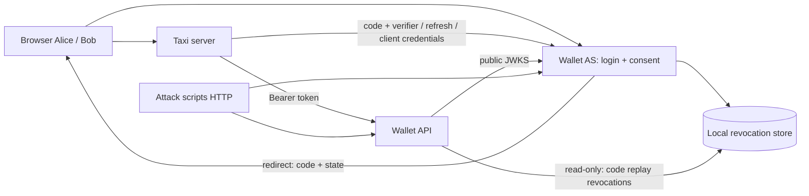

# Kế hoạch triển khai Block 5 — OAuth2 Taxi / Wallet

Ngày lập: 22/10/2026. Trạng thái: **đã triển khai hai mode và dashboard; kết quả chạy cụ thể tại PROGRESS.md**.

Điều chỉnh theo yêu cầu mới: dùng **HTTP localhost**, bỏ chứng chỉ/HTTPS; dashboard có hai luồng, sáu case mẫu, phản hồi Taxi/AS/API và chú thích. Giữ bộ kiểm chứng gọn, tập trung vào luồng thực tế và case bắt buộc. Runtime kiểm chứng là Node 22.17.1 hiện có. Cấu trúc thực tế dùng một package root, `apps/`, `shared/`, `public/`, `scripts/`; session là opaque SQLite store thay plugin session. README và docs/TRADEOFFS.md ghi thiết kế bàn giao thực tế.

Nguồn đề: https://pub.nndkhoa9.win/webadv/w3/block-05-assignment.html. Bản HTML tải về nằm tại `assignment-block-05.html`.

## Điều chỉnh flow OAuth và API nghiệp vụ — 22/10/2026

Theo yêu cầu tiếp theo: bỏ session và route demo, đăng nhập Taxi bằng mật khẩu; dùng API intent/booking có guard và record vé riêng. Mọi vé mới đi qua consent tại AS trước khi tạo vé. Case bảo mật gửi HTTP đến endpoint AS/Wallet chính. Trace thu từ request/response thực tế tại AS, nối callback/token với booking. Contract mới tại docs/API_FLOW.md; bằng chứng kiểm chứng tại PROGRESS.md. Các mục dưới giữ lịch sử thiết kế ban đầu; nơi khác biệt, contract mới mô tả hành vi hiện tại.

## 1. Phạm vi và cách hiểu đề

Xây dựng ba ứng dụng chạy thành ba process độc lập: Wallet Authorization Server (AS), Wallet Resource API và Taxi. Thành phần thứ tư là script tấn công gọi HTTP thật. Trọng tâm đánh giá là logic OAuth của AS; Taxi và API giúp chứng minh AS hoạt động đúng.

Theo yêu cầu của người dùng, bàn giao **cả baseline và full security**, chạy lại được độc lập. Full security bao gồm cả hai phần đề ghi là mở rộng: gỡ consent và Client Credentials. Từ “full” chỉ mức hoàn thành yêu cầu lab và các biện pháp bổ trợ trong plan này, không phải chứng nhận AS đủ an toàn cho production.

Các luồng bắt buộc:

1. Alice liên kết ví tại Taxi → đăng nhập và consent tại AS → callback → Taxi đổi code bằng library → API trả số dư.
2. Alice không còn session Taxi, access token thực sự hết hạn → job Taxi refresh → thanh toán một lần.
3. Replay authorization code, replay refresh token và các request sai bị xử lý đúng theo ma trận bên dưới.
4. Alice gỡ quyền → refresh thất bại → Taxi trở về chưa liên kết. Access token chưa hết hạn tuân theo policy rõ ràng.
5. `taxi-m2m` chỉ lấy token `rates:read`, gọi rates thành công, không được trừ tiền ví.

Khi lập plan ban đầu, repo chỉ có `README`, chưa có stack, package manifest hay mã nguồn để tái sử dụng. Kế hoạch được viết trước khi triển khai; các điều chỉnh khi bàn giao được ghi ở đầu file.

## 2. Technical stack đã chọn

| Lớp | Công nghệ | Vai trò và lý do |
|---|---|---|
| Runtime | Node.js 22.17+, TypeScript strict, ESM | Một ngôn ngữ cho cả ba app và script; đã kiểm chứng Node 22.17.1 |
| Workspace | Một package npm, `package-lock.json` | Chạy thuận tiện bằng `npm.cmd` trên PowerShell; tránh thêm package manager |
| HTTP server | Fastify 5 | Schema validation, lifecycle hooks, structured logging; cả ba app cùng framework |
| Web UI | HTML render phía server, CSS và JavaScript tối thiểu | Trang Taxi, login, consent, tài khoản; tránh thêm SPA khi đề tập trung OAuth |
| OAuth client của Taxi | `openid-client` 6 | Library sinh/kiểm state, PKCE, đổi code, refresh và Client Credentials; không tự viết OAuth client |
| JWT/JWKS | `jose` 6 | ES256/P-256, JWT signing/verification, export public JWK, JWKS cache |
| Password / client secret | `argon2`, Argon2id | Băm mật khẩu Alice/Bob và client secret với salt; không lưu plaintext |
| Random/hash/encryption | `node:crypto` | CSPRNG, SHA-256 cho code/refresh token, AES-256-GCM cho token vault của Taxi |
| Persistence | SQLite + `better-sqlite3`, SQL migrations viết rõ | Transaction và unique constraint dễ kiểm chứng; không cần dựng PostgreSQL trong lab |
| Session / form | `@fastify/cookie`, `@fastify/formbody`; opaque SQLite session store | Session phía server, browser chỉ giữ ID; login/consent POST hỗ trợ form encoding |
| Hardening | `@fastify/helmet`, `@fastify/rate-limit`, schema Fastify | CSP, security headers, giới hạn login/token, kiểm input và kích thước body |
| Logs | Pino qua Fastify + serializer/redaction riêng | Log theo event, correlation ID, không ghi URL query hay body chứa credential |
| Testing | `node:test`, `assert`, HTTP `fetch`; Playwright cho browser | Kiểm protocol/transaction bằng HTTP và kiểm hành vi browser bằng E2E |
| Transport local | HTTP, chỉ bind loopback | Theo yêu cầu người dùng; cookie HttpOnly/SameSite, không Secure |
| Báo cáo | Markdown + HTML tự chứa được sinh từ evidence | Người chấm xem luồng, bảng kết quả, grant table và giới hạn |

Phiên bản patch đã cài nằm trong lockfile, README và `evidence/<run-id>/manifest.json`. Ghi phiên bản “đã dùng” theo lượt chạy thực tế.

Không dùng Keycloak thay cho Wallet AS trong bài vì đề yêu cầu nhóm tự hiện thực logic giao thức. Không tự viết JWT, password hashing hay OAuth client. Không cần Redis, queue server, React hoặc Kubernetes cho phạm vi lab này.

## 3. Kiến trúc và hai bản chạy



### 3.1. Cô lập dữ liệu và cấu hình

| Thành phần | Baseline | Full security |
|---|---|---|
| Wallet AS | `http://localhost:4101` | `http://localhost:5101` |
| Wallet API | `http://localhost:4102` | `http://localhost:5102` |
| Taxi | `http://localhost:4103` | `http://localhost:5103` |
| Callback | `http://localhost:4103/oauth/callback` | `http://localhost:5103/oauth/callback` |
| Data directory | `.local/baseline/` | `.local/secure/` |
| Issuer, ES256 keys, client secrets, vault key, sessions | Riêng baseline | Riêng secure |
| Evidence | `evidence/<run-id>/baseline/` | `evidence/<run-id>/secure/` |

Chọn mode bằng entrypoint/config phía server khi khởi động, không nhận mode từ query/header/browser. Tên session cookie phân biệt cả service và mode vì cookie không cô lập theo port. Dùng host `localhost` nhất quán trong issuer, callback và chứng chỉ.

Hai mode dùng chung mã nghiệp vụ và schema, tách các policy OAuth thành implementation baseline/secure. Mục tiêu là so sánh tác dụng kiểm tra AS trong cùng điều kiện. Không nhân bản toàn bộ app khiến hai bản khác nhau ngoài ý muốn.

### 3.2. Baseline cụ thể

Baseline chạy đủ happy path, có login/consent, password hashing, code/token ngẫu nhiên, JWT ES256 thật, JWKS thật, API kiểm signature/issuer/audience/expiry/scope/principal, token nằm phía server và thanh toán idempotent. Những nền tảng này giữ nguyên để kết quả so sánh tập trung vào AS.

Các thiếu sót **cố ý** trong policy AS baseline:

- Client ID được nhận diện để lấy cấu hình, nhưng chưa exact-match redirect URI khi authorize.
- Chưa enforce scope allowlist, PKCE S256 và các binding của code tại token endpoint.
- HTTP Basic được parse để nhận diện client, nhưng chưa xác minh secret hash.
- Chưa enforce code expiry/one-time use và chưa thu hồi khi replay.
- Refresh token được phát để chạy offline nhưng chưa enforce ownership, expiry, consent, scope subset; chưa rotation/reuse detection.
- Client Credentials vẫn có nhánh grant riêng, nhưng chưa enforce đầy đủ grant/scope allowlist.
- Gỡ quyền có UI/dữ liệu để demo, nhưng baseline refresh chưa kiểm trạng thái đó.

Baseline vẫn có thể từ chối request do validation nền tảng hoặc API. Báo cáo ghi đúng kết quả quan sát; không ép mọi test baseline thành thành công và không bỏ bảo vệ API để tạo số liệu đẹp.

Giữ baseline chạy lại được sau khi hoàn thành full; source hashes trong manifest. Thực tế hai mode được xây trong cùng nguồn; evidence so sánh policy hiện tại, không có commit lịch sử baseline-only. Chỉ dùng dữ liệu giả và bind loopback cho cả hai bản.

## 4. Contract OAuth và API

### 4.1. Clients và grants

| Client | Loại | Grant được phép ở full | Scope được phép |
|---|---|---|---|
| `taxi-web` | Confidential, Basic secret đã hash | `authorization_code`, `refresh_token` | `wallet:read wallet:charge offline_access` |
| `taxi-m2m` | Confidential, Basic secret đã hash | `client_credentials` | `rates:read` |

Mỗi mode đăng ký đúng một redirect URI cho `taxi-web`. `taxi-m2m` không có luồng authorize/redirect. Các test đổi code/refresh bằng client khác dùng `taxi-m2m` với credential hợp lệ và nhận `invalid_grant`: với hai grant gắn credential này, kiểm ownership trước grant allowlist. Integration test bổ sung client web fixture chỉ trong database test để kiểm ownership giữa hai client cùng được phép dùng grant; không đăng ký thêm client mặc định.

### 4.2. Access token

- JWT ký **ES256**, header có `kid`; chỉ public key xuất hiện ở `/.well-known/jwks.json`.
- Claims bắt buộc: `iss` đúng URL AS của mode, `aud="wallet-api"`, `sub`, `client_id`, `scope` là chuỗi scope cách nhau bằng dấu cách, `exp`, `principal_type`.
- Thêm `iat`, `jti`, `grant_id` để audit và thu hồi token phát từ code bị replay. Đây là extension nội bộ, không thay thế claims đề bắt buộc.
- TTL: code **60 giây**, access token **120 giây**, refresh token **7 ngày**.
- `sub` của user token là user ID tại Wallet AS; client token có `sub=client_id`, `principal_type=client`.
- Token response: `access_token`, `token_type="Bearer"`, `expires_in=120`, `scope`; có `refresh_token` đúng những nhánh được phép. Header `Cache-Control: no-store`, `Pragma: no-cache`.
- Authorization Code chỉ cấp refresh token nếu consent scope có `offline_access`; Client Credentials tuyệt đối không cấp refresh token.
- Refresh chỉ giữ hoặc thu hẹp scope. Không cho thêm `offline_access` trong refresh nếu grant ban đầu không có.
- Refresh family có hạn tuyệt đối 7 ngày từ lúc cấp lần đầu; rotation không kéo dài family vô hạn.

### 4.3. Resource API

| Endpoint | Yêu cầu | Kết quả bảo mật |
|---|---|---|
| `GET /wallet/balance` | Bearer hợp lệ, `wallet:read`, principal user | Chỉ lấy ví theo `sub` đã verify |
| `POST /wallet/charges` | Bearer hợp lệ, `wallet:charge`, principal user, Idempotency-Key | Không nhận user ID từ body để chọn ví |
| `GET /public/rates` | Bearer hợp lệ, `rates:read` | Tên `/public` không có nghĩa được bỏ xác thực |

API pin issuer/JWKS URL từ cấu hình, allowlist ES256, kiểm `kid`, signature, audience, expiry và schema claims. Không lấy JWKS URL từ token header `jku`/`x5u`. Sai hoặc thiếu token → 401 `invalid_token`; token hợp lệ nhưng thiếu scope/sai principal → 403. Bearer challenge và error JSON được chốt nhất quán trong API contract.

Tiền lưu bằng số nguyên đơn vị nhỏ nhất. Transaction charge gồm kiểm idempotency, kiểm số dư, cập nhật số dư, ghi charge và tăng counter. Unique key theo `(sub, client_id, idempotency_key)`; key trùng cùng payload trả kết quả cũ, key trùng khác payload trả 409. Hai request song song cùng trip chỉ tăng counter một lần.

## 5. Thứ tự kiểm và mã lỗi ở full security

### 5.1. `/authorize`

| Thứ tự | Kiểm tra | Khi sai | Chặn |
|---|---|---|---|
| 1 | Parse query, phát hiện tham số security bị lặp | 400 tại AS; nếu chưa xác lập redirect an toàn thì không redirect | Parameter pollution |
| 2 | Client tồn tại; redirect URI khớp chính xác chuỗi đã đăng ký | 400 lỗi tại AS, không `Location`, không cấp code | Code exfiltration / open redirect |
| 3 | Client được phép authorization code; `response_type=code` | Redirect URI đã xác minh, `unauthorized_client` / `unsupported_response_type` | Grant confusion |
| 4 | Scope hợp lệ và thuộc allowlist | Redirect `invalid_scope` | Scope escalation |
| 5 | Có challenge hợp lệ và method duy nhất `S256` | Redirect `invalid_request` | Code interception / PKCE downgrade |
| 6 | User đăng nhập; login/consent POST có CSRF protection | Login sai không cấp code; CSRF sai 403 tại AS | Session/form CSRF |
| 7 | Consent đúng user, đúng client, đúng scope request đã lưu phía server | Từ chối consent → redirect `access_denied` | Consent tampering |
| 8 | Sinh code ngẫu nhiên, lưu hash và đủ binding | Redirect code và state; không gửi token qua browser | Code guessing / binding confusion |

Mọi redirect hợp lệ, kể cả lỗi, trả nguyên giá trị `state` nếu request có state. Dùng URL builder để encode an toàn; không nội suy state vào HTML. Không normalize/startsWith/wildcard redirect URI. Request authorize được lưu server-side qua login/consent để hidden input không sửa client/scope/redirect/challenge.

### 5.2. `/token`

1. Chỉ POST form-urlencoded; giới hạn body, từ chối duplicate parameters và nhiều phương thức client authentication. Malformed request → 400 `invalid_request`.
2. Xác thực HTTP Basic, parse theo OAuth, verify Argon2id client secret. Thiếu/sai credential → **401 `invalid_client`**, có `WWW-Authenticate: Basic`.
3. Grant type không hỗ trợ → 400 `unsupported_grant_type`. Với `authorization_code` và `refresh_token`, tra credential và kiểm client binding trước: không tồn tại hoặc không thuộc client đang xác thực → 400 `invalid_grant`, kể cả client đó cũng không được phép dùng grant. Sau binding mới kiểm grant allowlist → 400 `unauthorized_client`. Với `client_credentials` kiểm grant allowlist ngay.
4. Thực hiện các kiểm tra riêng còn lại theo grant ở dưới; không đưa code/token/secret vào error description. Thứ tự trên bảo đảm case “đổi code/refresh bằng client khác” nhận đúng `invalid_grant` như đoạn contract của đề.

**Authorization Code:**

- Tra code bằng SHA-256; kiểm tồn tại, client binding, redirect binding và PKCE verifier. Verifier phải đúng syntax/độ dài RFC 7636 và `BASE64URL(SHA256(ASCII(verifier)))` khớp challenge.
- Credential hoặc binding sai không được gây thu hồi grant của người khác.
- Với code đúng binding đã dùng: `invalid_grant`, ghi revocation của grant và thu hồi refresh family đã phát từ code đó. Giữ bản ghi code đã dùng đủ lâu để nhận diện replay.
- Code chưa dùng nhưng hết hạn → 400 `invalid_grant`. Code không tồn tại/verifier sai/redirect sai/client binding sai cũng → 400 `invalid_grant`.
- Consume code và lưu metadata của token/family trong cùng transaction; chỉ trả token sau commit. Hai request đồng thời không được cùng thành công.

**Refresh Token:**

- Tra hash token, kiểm client binding trước khi xử lý replay để client khác không thu hồi family của nạn nhân.
- Kiểm family chưa revoked, token/family chưa hết hạn, consent còn hiệu lực. Sai → 400 `invalid_grant`.
- Token đã dùng xuất hiện lại với đúng client → thu hồi cả family, commit rồi trả 400 `invalid_grant`. Không throw exception làm rollback thay đổi thu hồi.
- Scope yêu cầu rộng hơn grant hiện hành → 400 `invalid_scope`; không dùng lỗi này thay cho lỗi revoked consent.
- Trong một transaction: consume token cũ, insert hash token mới cùng family/client/consent và scope đã thu hẹp, cập nhật `replaced_by`, lưu metadata access token.
- Dùng conditional update/transaction để refresh song song chỉ có một winner; request còn lại kích hoạt reuse detection và family bị thu hồi. Taxi phải serialize refresh để tránh tự gây tình huống này.

**Client Credentials:**

- Enforce grant allowlist rồi scope allowlist. `taxi-m2m` xin `wallet:charge` → 400 `invalid_scope`.
- Phát access token principal client; không có consent user và không có refresh token.

## 6. Persistence và transaction

### Wallet AS — `as.sqlite`

- `users(id, username, password_hash, ...)` gồm Alice và Bob, không dùng chung identity với session Taxi.
- `clients(client_id, secret_hash, type, redirect_uri, allowed_grants, allowed_scopes)`.
- `auth_requests(id, session_id, validated_params, expires_at)` cho luồng login/consent.
- `consents(id, user_id, client_id, scope, granted_at, revoked_at)`; liên kết lại tạo consent mới, không hồi sinh family cũ.
- `auth_codes(code_hash, client_id, redirect_uri, user_id, scope, code_challenge, challenge_method, consent_id, expires_at, used_at, grant_id)`.
- `refresh_families(id, user_id, client_id, consent_id, scope, expires_at, revoked_at, revoke_reason)`.
- `refresh_tokens(token_hash, family_id, client_id, scope, expires_at, used_at, revoked_at, replaced_by)`.
- `issued_tokens(jti, grant_id, family_id, expires_at)` chỉ lưu metadata, không lưu nguyên access token.
- `sessions(...)` riêng AS.

### Wallet API — `wallet.sqlite`

- `wallets(user_id, balance_minor)`; `charges(id, user_id, client_id, amount_minor, currency, trip_id, ...)`.
- `idempotency_keys(user_id, client_id, key, request_hash, charge_id, response_json)` với unique constraint.
- Counter có thể suy ra từ charge rows hoặc lưu cập nhật trong cùng transaction; evidence phải dùng cùng định nghĩa trước/sau.

### Taxi — `taxi.sqlite`

- Session store, `oauth_attempts` với state/verifier phía server và TTL.
- `wallet_links(taxi_user_id, wallet_sub, status, encrypted_tokens, token_exp, version, ...)`.
- `payment_jobs(id, taxi_user_id, trip_id, idempotency_key, status, attempt_count, ...)`.
- AES-256-GCM dùng nonce ngẫu nhiên mỗi lần mã hóa, AAD gắn mode/user/client, key từ môi trường; không dùng password hash để mã hóa token. AS chỉ cần hash refresh token, nhưng Taxi phải khôi phục token để gửi refresh nên cần encryption.

Chọn `better-sqlite3` transaction ngắn, `BEGIN IMMEDIATE`, foreign keys, unique constraints và busy timeout. Không `await` network trong transaction đồng bộ. Chuẩn bị JWT và random candidate ở ngoài transaction, sau đó transaction xác minh lại trạng thái và commit metadata; nếu transaction thất bại thì không trả candidate token. Refresh/code race test phải dùng HTTP song song, có thêm kiểm thử hai connection/process để không nhầm event loop tuần tự với bảo đảm của database.

## 7. Policy thu hồi — quyết định cần ghi rõ

### 7.1. Alice gỡ consent

POST thao tác đã xác thực + CSRF tại AS; đánh dấu consent revoked và thu hồi toàn bộ refresh families của cặp Alice/Taxi. Refresh sau đó → `invalid_grant`; Taxi xóa token vault của liên kết và chuyển `unlinked`. Không tự retry vô hạn.

Access token đã phát vẫn được API nhận đến `exp` nếu không có lý do thu hồi riêng khác. Đây là policy đề yêu cầu mô tả cho kiểm JWT offline; tối đa còn khoảng 120 giây kể từ lúc token được cấp, không mặc định thêm 120 giây từ lúc gỡ quyền.

### 7.2. Authorization code bị dùng lại

Chỉ đánh dấu refresh revoked chưa đủ để nói access token đã bị thu hồi. Chọn giải pháp lab cụ thể: bảng `revoked_grants(grant_id, revoked_at, reason, retain_until)` trong **revocation store SQLite dùng chung trên cùng máy**. AS là writer, API mở read-only. AS attach store này trong transaction xử lý replay và ghi grant revoked; API sau khi verify JWT phải tra grant ID tại store trước khi nhận token.

AS database và store đều là file thật, dùng rollback journal (`journal_mode=DELETE`, `synchronous=FULL`) cho transaction xuyên hai file SQLite trên cùng máy; không dùng `:memory:` hoặc WAL cho cặp này. Cần kiểm chứng attach/commit/crash behavior ở pha transaction. Store không chứa secret/token và không là API introspection. Nếu store không đọc được, API fail closed với 503 thay vì bỏ qua thu hồi. Lookup từng request, không cache kết quả “chưa revoked”. Request đã xử lý xong trước thời điểm thu hồi không bị đảo ngược. API bắt buộc có `grant_id` trong schema token nội bộ; không được bỏ lookup chỉ vì token thiếu claim này.

Như vậy API vẫn verify chữ ký qua JWKS, không gọi AS `/introspect`, đồng thời từ chối access token thuộc code bị replay. Consent revoke không ghi vào store này nên vẫn giữ policy ở 7.1. Có thể dùng cùng cơ chế grant revocation khi phát hiện refresh reuse; policy full chọn thu hồi cả access token cùng grant để hạn chế thiệt hại.

Trade-off: ba app có process và business DB riêng nhưng chia sẻ hạ tầng revocation trên một host; chưa phải kiến trúc dịch vụ phân tán độc lập. Khi triển khai đa host cần thay bằng revocation event/outbox đồng bộ đến API hoặc introspection và đo độ trễ thu hồi. Không chỉ dựa vào JWT TTL để tuyên bố đã đạt test thu hồi ngay khi code replay.

## 8. Bảo mật bổ trợ ở full

| Kỹ thuật/phương pháp | Áp dụng | Mục tiêu |
|---|---|---|
| Least privilege và deny by default | Client grants, scope allowlist, principal gate | Giới hạn quyền user và M2M |
| Proof of possession của code bằng PKCE S256 | AS + `openid-client` | Code lộ không đủ để đổi token |
| State gắn session, dùng một lần | Taxi callback | Chống login/linking CSRF; không dùng state làm bằng chứng user identity |
| CSRF synchronizer token + kiểm Origin | Login, consent, revoke, Taxi mutation | Chống POST từ site khác; PKCE/state không thay CSRF cho form |
| Session rotation | Sau login, TTL và logout | Giảm session fixation; AS và Taxi có session riêng |
| Cookie HttpOnly, SameSite=Lax, host-only | AS/Taxi | Giảm lộ session; hỗ trợ callback top-level GET; không Secure do dùng HTTP theo yêu cầu |
| CSPRNG ≥256-bit; hash SHA-256 | Code, refresh token và random IDs | Không đoán được credential entropy cao; DB không chứa bản gốc |
| Argon2id có salt | User password, client secret | Bảo vệ credential entropy thấp; tham số khởi điểm memory 64 MiB, iterations 3, parallelism 1, benchmark trước khi chốt |
| AES-256-GCM + env-managed key | Taxi token vault | Bảo vệ token cần dùng lại khi DB bị đọc |
| HTTP giới hạn loopback | Browser và backchannel | Phạm vi local theo yêu cầu; không cung cấp bảo vệ TLS trên đường truyền |
| Prepared statements + schema validation | SQL và HTTP | SQL injection, malformed input, duplicate security parameter |
| Escaping HTML, CSP, frame-ancestors | Login/consent/Taxi | XSS, clickjacking và đánh cắp session |
| Rate limiting, generic login errors | Login, token endpoint | Brute force và thông tin dò user/client |
| Transaction, conditional update, unique constraint | Code, refresh, charge | Chặn replay/race và charge lặp |
| Log allowlist + redaction + secret scanning | Mọi app và evidence | Không lộ credential qua URL/query/header/body/report |

Không bật CORS rộng vì browser không cần gọi token endpoint hay Wallet API trực tiếp. Không log request URL nguyên query ở callback/authorize; không chỉ dựa vào redaction tên field vì code còn nằm trong URL và `Location`. Evidence redirect chỉ giữ origin/path, tên tham số, nhãn đã che và timestamp.

Private ES256 JWK, `kid`, vault key, client secrets được sinh bằng script vào config local đã gitignore và nạp qua môi trường khi chạy. Opaque session ID sinh ngẫu nhiên, DB chỉ lưu hash. Không sinh lại ES256 key mỗi lần restart vì sẽ làm token còn hạn mất hiệu lực. JWKS chỉ có public fields. Không còn bước cài chứng chỉ; dùng HTTP loopback theo yêu cầu.

## 9. Taxi và job thanh toán

1. Taxi có identity/session demo riêng; UI chỉ có liên kết ví, xem số dư, tạo chuyến mẫu, xem trạng thái job. Wallet password chỉ nhập ở AS.
2. Mỗi lần link: dùng `openid-client` sinh state và PKCE mới, lưu attempt phía server, hỗ trợ nhiều tab bằng attempt riêng. Callback kiểm expectedState và PKCE qua library, consume attempt, lưu token mã hóa rồi redirect về URL sạch.
3. Cấu hình OAuth server metadata tường minh cho library; không yêu cầu OIDC ID token, không thêm scope `openid` và không coi access token là chứng cứ đăng nhập Taxi. Discovery RFC 8414 có thể bổ sung sau, không là phụ thuộc bắt buộc của happy path.
4. Lưu job trước khi logout; logout chỉ hủy session trình duyệt, không xóa liên kết/token vault. “Gỡ quyền” là thao tác khác.
5. Chạy một worker Taxi duy nhất trong lab, serialize refresh theo từng user, tất cả đường refresh web/job đi qua cùng coordinator. Refresh token mới lưu bền vững trước khi thả lock; không có web handler tự refresh bên ngoài coordinator.
6. Demo chờ access token thật hết hạn dựa theo `exp`, đồng thời xác nhận Taxi session không tồn tại. Refresh bằng library, gọi charges với idempotency key cố định theo trip.
7. Nếu HTTP charge timeout, retry cùng key; nếu refresh timeout sau khi AS có thể đã rotate, không blind retry token cũ vì sẽ kích hoạt family revocation. Ghi trạng thái cần liên kết lại khi không xác định được kết quả.
8. Restart sau khi AS rotate nhưng trước khi Taxi lưu token mới có thể làm mất liên kết. Ghi nhận giới hạn này; không hứa exactly-once refresh giữa hai hệ thống không có distributed transaction.

Phân biệt: idempotent charge bảo đảm hiệu ứng trừ tiền một lần cho cùng trip/key; không hứa mọi job luôn hoàn tất đúng một lần bất kể sự cố.

## 10. Ma trận kiểm thử và evidence

Mỗi case chạy trên cả hai mode với fixture mới, ghi `case_id`, mode, timestamp, endpoint, status, OAuth error, redirect target đã che, outcome và assertion. Script HTTP tắt auto-follow redirect để kiểm AS có gửi sang URI lạ không. Không ghi request/response token nguyên bản vào file.

### 10.1. Chín tình huống bắt buộc từ tiêu chí đạt

| ID | Tình huống | Full security phải quan sát |
|---|---|---|
| A01 | Authorize với redirect URI chưa đăng ký | 400 tại AS, không Location, không code |
| A02 | Thiếu code_challenge | Redirect 302 về URI hợp lệ, `invalid_request`, state nguyên giá trị |
| A03 | Dùng lại code đã đổi | 400 `invalid_grant`; refresh family cũ revoked; access token thuộc grant bị API từ chối |
| A04 | Code quá 60 giây | 400 `invalid_grant` |
| A05 | Sai code_verifier | 400 `invalid_grant` |
| A06 | Sai client secret | 401 `invalid_client`, Basic challenge |
| A07 | Đổi code bằng client khác | 400 `invalid_grant` với taxi-m2m và fixture cùng grant; không thu hồi grant của đúng client |
| A08 | Replay refresh token cũ | 400 `invalid_grant`; token mới cùng family không refresh được nữa |
| A09 | Refresh bằng client khác | 400 `invalid_grant`; family hợp lệ không bị thu hồi do client sai |

### 10.2. Kiểm thử bổ sung cần cho full

- Unknown client / redirect khác hoa-thường, path, port, query, suffix; URI fragment không hợp lệ; không được redirect lỗi trước khi trust callback.
- Scope ngoài allowlist, challenge `plain`, challenge sai format, verifier thiếu/sai syntax, duplicate parameters, response/grant không hỗ trợ.
- Consent deny, state mismatch, callback replay, POST consent/revoke thiếu CSRF; binding không bị sửa qua hidden input.
- Không `offline_access` → không refresh token; expired refresh token/family → `invalid_grant`; scope escalation khi refresh → `invalid_scope`.
- Hai code exchange song song → đúng một success, request còn lại replay và token được phát bị policy thu hồi; hai refresh song song → đúng một success rồi family bị revoked theo reuse policy.
- Bob và Alice có ví riêng; request không thể đọc/charge ví khác bằng cách thay body/query.
- JWT sai signature/alg/kid/iss/aud, hết hạn hoặc thiếu claims → 401; đủ JWT nhưng sai scope/principal → 403.
- `taxi-m2m` đọc rates thành công; xin wallet:charge → invalid_scope; M2M gọi charge → 403. Thêm signed fixture client token có scope charge để kiểm principal gate độc lập với scope gate.
- Cùng idempotency key gửi tuần tự và song song → counter tăng đúng một; cùng key khác payload → 409; không âm số dư.
- Revoke consent → refresh fail và Taxi unlinked; access token còn hạn vẫn dùng được đến exp nếu không có replay revocation.
- Browser chỉ có session cookie, authorization code trong callback tạm thời; **không có access/refresh token trong URL, HTML, localStorage hay response browser**.
- Restart giữ đúng key/kid, persistence của job/link/consent; revocation store lỗi → API 503, không fail open.
- Logs/reports không chứa nguyên secret, key, code, token hay session cookie.

Bài test expiry dùng clock injection cho test logic, nhưng evidence acceptance phải có lượt chạy TTL thật: code 60 giây, access token 120 giây. Không sửa timestamp trong database rồi gọi đó là evidence thời gian thật.

### 10.3. Bảng grant phải sinh từ response thật

| Grant/case | refresh_token | sub | aud | scope | principal_type | expires_in |
|---|---|---|---|---|---|---|
| Authorization Code có offline_access | Chưa đo | Chưa đo | Chưa đo | Chưa đo | Chưa đo | Chưa đo |
| Authorization Code không offline_access | Chưa đo | Chưa đo | Chưa đo | Chưa đo | Chưa đo | Chưa đo |
| Refresh | Chưa đo | Chưa đo | Chưa đo | Chưa đo | Chưa đo | Chưa đo |
| Client Credentials | Chưa đo | Chưa đo | Chưa đo | Chưa đo | Chưa đo | Chưa đo |

Các trường JWT được verify trước khi trích xuất. Artifact chỉ lưu claims đã chọn và nhãn token, không lưu compact JWT. Bảng expectation trong contract không được dùng thay bảng observed này.

## 11. Cấu trúc repo dự kiến

```text
apps/
  wallet-as/src/       # routes, authorization, grants, consent, repositories, policy
  wallet-api/src/      # jwt guard, authorization, balance, charges, rates
  taxi/src/            # library OAuth client, sessions, vault, refresh coordinator, jobs
packages/
  contracts/          # claim schema, API types, lỗi và cấu hình không chứa secret
  infrastructure/     # config loader, sqlite helpers, safe logging, crypto wrappers
scripts/
  setup-local.ts      # keys, client secrets, env local, migrations và seed giả
  run-lab.ts          # process supervisor, health checks, shutdown sạch
  attacks/            # HTTP test cases chung cho baseline / secure
  evidence/           # capture, sanitize, compare, manifest, report
tests/
  integration/        # AS/API transactions, protocol, concurrent requests
  e2e/                # browser link/consent/logout/job/revoke
docs/
  AS_CHECKLIST.md
  TOKEN_CONTRACT.md
  REVOCATION_POLICY.md
  DEMO.md
  TRADEOFFS.md
evidence/<run-id>/     # chỉ kết quả đã sanitize; manifest gắn source hash
.local/               # gitignored: env, db, private keys, logs thô nếu có
Plan.md
README.md
package.json
package-lock.json
```

Các lệnh đã có trong package.json; hướng dẫn chạy hiện tại ở README.md:

```powershell
npm.cmd ci
npm.cmd run setup:local
npm.cmd run dev:baseline
npm.cmd run dev:secure
npm.cmd run attacks -- --target baseline
npm.cmd run attacks -- --target secure
npm.cmd test
npm.cmd run test:e2e
npm.cmd run evidence:submission
```

Hai lệnh dev có thể chạy ở hai terminal; supervisor của mỗi mode khởi động ba process, worker job nằm trong Taxi. `setup:local` không ghi đè key/database có sẵn nếu chưa có reset được chỉ định. Evidence runner dùng thư mục run mới thay vì ghi đè dữ liệu demo.

## 12. Các pha triển khai và điều kiện hoàn thành

| Pha | Việc làm / file ảnh hưởng chính | Điều kiện hoàn thành |
|---|---|---|
| P0 — chốt thiết kế | Plan, token contract, AS checklist, revocation policy | Contract, baseline omissions, lỗi và thứ tự kiểm không mâu thuẫn |
| P1 — bootstrap | package root, config, SQL schema, setup, supervisor, HTTP | Ba app mỗi mode khởi động; DB/keys/issuer/cookies cô lập; ghi dependency versions |
| P2 — baseline | AS happy path + policy baseline, API guard, Taxi library client, attack scripts | Link/read/refresh/charge chạy thật; lưu baseline output và source hash trước khi harden |
| P3 — authorize full | AS validation, login/consent, request store, CSRF | Redirect không đăng ký không bao giờ nhận code; scope/PKCE/deny/state đúng |
| P4 — code exchange full | Basic auth, code binding/expiry, atomic consume, revocation store | Happy path library chạy; replay/race bị chặn; token cũ bị API từ chối sau replay |
| P5 — refresh + job | Rotation/families, vault, coordinator, idempotent charges | Session vắng + access token hết hạn thật → refresh và charge một lần; replay family bị thu hồi |
| P6 — phần mở rộng | Consent revoke, Client Credentials | Revoke và policy access token đúng; M2M chỉ rates, không charge |
| P7 — kiểm chứng full | Integration/E2E, attack comparison, logs redaction | Tất cả case có observed result; failure được giữ nguyên và giải thích |
| P8 — bàn giao | README, evidence/report, DEMO, trade-offs | Người khác chạy lại từ clean checkout; không cần secret từ máy tác giả |

Thực hiện inspect → plan → implement → run → test → verify theo từng pha. Chỉ cập nhật trạng thái đạt khi có artifact chạy thật. Sau mỗi pha kiểm diff và chạy đúng nhóm kiểm thử liên quan; trước bàn giao chạy toàn bộ acceptance.

Khung 65 phút trong đề dùng cho buổi thực hành/demo có chuẩn bị; không coi là cam kết đủ để xây toàn bộ hai bản, xử lý race/revocation và tạo evidence hoàn chỉnh từ repo trống. Ưu tiên hoàn tất P0–P5 trước, nhưng phạm vi bàn giao cuối vẫn bao gồm P6–P8 theo yêu cầu full.

## 13. Danh sách sản phẩm và tiêu chí bàn giao

- [x] README chạy lại toàn bộ: prerequisites, key generation, config/env, seed, ba app, job, attacks và reset. Bỏ CA theo yêu cầu HTTP.
- [x] Plan viết trước khi hiện thực.
- [x] Source ba app và attack scripts; runtime/package version thật cùng lockfile.
- [x] Bảng AS endpoint/check/error/attack và các quyết định đã chốt.
- [x] Output baseline và secure của cùng attack suite, có status + OAuth error + kết luận từ assertion.
- [x] Redirect trace link ví đã che code/state nhạy cảm/session; browser token-leak assertions.
- [x] Log job có `exp`, thời điểm logout/refresh/charge, job/trip label và counter trước/sau.
- [x] Grant table sinh từ response thật, đối chiếu RFC 6749 §5.1.
- [x] Policy consent revoke, code replay revoke, refresh reuse và access token còn hạn.
- [x] Báo cáo giới hạn và kịch bản trình bày Problem → Solution → Demo → Evidence → Trade-off.
- [x] Manifest ghi run ID, mode, source hash, cấu hình TTL, dependency versions, kết quả và hash artifacts.
- [x] Secret scan và kiểm tra thủ công artifacts local. Trước khi nộp bên ngoài cần giữ nguyên các artifact đã che.

Giới hạn được báo cáo rõ: AS tự viết chỉ cho lab, HTTP loopback theo yêu cầu; chưa có HA/multi-host, HSM/KMS, automated signing-key rotation, distributed worker coordination, MFA hay audit bảo mật độc lập. Các kiểm tra local không thay thế AS production đã được kiểm chứng.

## 14. Tài liệu đối chiếu

- Đề Block 5: https://pub.nndkhoa9.win/webadv/w3/block-05-assignment.html
- RFC 6749, đặc biệt §4.1.2, §4.1.3–4.1.4, §4.4, §5.1–5.2, §6: https://www.rfc-editor.org/rfc/rfc6749
- PKCE RFC 7636: https://www.rfc-editor.org/rfc/rfc7636
- OAuth security BCP RFC 9700: https://www.rfc-editor.org/rfc/rfc9700
- Library Taxi: https://github.com/panva/openid-client
- JWT/JWKS: https://github.com/panva/jose
- SQLite transaction API: https://github.com/WiseLibs/better-sqlite3/blob/master/docs/api.md
- Atomicity khi SQLite ATTACH nhiều file: https://www.sqlite.org/lang_attach.html
- Runtime LTS: https://nodejs.org/en/about/previous-releases
- Fastify LTS: https://fastify.dev/docs/latest/Reference/LTS/

Đề là nguồn yêu cầu chấm bài. RFC/library docs dùng để kiểm logic và khả năng tương thích; phần kiến trúc, baseline omissions, vault, revocation store và cấu trúc repo là quyết định thiết kế của kế hoạch này.
