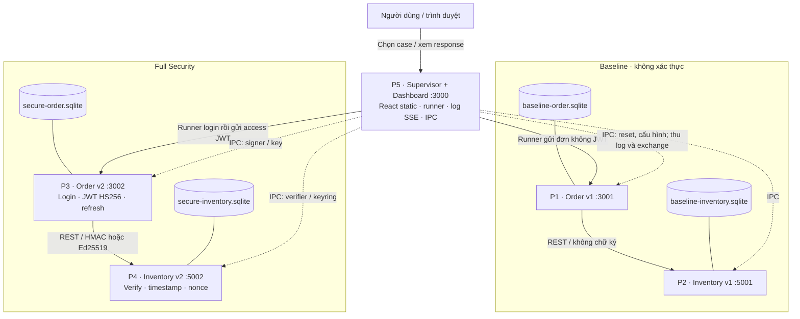

# BÁO CÁO LỰA CHỌN KỸ THUẬT — BLOCK 04

**Đề tài:** Server-to-Server Authentication & JWT  
**Ngày đối chiếu source:** 15/10/2026  
**Phạm vi:** Giải thích các quyết định tạo nên phiên bản cuối của lab Order–Inventory.

Báo cáo trình bày lý do nhóm chọn giải pháp hiện tại, những phương án đã cân nhắc và cái giá phải trả của từng lựa chọn. Đây là giải thích thiết kế theo source trong repository, không phải tuyên bố hệ thống đã sẵn sàng chạy production. Các giá trị cấu hình được ghi là mặc định trong code, không công bố nội dung `.env` hoặc khóa bí mật của máy demo.

## Mục lục

- [1. Bài toán và tiêu chí lựa chọn](#bai-toan)
- [2. Kiến trúc tổng quát](#kien-truc)
- [3. Node.js, TypeScript và Fastify](#stack)
- [4. REST/JSON giữa các service](#rest)
- [5. SQLite, WAL và transaction](#database)
- [6. JWT hay session?](#jwt-session)
- [7. Refresh token, cookie và logout](#refresh)
- [8. Lưu mật khẩu bằng bcrypt](#password)
- [9. HMAC-SHA256 cho request nội bộ](#hmac)
- [10. Ed25519 và các thuật toán bất đối xứng khác](#ed25519)
- [11. So sánh HMAC với chữ ký bất đối xứng](#so-sanh)
- [12. Canonical request, timestamp và nonce](#canonical)
- [13. Chuyển thuật toán và rotation key](#rotation)
- [14. Supervisor, IPC và quản lý cấu hình](#supervisor)
- [15. Logging bằng Pino và streaming bằng SSE](#logging)
- [16. Dashboard React và cách trình bày request/response](#dashboard)
- [17. Documentation bằng Markdown và HTML](#documentation)
- [18. Evidence và mức độ kiểm chứng](#evidence)
- [19. Giới hạn và hướng phát triển](#gioi-han)
- [20. Đối chiếu source](#doi-chieu-source)

<a id="bai-toan"></a>

## 1. Bài toán và tiêu chí lựa chọn

Lab mô phỏng việc đặt hàng: Client gửi đơn đến Order; Order gọi Inventory để giữ hàng; Inventory trả `reservationId`; Order lưu đơn và trả kết quả cho Client. Nếu Inventory chấp nhận mọi request, người gọi có thể bỏ qua Order để giữ hàng trực tiếp. Nếu Order không xác thực người dùng, ai cũng có thể gửi đơn.

Nhóm cần làm rõ hai ranh giới khác nhau: **Client → Order xác thực người dùng**, còn **Order → Inventory xác thực service và tính toàn vẹn request**. Một JWT hợp lệ ở ranh giới đầu không tự chứng minh request nội bộ đến Inventory là đáng tin cậy.

### Quyết định

Giữ hai luồng end-to-end song song: Baseline không xác thực và Full Security có xác thực người dùng lẫn chữ ký service. Cùng nghiệp vụ đặt hàng nhưng mỗi luồng có bộ dữ liệu riêng, giúp quan sát trực tiếp sự khác biệt trước và sau khi thêm bảo mật.

Tiêu chí ưu tiên là chạy được trên một máy, dễ tái hiện, nhìn được request thật, tách rõ trách nhiệm khóa và không làm thay đổi nghiệp vụ chỉ để trình diễn thuật toán.

### Phương án thay thế

Một service duy nhất có cờ `security=true/false` giảm số file và process. Một hệ thống microservice triển khai bằng container, gateway, identity provider và database riêng lại gần vận hành thực tế hơn.

### Trade-off

Hai phiên bản có phần lặp code và phải giữ nghiệp vụ tương đương. Đổi lại, chuyển tab không vô tình tắt bảo mật của một endpoint đang phục vụ luồng Secure. Hai tab là hai hệ thống cùng chạy, không phải công tắc vô hiệu hóa security tại chỗ. Mô hình nhiều process trên một máy vẫn chưa thể hiện đầy đủ độ trễ mạng, phân vùng mạng hoặc phân quyền hạ tầng của hệ thống phân tán.

<a id="kien-truc"></a>

## 2. Kiến trúc tổng quát

### Quyết định

Nhóm dùng năm process Node.js thường trực: một Supervisor kiêm Dashboard và bốn worker HTTP. Các process bind `127.0.0.1`; không cần server database hoặc Vite dev server khi chạy bản build.



**Cách đọc sơ đồ:** đường liền giữa Order và Inventory là HTTP nghiệp vụ; đường chấm là kênh điều khiển/quan sát của lab. Khi bấm chạy case, trình duyệt gọi P5; runner trong P5 mới gửi HTTP đến worker. Vì vậy, “Client” trên timeline là vai trò người gọi nghiệp vụ, không có nghĩa browser trực tiếp gửi mọi request được hiển thị.

| Thành phần | Trách nhiệm | Dữ liệu/khóa được sử dụng |
|---|---|---|
| P5 — Supervisor/Dashboard | Spawn worker, chạy case, cấu hình, nhận log, lưu evidence | Admin session lab; runner có quyền đọc fixture và một số khóa phục vụ case |
| P1 — Order v1 | Nhận đơn và gọi Inventory v1 | Database đơn baseline |
| P2 — Inventory v1 | Kiểm kho, giữ hàng, không xác thực service | Database kho baseline |
| P3 — Order v2 | Login, JWT, refresh/logout, ký request nội bộ | Database user/refresh/order; JWT secret; HMAC secret; private key Ed25519 |
| P4 — Inventory v2 | Kiểm chữ ký, timestamp, nonce rồi giữ hàng | Database kho/nonce; HMAC secret hoặc public key Ed25519 |

Trình tự Full Security là: login tại P3 → nhận access JWT và refresh cookie → gửi `POST /orders` với bearer token → P3 xác minh JWT → P3 ký request giữ hàng → P4 xác minh và ghi transaction → P3 lưu đơn → trả response. Nếu JWT không hợp lệ, P3 dừng trước khi gọi P4.

### Phương án thay thế

Monolith gộp Order và Inventory có thể gọi hàm trực tiếp, dễ transaction chung hơn nhưng không còn ranh giới server-to-server để khảo sát. Docker Compose/Kubernetes tách môi trường tốt hơn nhưng thêm manifest, mạng và cơ chế quản lý secret. Gateway và auth service riêng phù hợp hệ thống lớn hơn, chưa cần cho bài toán hai service.

### Trade-off

Tách process làm rõ hai lớp xác thực và quan sát được từng chặng. Tuy nhiên, đây là tách trách nhiệm logic, chưa phải cách ly bảo mật ở cấp hệ điều hành: các process chạy cùng tài khoản và cùng filesystem. Supervisor/runner là thành phần tin cậy có quyền quản trị cao, không phải mô hình client công khai production.

**Đối chiếu:** [process-manager.ts](src/supervisor/process-manager.ts), [supervisor/main.ts](src/supervisor/main.ts), [config.ts](src/shared/config.ts).

<a id="stack"></a>

## 3. Node.js, TypeScript và Fastify

### Quyết định

Nhóm dùng Node.js với TypeScript ESM cho backend và React cho giao diện. `package.json` yêu cầu Node.js từ 24.10; các phiên bản được khai báo gồm Fastify 5.12.7, TypeScript 5.9.3, React 19.2.0, Vite 7.3.7, `jose` 6.1.0 và Zod 4.1.12. Đây là phiên bản trong manifest, không phải khẳng định chúng là bản mới nhất.

Node cung cấp sẵn HTTP client `fetch`, crypto và `child_process.fork` có IPC. TypeScript giúp khai báo rõ DTO, loại thuật toán được phép và cấu trúc message giữa parent/worker. Fastify hỗ trợ route, hook và logging; nhóm dùng các hook chung cho trace ID, và dùng Zod kiểm tra body strict trước xử lý nghiệp vụ. `jose` xử lý JWT thay vì tự viết phần ký và verify JWT.

### Phương án thay thế

Spring Boot/Spring Security phù hợp đội Java, có hệ sinh thái bảo mật và cấu trúc ứng dụng đầy đủ. NestJS có module, dependency injection và convention rõ. Express nhỏ gọn nhưng nhóm phải tự ghép nhiều quy ước. JavaScript thuần giảm bước build nhưng khó phát hiện sớm sai loại message hoặc tên trường khi chỉnh signer/verifier.

### Trade-off

Stack hiện tại giúp tập trung vào giao thức xác thực, không cần thiết lập framework nhiều tầng cho một lab nhỏ. Đổi lại, nhóm tự chịu trách nhiệm tổ chức module, phân quyền và vòng đời key. TypeScript không kiểm tra dữ liệu HTTP khi runtime, nên vẫn cần Zod. SQLite đồng bộ và các thao tác đồng bộ khác có thể chặn event loop; chưa có benchmark để kết luận stack này nhanh hơn Spring Boot hoặc các lựa chọn khác.

**Đối chiếu:** [package.json](package.json), [contracts.ts](src/shared/contracts.ts), [http.ts](src/shared/http.ts).

<a id="rest"></a>

## 4. REST/JSON giữa các service

### Quyết định

Order gọi Inventory bằng `POST /internal/reservations` với JSON. REST giúp đọc trực tiếp method, path, headers và body được ký. Cùng định dạng HTTP dùng được trong cả HMAC lẫn Ed25519; phần nghiệp vụ không phụ thuộc loại khóa.

Body được Zod giới hạn ở các trường cụ thể. Inventory kiểm body trước, sau đó mới kiểm security headers và chữ ký. Vì vậy, body sai schema có thể nhận `400`; không nên mô tả mọi request thiếu xác thực đều luôn nhận `401` bất kể body.

### Phương án thay thế

gRPC cho contract Protobuf và client sinh tự động, nhưng chuyển phần trình diễn sang binary payload/metadata. Message queue phù hợp xử lý bất đồng bộ, song phải thêm broker, correlation và trạng thái hoàn tất. GraphQL linh hoạt ở lớp truy vấn client, chưa đem lại lợi ích rõ cho thao tác giữ hàng có input cố định này.

### Trade-off

REST dễ quan sát và kiểm tra thủ công; JSON dài hơn định dạng binary và contract không tự sinh client. Nhóm giữ giao tiếp đồng bộ để timeline dễ hiểu, nhưng Order phải chờ Inventory. HTTP trong lab là plaintext loopback: chữ ký chỉ giúp xác thực/tính toàn vẹn, không mã hóa payload và không bảo vệ response khỏi mọi dạng can thiệp. Khi triển khai qua mạng phải bổ sung TLS.

**Đối chiếu:** [baseline/order/main.ts](src/baseline/order/main.ts), [secure/order/main.ts](src/secure/order/main.ts), [secure/inventory/main.ts](src/secure/inventory/main.ts).

<a id="database"></a>

## 5. SQLite, WAL và transaction

### Quyết định

Mỗi worker có một file SQLite riêng qua `better-sqlite3`; bật WAL, foreign keys và `busy_timeout=5000`. Nhóm cần lưu stock, reservation, order, refresh token và nonce sau restart mà không phát sinh process database thứ sáu.

Ở Inventory Secure, insert nonce, kiểm tồn kho, trừ kho và tạo reservation nằm trong cùng một transaction. Khóa chính trên `used_nonces.nonce` ngăn cùng nonce được chấp nhận hai lần. Ở Order Secure, consume refresh A và tạo refresh B cũng nằm trong transaction. Thiếu hàng không trừ stock hoặc tạo reservation; một request đã xác thực nhưng thiếu hàng vẫn có thể consume nonce.

### Phương án thay thế

PostgreSQL phù hợp nhiều instance, transaction và vận hành tập trung. Redis thuận tiện cho nonce có TTL nhưng thêm service và không tự làm transaction chung với stock trong database khác. `Map` trong RAM đơn giản nhưng mất replay history/session khi restart. Một database chung giảm cấu hình nhưng làm mờ ownership của Order và Inventory.

### Trade-off

SQLite dễ cài, seed và reset; WAL hỗ trợ đọc/ghi đồng thời theo mô hình của SQLite nhưng vẫn chỉ có một writer tại một thời điểm. Không nên suy ra WAL biến SQLite thành database phân tán.

Transaction của Inventory không bao trùm thao tác lưu đơn ở Order. Nếu Inventory giữ hàng thành công nhưng Order lỗi trước khi lưu, có thể còn reservation không gắn với đơn đã lưu. Source chưa có saga/compensation, outbox hoặc idempotency theo orderId. Replay protection theo nonce cũng không ngăn client gửi hai đơn mới với hai nonce khác nhau.

Ngoài ra, runner chủ động mở các database để reset và lấy snapshot, kể cả reset cả hai luồng trước một case. Đây là quyền đặc biệt phục vụ demo, không phải cách service production truy cập dữ liệu của nhau.

**Đối chiếu:** [database.ts](src/shared/database.ts), [secure/inventory/main.ts](src/secure/inventory/main.ts), [end-to-end.ts](src/testing/end-to-end.ts).

<a id="jwt-session"></a>

## 6. JWT hay session?

### Quyết định

Nhóm chọn access JWT thời hạn ngắn để minh họa xác minh token tại Order mà không tra session store cho từng request đặt hàng. JWT dùng HS256, mặc định 120 giây; có `sub`, `iss`, `aud`, `iat`, `exp`, `jti` và `username`. `jwtVerify` chỉ cho HS256, kiểm issuer/audience và hiệu lực thời gian; code còn yêu cầu subject và username. Nhóm không tự chấp nhận thuật toán do token đề xuất.

JWT ở đây được ký/xác thực, **không được mã hóa**. Ai cầm token có thể đọc payload; không đưa password hoặc secret vào claims. `jti` được cấp để định danh token, nhưng source chưa dùng nó làm denylist.

### Phương án thay thế

Session server-side dùng cookie chứa ID ngẫu nhiên; mỗi request tra session để lấy user và trạng thái thu hồi. Đây là lựa chọn tốt cho nhiều ứng dụng web, đặc biệt nếu cần logout có hiệu lực ngay. Opaque bearer token kết hợp introspection cũng cho khả năng thu hồi tập trung. JWT ký bằng RS256/EdDSA phù hợp khi nhiều service cần verify nhưng không nên có quyền phát hành token.

### Trade-off

JWT giảm truy vấn session trên đường xử lý access token và thể hiện rõ việc kiểm claims. Đổi lại, token đã cấp vẫn dùng được đến `exp` sau logout hoặc khi user bị thu hồi ở database, vì request hiện không kiểm lại trạng thái user. Session dễ revoke hơn nhưng phụ thuộc session store. Không có kết luận “JWT luôn tốt hơn session”; nhóm chọn JWT theo mục tiêu bài và chấp nhận cửa sổ access còn hiệu lực.

HS256 phù hợp hiện trạng P3 vừa cấp vừa verify access JWT. Nếu chia auth service và nhiều API verifier, chia sẻ JWT secret sẽ đồng nghĩa các verifier có thể phát hành JWT; lúc đó nên cân nhắc chữ ký bất đối xứng và public-key distribution.

**Điểm dễ nhầm:** chọn Ed25519 trên dashboard chỉ đổi chữ ký request **Order → Inventory**. Nó không đổi JWT HS256 thành JWT Ed25519. Access JWT secret và HMAC secret nội bộ được sinh độc lập, dù hai cơ chế đều sử dụng HMAC-SHA256 bên trong.

**Đối chiếu:** `issueAccessToken`, `verifyAccessToken` trong [secure/order/main.ts](src/secure/order/main.ts); cấu hình TTL trong [config.ts](src/shared/config.ts).

<a id="refresh"></a>

## 7. Refresh token, cookie và logout

### Quyết định

Refresh token là 32 byte ngẫu nhiên, không phải JWT. Database chỉ giữ SHA-256 hash cùng family, thời điểm hết hạn, consumed/revoked và token thay thế. TTL mặc định là 604800 giây, tức 7 ngày. Khi dùng A, transaction đánh dấu A đã consumed và tạo B cùng family. Dùng lại A khiến toàn family bị revoke; B cũng không dùng tiếp được.

Refresh được gửi bằng cookie `HttpOnly`, `SameSite=Lax`, `Path=/auth`; cờ `Secure` bật khi `NODE_ENV=production`. Logout revoke family tìm được từ cookie rồi xóa cookie. Access token đã cấp không bị thu hồi ngay. Lab triển khai rotation và phát hiện dùng lại refresh token, chưa phải một OAuth authorization server đầy đủ.

### Phương án thay thế

Access token dài hạn giảm thao tác refresh nhưng kéo dài thời gian token bị lộ có thể bị dùng. Refresh JWT tự chứa claims vẫn cần thêm trạng thái nếu muốn thu hồi theo family và phát hiện reuse. Lưu token trong localStorage tiện cho JavaScript nhưng script bị chèn có thể đọc trực tiếp. Session thuần giảm số loại token nhưng quay lại session lookup cho request nghiệp vụ.

### Trade-off

HttpOnly ngăn JavaScript đọc cookie, không ngăn mọi tác động của XSS. Cookie tự động được gửi nên cần chính sách CSRF phù hợp; source kiểm Origin cho refresh/logout và cho phép request không có Origin, do đó không nên gọi đây là cơ chế CSRF hoàn chỉnh cho mọi kiểu triển khai. Runner của dashboard tự chuyển cookie giữa các HTTP request server-side; đó không phải minh chứng kiểm thử hành vi cookie trên browser thật.

Chính sách reuse nghiêm ngặt có thể coi hai request refresh đồng thời là hành vi đáng ngờ và revoke family. Client thực tế cần cơ chế single-flight. Hạn refresh được cấp lại từ thời điểm rotate, nên hiện là cửa sổ trượt; chưa có hạn tuyệt đối của cả family. Cả hệ thống không hoàn toàn stateless vì refresh và logout vẫn dựa vào SQLite.

SHA-256 được dùng cho refresh vì input là token ngẫu nhiên entropy cao; lý do này không áp dụng cho mật khẩu do người dùng chọn.

**Đối chiếu:** `createRefreshFamily`, `rotateRefresh`, `/auth/refresh`, `/auth/logout` trong [secure/order/main.ts](src/secure/order/main.ts).

<a id="password"></a>

## 8. Lưu mật khẩu bằng bcrypt

### Quyết định

Nhóm dùng `bcryptjs`, cost mặc định 12, lưu hash trong bảng users. Login gọi `bcrypt.compare`; với username không tồn tại vẫn so sánh với dummy hash và trả cùng thông báo công khai như sai password. Điều này giảm khác biệt xử lý rõ rệt giữa hai trường hợp, không phải cam kết không thể suy luận username qua timing.

### Phương án thay thế

Argon2id và scrypt là những phương án thay thế đáng cân nhắc cho hệ thống mới. Hash nhanh như SHA-256 thuần hoặc lưu plaintext không phù hợp với password ít entropy. `bcryptjs` tránh thêm native binding riêng cho bcrypt trong môi trường lab, dù dự án vẫn có native dependency `better-sqlite3`.

### Trade-off

Bcrypt dễ trình bày và có work factor điều chỉnh được, nhưng `bcryptjs` tiêu tốn CPU và bcrypt có giới hạn 72 byte đầu vào. Schema hiện cho password đến 200 ký tự, chưa ràng buộc theo số byte UTF-8; đây là điểm cần sửa nếu đưa ra ngoài lab. Chưa có rate limiting, MFA hay cơ chế chống credential stuffing. Dummy hash không thay thế những biện pháp đó.

**Đối chiếu:** [database.ts](src/shared/database.ts), [contracts.ts](src/shared/contracts.ts), [secure/order/main.ts](src/secure/order/main.ts).

<a id="hmac"></a>

## 9. HMAC-SHA256 cho request nội bộ

### Quyết định

Nhóm dùng HMAC-SHA256 với secret ngẫu nhiên 32 byte và `kid=hmac-lab-1`. Order tính MAC trên canonical request; Inventory tính lại và so sánh buffer bằng `timingSafeEqual` sau khi kiểm độ dài. MAC được truyền dạng base64url trong header. Cấu trúc HMAC là cơ chế xác thực thông điệp có khóa, khác hash thông thường.

Điểm cần bảo vệ không chỉ là “người gọi biết một secret”, mà còn là method/path/body/timestamp/nonce cụ thể của request đó. Thay quantity sau khi ký làm canonical request đổi, MAC cũ không còn hợp lệ.

### Phương án thay thế

API key tĩnh trong header xác định ai có credential nhưng tự nó không ràng buộc body và không chống replay. SHA-256 của body không kèm khóa cho phép bất kỳ người gọi nào tính lại. Chữ ký bất đối xứng tách quyền ký khỏi quyền verify tốt hơn nhưng phải quản lý key pair. mTLS bảo vệ danh tính peer và kênh truyền, có thể bổ sung thay vì bắt buộc loại bỏ message signing.

### Trade-off

HMAC có ít thành phần và phù hợp hai service tin cậy trong một lab. Hạn chế chính là Order và Inventory đều cần secret: ai giữ secret verify cũng có khả năng tạo MAC mới. Nếu secret lọt từ verifier, không thể dùng MAC để phân biệt thông điệp do signer thật tạo với thông điệp do người có secret giả mạo.

Với nhiều service, chia sẻ một secret chung mở rộng phạm vi ảnh hưởng khi lộ khóa; dùng secret theo cặp lại tăng công việc quản lý. Source hiện chỉ có một HMAC key ID, chưa có flow rotation HMAC nhiều key song song. Chuyển HMAC ↔ Ed25519 là đổi chế độ ký, không phải rotation HMAC secret.

**Đối chiếu:** `signHmac`, `verifyHmac`, `signatureHeaders` trong [signing.ts](src/shared/signing.ts); [generate-keys.ts](scripts/generate-keys.ts).

<a id="ed25519"></a>

## 10. Ed25519 và các thuật toán bất đối xứng khác

### Quyết định

Nhóm chọn Ed25519 cho chữ ký request nội bộ: Order đọc private key, Inventory chỉ nạp public key vào keyring. `kid` chọn khóa trong danh sách tin cậy, không được biến thành đường dẫn file do người gọi quyết định. Node `crypto.sign(null, ...)` và `verify(null, ...)` thực hiện Ed25519; nhóm không tự lập trình phép toán đường cong.

Ed25519 có public key thô 32 byte và chữ ký 64 byte; Ed448 có kích thước lớn hơn. EdDSA không đòi hỏi sinh số ngẫu nhiên riêng cho mỗi lần ký như một số cách triển khai chữ ký khác. Chúng giúp nhóm có chữ ký gọn, API đơn giản và tập trung trình diễn sự tách biệt signer/verifier. Kích thước file PEM và chuỗi base64url không bằng kích thước byte thô vừa nêu.

### Phương án thay thế

| Phương án | Khi nào đáng cân nhắc | Vì sao nhóm không chọn cho lab này |
|---|---|---|
| RSA-PSS / RSA | Tương thích hệ thống, PKI hoặc thiết bị đang dùng RSA | Quản lý lựa chọn padding/tham số và dữ liệu khóa/chữ ký lớn hơn nhu cầu minh họa |
| ECDSA P-256 | Tích hợp hệ sinh thái hoặc yêu cầu thuật toán cụ thể | Cần chú ý encoding chữ ký và cách thư viện xử lý nonce; Ed25519 đơn giản hơn với API hiện tại |
| Ed448 | Muốn mức an toàn cổ điển cao hơn và chấp nhận chi phí tăng | Payload/khóa lớn hơn, không có yêu cầu đó trong phạm vi lab |
| HMAC-SHA256 | Hai phía có thể giữ chung secret | Không đạt mục tiêu verifier chỉ giữ public key |

RSA/ECDSA không bị loại vì “không an toàn”; nếu triển khai đúng, chúng là lựa chọn hợp lệ theo yêu cầu tương thích và vận hành. X25519 là thuật toán thỏa thuận khóa, không phải phương án ký request thay trực tiếp cho Ed25519.

### Trade-off

Ed25519 giảm yêu cầu phát tán private key đến verifier. Đổi lại, nhóm phải quản lý keyring, `kid`, public-key distribution và quá trình thu hồi khóa cũ. Nếu private key bị lộ, ưu điểm public-key verification không cứu được signer. Khi có yêu cầu FIPS, HSM/KMS hoặc hệ thống cũ, cần kiểm tra provider/runtime và thuật toán được chấp thuận thay vì mặc định mọi môi trường đều dùng được Ed25519.

Đây là lựa chọn theo phạm vi và khả năng tích hợp, không dựa trên benchmark chứng minh Ed25519 nhanh hơn mọi phương án. Chữ ký cũng không thay TLS và không tự chứng minh ai ngoài đời đang sở hữu key.

**Đối chiếu:** [signing.ts](src/shared/signing.ts), [secure/order/main.ts](src/secure/order/main.ts), [secure/inventory/main.ts](src/secure/inventory/main.ts).

<a id="so-sanh"></a>

## 11. So sánh HMAC với chữ ký bất đối xứng

### Quyết định

Giữ cả hai preset trong Full Security để cùng nghiệp vụ đi qua hai mô hình quản lý khóa. Nhóm không chọn thuật toán theo một chỉ số “mạnh/yếu” duy nhất; khác biệt quan trọng nhất ở đây là ai được quyền tạo thông điệp hợp lệ.

| Tiêu chí | HMAC-SHA256 | Ed25519 |
|---|---|---|
| Loại cơ chế | Message Authentication Code có khóa đối xứng | Chữ ký số bất đối xứng |
| Order cần gì? | Shared secret | Private key |
| Inventory cần gì? | Cùng shared secret | Public key |
| Người có khóa verify tạo được thông điệp mới không? | Có, nếu có shared secret | Không chỉ từ public key |
| Kích thước đầu ra thô trong cấu hình này | 32 byte MAC | 64 byte chữ ký |
| Quản lý ít service | Ít bước, dễ bootstrap | Phải sinh và phân phối key pair/public key |
| Nhiều verifier | Chia sẻ secret làm tăng nơi giữ quyền ký | Có thể phân phối public key mà không cấp quyền ký |
| Rotation đang có trong code | Một key HMAC cố định, chưa có flow nhiều key | ed-1 → ed-2 theo các bước nạp/chuyển/gỡ |
| Chống replay tự thân | Không | Không |
| Mã hóa nội dung | Không | Không |

### Phương án thay thế

Chỉ giữ HMAC làm lab nhỏ hơn nhưng không minh họa public-key verification. Chỉ giữ Ed25519 giảm số chế độ nhưng khó so sánh hậu quả của shared secret. mTLS hoặc OAuth client credentials có thể phù hợp dịch vụ production, với chi phí PKI/identity infrastructure và mô hình trust khác.

### Trade-off

Hai chế độ tăng nhánh cấu hình và khả năng signer/verifier lệch nhau. Dashboard khóa thao tác trong lúc chạy và P5 chờ trạng thái khi đổi preset; verifier chỉ nhận đúng active mode, không tự fallback sang thuật toán còn lại. HMAC thường có chi phí tính toán nhỏ, nhưng lab chưa đo throughput/latency để đưa ra tỷ lệ nhanh hơn. Ed25519 đem lại sự tách quyền, không phải lời hứa hệ thống miễn nhiễm xâm nhập.

Nếu chính Inventory bị chiếm quyền, kẻ tấn công vẫn có thể sửa logic hoặc dữ liệu trên Inventory. Lợi ích của public key là không trao cho verifier credential để tạo chữ ký được các verifier độc lập khác tin cậy; không phải bảo vệ dữ liệu khỏi chính process đã bị chiếm.

<a id="canonical"></a>

## 12. Canonical request, timestamp và nonce

### Quyết định

Nhóm không ký raw JSON tùy ý vì thứ tự key/khoảng trắng có thể khác nhau. Zod strict chỉ nhận các trường hợp lệ; `canonicalBody` serialize cố định thứ tự `sku`, `quantity`, `orderId`. SHA-256 của chuỗi đó là dòng cuối của canonical request:

```text
v1
POST
/internal/reservations
<algorithm>
<kid>
<timestamp-seconds>
<nonce>
<sha256-canonical-body>
```

Chuỗi có tám dòng, không newline cuối. Chữ ký ràng buộc version, method, path, algorithm, key ID, timestamp, nonce và nội dung nghiệp vụ. Method/path trong helper hiện được cố định cho đúng endpoint này, không phải bộ ký HTTP tổng quát.

Inventory kiểm header thiếu/trùng, version/algorithm được phép, timestamp trong ±60 giây, dạng nonce và chữ ký trước khi consume nonce. Nonce là UUID khi tạo request, được lưu tối thiểu 120 giây từ lúc chấp nhận. TTL này dài hơn cửa sổ thời gian giúp giữ dấu vết replay trong toàn khoảng request còn có thể hợp lệ. Nonce quá hạn được dọn khi có transaction mới, không có process scheduler riêng.

### Phương án thay thế

Chỉ timestamp giới hạn tuổi request nhưng vẫn cho replay trong cửa sổ hợp lệ. Chỉ nonce mà không TTL cần lưu vô hạn hoặc chính sách dọn khác. Ký raw body tránh serialize lại nhưng yêu cầu lấy đúng byte và thống nhất middleware. Một chuẩn HTTP Message Signatures giúp tương tác rộng hơn, nhưng thêm phạm vi và thư viện vượt nhu cầu một endpoint của lab.

### Trade-off

Canonical theo schema cố định dễ kiểm tra nhưng khi thêm field phải cập nhật contract ký/verify cùng nhau. Query string, các header HTTP tùy ý và response không nằm trong canonical hiện tại; không nên dùng helper này cho endpoint khác mà không thiết kế lại. `x-trace-id` chỉ phục vụ correlation, không phải thông tin danh tính đã được xác thực.

Replay guard cần database hoạt động và đồng hồ các bên đủ đồng bộ. Unique nonce ngăn dùng lại cùng request, không phải idempotency cho thao tác nghiệp vụ mới. Public response dùng thông báo xác thực chung; lý do cụ thể như `BAD_SIGNATURE`, `UNKNOWN_KID`, `REPLAY_NONCE` được ghi nội bộ để giải thích demo.

**Đối chiếu:** [signing.ts](src/shared/signing.ts), [secure/inventory/main.ts](src/secure/inventory/main.ts), [signing.test.ts](tests/signing.test.ts).

<a id="rotation"></a>

## 13. Chuyển thuật toán và rotation key

### Quyết định

Nhóm tách hai thao tác: đổi preset HMAC/Ed25519 và rotation key Ed25519. Đổi preset gửi lệnh cho cả verifier lẫn signer, sau đó P5 chờ state tương ứng trước khi báo hoàn tất. Inventory chỉ chấp nhận active algorithm; đây là cách tránh request tự chọn thuật toán yếu hơn hoặc tự fallback.

Rotation Ed25519 giữ overlap giữa public key cũ và mới:

| Giai đoạn | Signer Order | Public key Inventory | Ý nghĩa |
|---|---|---|---|
| Initial | ed-1 | Đảm bảo có ed-1 | Chạy E2E trước chuyển khóa |
| Prepare | Vẫn ed-1 | Thêm ed-2, giữ ed-1 | Verifier sẵn sàng trước signer |
| Switch | ed-2 | Chưa gỡ ed-1 | Request mới dùng key mới, key cũ còn được verify |
| Retire | ed-2 | Gỡ ed-1 | Request ký bằng key cũ không còn được tin cậy |

Nút chạy rotation thực hiện E2E ở các giai đoạn và gửi thêm request ký bằng ed-1 sau Retire để quan sát response, rồi chạy E2E bằng ed-2. Đây là rotation hai key đã sinh sẵn tại máy, chưa phải sinh khóa mới động trong KMS. Initial bổ sung ed-1 nhưng không cam kết xóa mọi key khác còn trong keyring từ lần chạy trước.

### Phương án thay thế

Thay key bằng restart đơn giản nhưng có thể ngắt request và làm demo phụ thuộc thứ tự khởi động. Gỡ key cũ ngay khi đổi signer dễ từ chối request đang bay. JWKS/key discovery, KMS và bộ điều phối rollout có version phù hợp nhiều replica, nhưng thêm cache, TTL và quy tắc lỗi cần quản lý.

### Trade-off

IPC cho phép cập nhật live mà không restart. Tuy nhiên, đổi preset không phải transaction cấu hình nguyên tử xuyên process; request bên ngoài vẫn có thể chen vào khoảng chuyển tiếp. Dashboard chỉ hạn chế thao tác trên chính UI.

**Giới hạn quan trọng:** endpoint Retire hiện yêu cầu `confirmNoInflight=true`, nhưng chưa tự đếm request in-flight hoặc tính grace period. Runner chờ khoảng 300 ms giữa một số bước; khoảng chờ này không phải chứng minh an toàn cho request mạng tùy ý. Vì vậy kết quả demo tuần tự không đủ khẳng định “zero downtime khi rotation dưới tải”. Cần bổ sung barrier cấu hình, chờ ACK từng phase và chính sách retire dựa trên thời gian/request thực trước production.

Worker bị restart cũng quay về mode/keyring mặc định; Supervisor chưa tự replay toàn cấu hình security đang chọn. Điều này cần được xử lý nếu muốn phục hồi nhất quán sau sự cố.

**Đối chiếu:** các route `/api/demo/signing-mode`, `/api/demo/rotation/*` trong [supervisor/main.ts](src/supervisor/main.ts); `runRotationFlow` trong [dashboard/main.tsx](src/dashboard/main.tsx).

<a id="supervisor"></a>

## 14. Supervisor, IPC và quản lý cấu hình

### Quyết định

P5 dùng `child_process.fork` để spawn bốn worker, gom stdout/stderr, nhận state và HTTP exchange qua IPC. Khi chạy build, worker là JavaScript trong `dist`; chế độ dev dùng `tsx`. P5 chờ health khi khởi động, có cơ chế restart worker thoát và gửi tín hiệu shutdown khi dừng.

Các thao tác thay mode/keyring và reset đi qua IPC, không có public endpoint thay key trực tiếp tại Inventory. API `/api/*` ở P5 yêu cầu cookie admin ngẫu nhiên của phiên chạy và kiểm Origin khi có header. Cookie được cấp khi mở `/`; đây là hàng rào thao tác trong lab local, không phải tài khoản quản trị có login/role.

### Phương án thay thế

PM2/systemd/Docker quản lý process độc lập và mạnh hơn về vận hành. Một control API dùng authentication/authorization riêng phù hợp điều phối từ xa. Đọc `.env` rồi restart dễ làm nhưng không minh họa hot rotation. KMS/Vault giúp giảm việc giữ private key/secret trong file.

### Trade-off

Supervisor tự viết giữ nguyên mục tiêu năm process và một điểm mở demo. Đổi lại, đây là single point of failure, có quyền cao và chưa có backoff/circuit breaker hoàn chỉnh cho vòng lặp restart. Các message TypeScript không tự trở thành kiểm tra schema IPC runtime.

Khóa nằm trong file gitignored; script sinh riêng secret JWT và secret HMAC, private key dạng PKCS#8 PEM, public key dạng SPKI PEM. Vai trò “Inventory chỉ đọc public key” được thể hiện trong code worker, không được cưỡng chế bằng filesystem isolation. Quyền mode file trong script cũng không thay thế việc kiểm tra ACL thực tế trên Windows.

**Đối chiếu:** [process-manager.ts](src/supervisor/process-manager.ts), [process-messages.ts](src/shared/process-messages.ts), [generate-keys.ts](scripts/generate-keys.ts), [.gitignore](.gitignore).

<a id="logging"></a>

## 15. Logging bằng Pino và streaming bằng SSE

### Quyết định

Nhóm dùng structured JSON logging của Fastify/Pino, gắn service, event và trace ID. Order chuyển `x-trace-id` sang Inventory để đối chiếu hai chặng. Supervisor thu stdout/stderr của worker, thêm thông tin process/thời gian và append vào `evidence/logs/runtime.jsonl`. Dashboard nhận log qua SSE (`EventSource`), lọc theo service.

Logger cấu hình redact các vị trí credential đã biết; Supervisor có lớp che bearer token và refresh cookie trong dòng log. Timeline IPC cũng che chữ ký; runner thay password/token/cookie bằng nhãn trước khi ghi evidence. Nhóm không cố tình log nguyên body đăng nhập hoặc private key.

### Phương án thay thế

ELK/Elastic Stack cung cấp ingest, search và dashboard tập trung nhưng thêm nhiều dịch vụ ngoài năm process. Loki/Grafana thuận tiện cho hệ sinh thái quan sát tập trung nhưng vẫn cần collector/backend. `console.log` thuần dễ dùng nhưng khó lọc theo field và correlation. WebSocket truyền hai chiều, trong khi log của bài chỉ cần server đẩy về browser; polling đơn giản nhưng tạo thêm request lặp lại.

### Trade-off

Pino + file JSONL + SSE đủ theo dõi một phiên demo, dễ mở trực tiếp và ít phụ thuộc. Nó chưa thay log platform: chưa có rotation/retention file, index tìm kiếm, alert hoặc thu thập xuyên máy. Append file đồng bộ có chi phí I/O; số dòng trong bộ nhớ và trên UI được giới hạn nhưng file log vẫn tăng.

Redaction là tập quy tắc cụ thể, không phải bảo đảm mọi field nhạy cảm tương lai đều tự được che. Bổ sung body log hoặc field token mới phải cập nhật quy tắc và rà artifact. `runtime.jsonl` được append qua các lần chạy; log hiển thị trên UI lấy từ buffer của Supervisor hiện tại, còn evidence JSON có thể là kết quả phiên cũ.

**Đối chiếu:** [http.ts](src/shared/http.ts), [process-manager.ts](src/supervisor/process-manager.ts), `/api/logs/stream` trong [supervisor/main.ts](src/supervisor/main.ts).

<a id="dashboard"></a>

## 16. Dashboard React và cách trình bày request/response

### Quyết định

Nhóm dùng React, TypeScript và Vite để build static bundle, được P5 phục vụ trực tiếp. Chỉ có hai tab luồng chính, case mẫu tiếng Việt, preset HMAC/Ed25519 và phần rotation nằm trong Full Security. Chọn case bên trái, xem request/response bên phải; các khối dữ liệu/log phụ có thể thu gọn.

Timeline tách từng lần gọi, ghi bên gửi/bên nhận và lồng chặng Order → Inventory vào lúc Order chờ response. Exchange nội bộ đến từ IPC sau HTTP call thực, ghép bằng trace ID; không dựng response giả từ status tổng. JSON được tô màu qua token React, không chèn body như HTML. Endpoint và headers tách khỏi body, có số dòng, sao chép và chú thích các field chính.

Khi chạy có spinner, nhãn đang chạy, thời gian chờ và banner phân biệt kết quả cũ với response mới. Bộ đếm thể hiện thời gian UI chờ, không phải phép đo latency riêng của Inventory; thanh chuyển động không biểu diễn phần trăm hoàn thành. Health được lấy lúc mở trang và kiểm tra lại mỗi 5 phút, ngoài các lần refresh sau thao tác.

### Phương án thay thế

Postman/curl dễ gọi từng endpoint nhưng không tự tập hợp trạng thái của nhiều service và rotation thành một màn hình. Server-rendered HTML ít client state hơn nhưng khó cập nhật timeline/log liên tục. Một framework SSR đầy đủ thêm runtime/cấu hình mà dashboard local này chưa cần.

### Trade-off

Dashboard giúp trình bày trực quan nhưng không thay thế API contract hay kiểm thử bảo mật. UI chỉ hiện HTTP status và response thực tế, không hiện expected/PASS/FAIL theo yêu cầu cuối. Backend/evidence vẫn có trường kiểm tra để phục vụ runner; việc ẩn trên UI không có nghĩa xóa cơ chế đánh giá ở script.

Hai luồng tương đương về nghiệp vụ chứ không dùng chung dữ liệu runtime; mỗi case reset fixture, nên đây là môi trường demo có chủ đích, không phải giao diện đặt hàng sử dụng hằng ngày. Các lời giải thích field là trợ giúp hiển thị, không phải schema response được sinh từ OpenAPI.

**Đối chiếu:** [dashboard/main.tsx](src/dashboard/main.tsx), [dashboard/styles.css](src/dashboard/styles.css), [end-to-end.ts](src/testing/end-to-end.ts), [vite.config.ts](vite.config.ts).

<a id="documentation"></a>

## 17. Documentation bằng Markdown và HTML

### Quyết định

Nhóm dùng README cho cách chạy, Plan cho ý định triển khai và hai file REPORT cho lập luận thiết kế. Markdown tiện review/version control; HTML có mục lục, sơ đồ tự chứa, responsive và CSS in giấy, đọc offline không cần chạy ứng dụng. Hai report giữ cùng nội dung chính.

Source hiện **chưa tích hợp Swagger UI/OpenAPI**, chưa có ELK và không dùng Spring Boot. Những công nghệ đó là phương án so sánh, không được ghi thành thành phần đã triển khai chỉ vì xuất hiện trong ví dụ đề bài.

### Phương án thay thế

OpenAPI + Swagger UI/Redoc thích hợp mô tả schema, auth và thử API theo contract máy đọc được. Postman collection phù hợp chia sẻ chuỗi gọi API. Một wiki giúp cộng tác nhưng tách khỏi source và cần hệ thống lưu trữ/truy cập riêng.

### Trade-off

Markdown/HTML giải thích tốt vì sao chọn JWT, vì sao tách khóa và giới hạn rotation, nhưng không tự sinh client hoặc kiểm tra request theo OpenAPI. Dashboard bù phần quan sát request thật, chưa bù được contract machine-readable. Khi API nhiều hơn, nhóm nên bổ sung OpenAPI dùng cùng schema hoặc có kiểm tra đồng bộ để tránh tài liệu lệch code.

<a id="evidence"></a>

## 18. Evidence và mức độ kiểm chứng

### Quyết định

Nhóm tách unit test cho canonical/HMAC khỏi smoke HTTP và các case demo end-to-end. Evidence lưu actual response, snapshot và thời điểm; không xem việc có route hoặc có nút UI là bằng chứng đã chạy thành công. Báo cáo này đọc artifact có sẵn, không chạy lại toàn bộ test matrix và không cập nhật kết quả lịch sử.

`evidence/summary.md` hiện ghi lần tạo `2026-10-15T04:29:50.359Z`, tức khoảng 11:29 ngày 15/10/2026 giờ Việt Nam, với 10/10 case smoke đạt. Đây là kết quả của lần chạy đó, không phải xác nhận mới cho mọi thay đổi sau thời điểm tạo artifact.

| Nhóm evidence | Case đang có | Kết quả HTTP đã lưu | Điều được minh họa |
|---|---|---|---|
| Inventory không chữ ký | B03 / S01 | 201 / 401 | Cùng kiểu gọi trực tiếp nhưng khác ranh giới xác thực |
| Replay chữ ký | S04 | Lần 1: 201; lần 2: 401 | Request đã nhận không được consume nonce lần nữa |
| Order không JWT | B04 / J04 | 201 / 401 | Bảo vệ người gọi tại Order Secure |
| Login và đặt hàng | J01 / J10 | 200 / 201 | Người dùng hợp lệ đi qua chữ ký service |
| Refresh family | J11 / J12 / J13 | 200 / 401 / 401 | Rotate A→B; reuse A làm B bị thu hồi |

`[201,401]` của S04 là hai response theo thứ tự, không phải một request được phép chọn một trong hai status. Các case end-to-end trên dashboard và rotation có runner riêng; không nên lấy 10 case smoke này để tuyên bố mọi nhánh Ed25519/rotation đều đã được kiểm thử đầy đủ.

### Phương án thay thế

Chỉ chụp màn hình nhanh nhưng thiếu metadata tái hiện. Chạy toàn bộ ma trận tự động, kiểm thử tải và fault injection cho độ tin cậy cao hơn, đổi lại tốn thêm thời gian tổ chức fixture và hạ tầng. Unit test mọi nhánh có thể cô lập logic tốt nhưng không thay được HTTP/IPC thật.

### Trade-off

Nhóm ưu tiên một tập smoke thể hiện ranh giới và chuyển trạng thái quan trọng. File unit test hiện có ba case cho serialize, canonical newline và HMAC/body tampering. Chưa có đủ bằng chứng tự động cho mọi case trong Plan, đặc biệt concurrent nonce, mọi nhánh JWT sai, cookie browser và rotation với request in-flight. Tài liệu không biến checklist kế hoạch chưa đánh dấu thành kết quả đã đạt.

Các lệnh có sẵn để tái hiện khi cần, không phải danh sách khẳng định vừa được thực thi trong lần viết báo cáo:

```powershell
npm.cmd run typecheck
npm.cmd run build
npm.cmd test
npm.cmd start
# Mở terminal khác khi các worker đã sẵn sàng:
npm.cmd run demo:all
```

`demo:all` gửi request và reset dữ liệu demo. Chỉ mở REPORT, xem evidence hoặc đổi tab dashboard không tự chạy lại toàn bộ test. Muốn kiểm preset/rotation hiện tại thì chọn đúng case và bấm chạy trên dashboard.

**Đối chiếu:** [summary.md](evidence/summary.md), [signing.test.ts](tests/signing.test.ts), [evidence.ts](src/testing/evidence.ts), [end-to-end.ts](src/testing/end-to-end.ts), [export-evidence.ts](scripts/export-evidence.ts).

<a id="gioi-han"></a>

## 19. Giới hạn và hướng phát triển

### Quyết định

Phiên bản cuối ưu tiên lab local chạy và giải thích được hai ranh giới xác thực, so sánh hai mô hình khóa, quan sát refresh/replay và chuyển key. Nhóm giữ các giới hạn công khai thay vì thêm hạ tầng khiến bài trình diễn khó tái hiện.

### Phương án thay thế

Một triển khai production sẽ dùng TLS, identity/access control riêng cho control plane, secret manager, shared data store phù hợp replica, contract API, observability tập trung và pipeline kiểm thử. Có thể giữ cấu trúc Order/Inventory nhưng thay dần các thành phần vận hành thay vì viết lại tất cả cùng lúc.

### Trade-off

| Hạng mục | Trạng thái hiện tại | Hướng nâng cấp khi mở rộng |
|---|---|---|
| Transport | HTTP loopback | HTTPS/mTLS phù hợp topology; không để signature thay mã hóa kênh |
| Authorization | Xác thực người dùng/service; chưa có role/scope đầy đủ | RBAC/ABAC, quyền theo endpoint và tenant |
| JWT revoke | Access còn hạn sau logout | Chọn session/introspection/denylist khi cần revoke ngay, hoặc giữ TTL ngắn theo policy |
| Rotation | Sequential demo, retire bằng xác nhận | Grace period/in-flight tracking, ACK/version cấu hình, khôi phục state sau restart |
| Dữ liệu phân tán | SQLite riêng từng worker | Shared store cho nonce/session khi nhiều replica; saga/compensation cho Order–Inventory |
| Idempotency | Chặn replay cùng nonce | Idempotency key nghiệp vụ và ràng buộc duy nhất phù hợp |
| Credential | File key local, bcrypt và tài khoản demo | KMS/ACL, Argon2id hoặc policy bcrypt phù hợp, rate limit/MFA |
| Quản trị | Cookie được cấp khi mở lab ở loopback | Đăng nhập admin, phân quyền, audit và tách khỏi API công khai |
| Log/evidence | JSONL local, che các field đã biết | Retention, rotation, kiểm soát truy cập, kiểm tra redaction và collector tập trung |
| Verification | Smoke có sẵn; chưa phủ toàn Plan | Test concurrent, lỗi mạng, restart, browser-cookie và rotation dưới tải |

Vì vậy, “Full Security” là tên preset đầy đủ các cơ chế trong phạm vi bài: JWT, refresh, service signing và replay guard. Nó không đồng nghĩa đã giải quyết mọi yêu cầu bảo mật hoặc vận hành của một sản phẩm.

<a id="doi-chieu-source"></a>

## 20. Đối chiếu source

### Source chính

| Nội dung | Vị trí kiểm tra |
|---|---|
| Dependencies và lệnh chạy | [package.json](package.json), [README.md](README.md) |
| Cấu hình mặc định, host, port, TTL | [config.ts](src/shared/config.ts) |
| DTO strict và public authentication error | [contracts.ts](src/shared/contracts.ts) |
| Canonical/HMAC/Ed25519 | [signing.ts](src/shared/signing.ts) |
| JWT, refresh, logout, signer | [secure/order/main.ts](src/secure/order/main.ts) |
| Verifier, timestamp, nonce, reservation transaction | [secure/inventory/main.ts](src/secure/inventory/main.ts) |
| Database schema và reset | [database.ts](src/shared/database.ts) |
| Spawn/IPC/restart/log buffer | [process-manager.ts](src/supervisor/process-manager.ts) |
| API lab và rotation control | [supervisor/main.ts](src/supervisor/main.ts) |
| Runner end-to-end và snapshot | [end-to-end.ts](src/testing/end-to-end.ts) |
| Smoke suite và historical evidence | [evidence.ts](src/testing/evidence.ts), [summary.md](evidence/summary.md) |
| Trình bày timeline và trạng thái đang chạy | [dashboard/main.tsx](src/dashboard/main.tsx), [dashboard/styles.css](src/dashboard/styles.css) |
