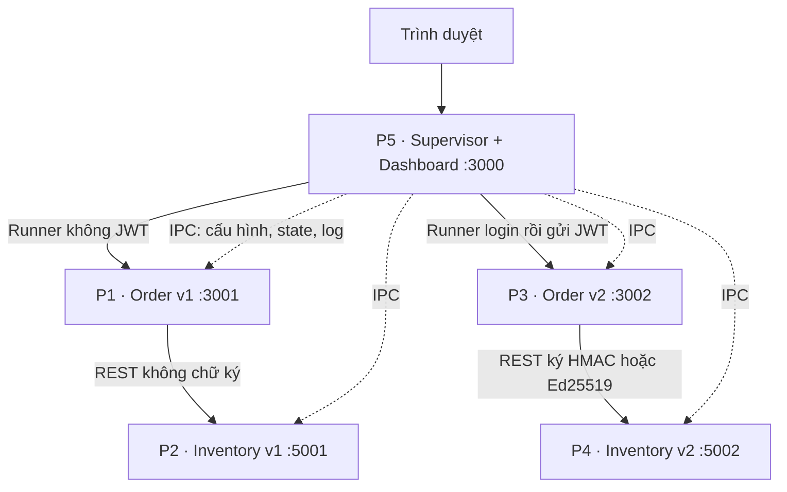

# BÁO CÁO LỰA CHỌN KỸ THUẬT — BLOCK 04

**Đề tài:** Server-to-Server Authentication & JWT  
**Phạm vi:** Giải thích kiến trúc, lựa chọn kỹ thuật và các đánh đổi của lab Order–Inventory.

Client gửi đơn đến Order; Order gọi Inventory để giữ hàng rồi trả kết quả. Nhóm xây dựng hai phiên bản cùng nghiệp vụ: **Baseline** không xác thực và **Full Security** có JWT, chữ ký service và chống gửi lại request.

## Mục lục

- [1. Kiến trúc tổng quát](#kien-truc)
- [2. Stack và giao tiếp giữa các service](#stack)
- [3. Lưu dữ liệu bằng SQLite](#database)
- [4. JWT hay session?](#jwt-session)
- [5. Mật khẩu, refresh token và logout](#refresh)
- [6. HMAC hay chữ ký Ed25519?](#hmac-ed25519)
- [7. Bảo vệ nội dung và chống replay](#chong-replay)
- [8. Đổi thuật toán và rotation key](#rotation)
- [9. Dashboard, logging và documentation](#dashboard)
- [10. Thiết lập secrets và tạo khóa bằng agent](#secrets)
- [11. Kết quả và giới hạn](#ket-qua)

<a id="kien-truc"></a>

## 1. Kiến trúc tổng quát

### Quyết định

Dùng năm process Node.js: Supervisor kiêm Dashboard và bốn worker. Hai luồng có database riêng để so sánh mà không làm thay đổi dữ liệu của nhau trong quá trình xử lý nghiệp vụ.



Có hai ranh giới bảo mật: **Client → Order** xác thực người dùng bằng JWT; **Order → Inventory** xác thực service bằng HMAC hoặc Ed25519. JWT hợp lệ không thay thế chữ ký service.

Khi bấm chạy case, browser gọi Supervisor; runner trong Supervisor gửi HTTP đến worker. Order gọi Inventory thật, và timeline hiển thị từng request/response. Dashboard chạy từ bundle đã build, không cần Vite server thường trực.

### Phương án thay thế

Monolith dễ triển khai và transaction chung hơn, nhưng không thể hiện rõ xác thực giữa các server. Docker/Kubernetes cách ly và quản lý triển khai tốt hơn, đổi lại thêm cấu hình hạ tầng cho lab.

### Trade-off

Năm process giúp thấy rõ trách nhiệm từng service nhưng vẫn chạy chung máy, tài khoản hệ điều hành và filesystem. Đây là phân chia logic, chưa phải cách ly bảo mật production. Hai tab là hai hệ thống song song, không phải công tắc tắt security của cùng một endpoint.

<a id="stack"></a>

## 2. Stack và giao tiếp giữa các service

### Quyết định

Chọn **Node.js + TypeScript + Fastify**, giao tiếp **REST/JSON**. Node có sẵn crypto, HTTP client và IPC; TypeScript giúp kiểm soát DTO/message; Fastify cung cấp route, hook và logging. Zod kiểm dữ liệu HTTP lúc chạy, còn `jose` xử lý JWT.

REST giúp người xem đọc trực tiếp method, URL, header và body được ký. Frontend dùng React, build bằng Vite và được Supervisor phục vụ.

### Phương án thay thế

Spring Boot/Spring Security phù hợp đội Java và hệ thống nhiều tầng; Express linh hoạt nhưng cần tự ghép thêm quy ước. gRPC có contract và client sinh tự động, song binary payload khó quan sát hơn trong bài trình diễn này.

### Trade-off

Stack hiện tại gọn và thuận tiện cho demo; nhóm phải tự tổ chức logic bảo mật và quản lý key. TypeScript không thay kiểm tra runtime. REST/JSON dễ đọc nhưng chưa có client sinh từ contract; nhóm cũng chưa benchmark để kết luận nhanh hơn các stack khác.

<a id="database"></a>

## 3. Lưu dữ liệu bằng SQLite

### Quyết định

Dùng `better-sqlite3`, mỗi worker một file database, bật WAL. SQLite lưu được dữ liệu sau restart mà không thêm database process thứ sáu.

Inventory ghi nonce, kiểm kho, trừ kho và tạo reservation trong một transaction. Khóa chính của nonce ngăn dùng lại cùng request. Việc đổi refresh token A sang B cũng nằm trong transaction tại Order.

### Phương án thay thế

PostgreSQL phù hợp nhiều replica và vận hành tập trung. Redis thuận tiện cho nonce có TTL nhưng thêm service. Lưu RAM đơn giản hơn nhưng mất trạng thái khi restart.

### Trade-off

SQLite hợp lab một máy, chưa phù hợp shared store phân tán; WAL vẫn chỉ cho một writer tại một thời điểm. Transaction Inventory không bao trùm việc lưu đơn tại Order: nếu Order lỗi sau khi giữ hàng, có thể còn reservation chưa được xử lý bù. Nhóm chưa triển khai saga hoặc idempotency nghiệp vụ.

<a id="jwt-session"></a>

## 4. JWT hay session?

### Quyết định

Chọn access **JWT HS256**, TTL mặc định **120 giây**. Order kiểm chữ ký, thuật toán cho phép, issuer, audience, thời hạn và thông tin người dùng trước khi nhận đơn. Request đặt hàng không phải tra session store.

JWT chỉ được ký, không mã hóa; payload không chứa password hay secret.

### Phương án thay thế

Session server-side lưu trạng thái đăng nhập ở server, thuận tiện khi cần thu hồi ngay. Opaque token kết hợp introspection cũng cho khả năng kiểm soát tập trung. JWT ký bất đối xứng phù hợp khi nhiều API cần verify mà không được quyền phát hành token.

### Trade-off

JWT giảm truy vấn session nhưng access token đã cấp vẫn dùng được đến hết hạn sau logout. Nhóm chấp nhận cửa sổ này và dùng TTL ngắn; nếu cần revoke ngay, session hoặc introspection phù hợp hơn.

HS256 đủ cho hiện trạng Order vừa cấp vừa verify JWT. **Đổi HMAC ↔ Ed25519 trên dashboard chỉ đổi chữ ký Order → Inventory; JWT vẫn dùng HS256.** Secret JWT và secret HMAC nội bộ là hai giá trị độc lập.

<a id="refresh"></a>

## 5. Mật khẩu, refresh token và logout

### Quyết định

Mật khẩu lưu bằng `bcryptjs`, cost mặc định 12. Login sai user hoặc password đều trả thông báo chung.

Refresh token là 32 byte ngẫu nhiên, TTL mặc định 7 ngày; database chỉ giữ SHA-256 hash. Cookie dùng `HttpOnly`, `SameSite=Lax`, `Path=/auth`; bật `Secure` khi chạy production.

Mỗi lần refresh, A bị đánh dấu đã dùng và được thay bằng B. Dùng lại A sẽ thu hồi cả family, khiến B cũng mất hiệu lực. Logout thu hồi family và xóa cookie.

### Phương án thay thế

Argon2id/scrypt là các lựa chọn password hashing khác. Access token dài hạn giảm refresh nhưng tăng thời gian bị lạm dụng nếu lộ. Lưu token trong localStorage dễ thao tác nhưng JavaScript bị chèn có thể đọc trực tiếp.

### Trade-off

HttpOnly hạn chế đọc cookie bằng JavaScript, không ngăn mọi tác động của XSS/CSRF. Code có kiểm Origin cho refresh/logout nhưng vẫn là cấu hình lab.

Hai refresh đồng thời có thể kích hoạt chính sách thu hồi family; client thực tế cần tránh gửi trùng. Bcrypt giới hạn 72 byte trong khi schema hiện chưa giới hạn đúng theo byte. Hệ thống cũng chưa có rate limiting hoặc MFA.

<a id="hmac-ed25519"></a>

## 6. HMAC hay chữ ký Ed25519?

### Quyết định

Giữ cả hai chế độ để so sánh cách quản lý quyền ký và verify trên cùng nghiệp vụ.

| Tiêu chí | HMAC-SHA256 | Ed25519 |
|---|---|---|
| Order sử dụng | Shared secret | Private key |
| Inventory sử dụng | Cùng shared secret | Public key |
| Người có khóa verify ký được request mới? | Có | Không chỉ từ public key |
| Đầu ra thô | MAC 32 byte | Chữ ký 64 byte |
| Điểm mạnh | Ít thành phần, tính toán nhẹ | Tách quyền ký khỏi quyền verify |
| Điểm yếu | Lộ secret ở verifier cũng có thể giả signer | Phải quản lý key pair và keyring |
| Rotation hiện có | Chưa có flow nhiều HMAC key | ed-1 → ed-2 |

Nhóm chọn **Ed25519** vì API Node gọn, khóa/chữ ký nhỏ và dễ thể hiện việc Inventory không cần private key. HMAC dùng secret ngẫu nhiên 32 byte; so sánh MAC bằng `timingSafeEqual`.

### Phương án thay thế

RSA-PSS phù hợp hạ tầng đang dùng RSA nhưng khóa/chữ ký lớn hơn. ECDSA P-256 phù hợp nhiều hệ sinh thái nhưng cần chú ý encoding và cách thư viện xử lý nonce ký. Ed448 cho mức an toàn cổ điển cao hơn với kích thước/chi phí tăng, vượt nhu cầu lab.

API key tĩnh đơn giản nhưng tự nó không ràng buộc body hoặc chống replay. mTLS có thể bổ sung xác thực peer và bảo vệ kênh truyền khi triển khai thực tế.

### Trade-off

HMAC dễ bootstrap nhưng chia sẻ cả quyền ký cho verifier. Ed25519 giảm nơi giữ private key, song không bảo vệ được khi chính signer bị lộ private key hoặc Inventory đã bị chiếm quyền.

Cả hai đều **không mã hóa nội dung và không tự chống replay**. Cần TLS khi đi qua mạng. Nhóm không xem RSA/ECDSA là kém an toàn; lựa chọn cuối phụ thuộc tương thích, provider và yêu cầu vận hành.

<a id="chong-replay"></a>

## 7. Bảo vệ nội dung và chống replay

### Quyết định

Nhóm ký một chuỗi chuẩn hóa gồm: version, method, path, thuật toán, key ID, timestamp, nonce và SHA-256 của body. Body có thứ tự trường cố định `sku`, `quantity`, `orderId`, giúp hai bên tính cùng đầu vào.

Inventory chỉ nhận thuật toán đang bật, kiểm header thiếu/trùng, timestamp trong ±60 giây và chữ ký trước khi ghi nonce. Nonce được giữ ít nhất 120 giây. Sửa body hoặc gửi lại request cùng nonce sẽ bị phát hiện.

### Phương án thay thế

Chỉ timestamp vẫn cho replay trong cửa sổ hợp lệ. Hash body không có khóa thì ai cũng tính lại được. Ký raw body hoặc dùng HTTP Message Signatures linh hoạt hơn, nhưng tăng yêu cầu về byte đầu vào và phạm vi triển khai.

### Trade-off

Canonical hiện được thiết kế riêng cho `POST /internal/reservations`, chưa phải bộ ký HTTP tổng quát. Thêm field/endpoint phải cập nhật contract. Nonce ngăn gửi lại cùng request, không ngăn tạo hai đơn mới với hai nonce khác nhau.

<a id="rotation"></a>

## 8. Đổi thuật toán và rotation key

### Quyết định

Đổi HMAC/Ed25519 cập nhật cả signer và verifier; Supervisor chờ state hai bên trước khi báo hoàn tất. Inventory không tự fallback sang thuật toán khác.

Rotation Ed25519 dùng hai cặp khóa đã tạo sẵn:

| Bước | Order ký bằng | Inventory tin cậy |
|---|---|---|
| Initial | ed-1 | Đảm bảo có ed-1 |
| Prepare | ed-1 | Thêm ed-2, giữ ed-1 |
| Switch | ed-2 | Chưa gỡ ed-1 |
| Retire | ed-2 | Gỡ ed-1 |

Dashboard chạy request ở các giai đoạn và thử lại bằng key cũ sau Retire. Cập nhật qua IPC nên không cần restart worker.

### Phương án thay thế

Thay file rồi restart đơn giản nhưng có thể gián đoạn request. Gỡ key cũ ngay khi chuyển signer dễ làm request đang xử lý bị từ chối. KMS/JWKS và cơ chế rollout có version phù hợp hệ thống nhiều replica hơn.

### Trade-off

Code hiện yêu cầu xác nhận trước Retire nhưng **chưa tự theo dõi request in-flight hoặc tính grace period**. Khoảng chờ của demo không chứng minh zero downtime dưới tải. Worker restart cũng chưa tự khôi phục toàn bộ cấu hình security đang chọn.

<a id="dashboard"></a>

## 9. Dashboard, logging và documentation

### Quyết định

Dashboard có hai luồng, case tiếng Việt và timeline ghi rõ bên gửi/bên nhận. Response hiển thị status/body thực tế; JSON được tô màu, headers tách riêng, có dấu hiệu đang chạy và các khối thu gọn.

Fastify/Pino ghi log JSON theo service và trace ID. Supervisor thu log vào JSONL rồi đẩy lên UI bằng SSE. Password, token, cookie và chữ ký được che ở các vị trí đã cấu hình.

README hướng dẫn chạy; REPORT giải thích quyết định bằng Markdown và HTML đọc offline. Source hiện chưa tích hợp Swagger/OpenAPI.

### Phương án thay thế

Postman/curl tiện gọi từng API nhưng không gom được toàn bộ demo lên một màn hình. ELK hoặc Loki/Grafana mạnh hơn về tìm kiếm/giám sát nhưng thêm hạ tầng. WebSocket hỗ trợ hai chiều, trong khi SSE đủ cho log đẩy từ server. Swagger/Redoc hữu ích cho contract máy đọc được, không thay phần giải thích kiến trúc.

### Trade-off

Cách hiện tại gọn cho lab nhưng chưa có log retention, cảnh báo hoặc contract OpenAPI sinh client. Redaction phải được cập nhật khi thêm field nhạy cảm. Evidence có thể thuộc phiên cũ; xem lại kết quả không đồng nghĩa đã gửi request mới.

<a id="secrets"></a>

## 10. Thiết lập secrets và tạo khóa bằng agent

### Quyết định

Sinh khóa tại máy bằng `npm.cmd run keys:generate`. Script dùng `randomBytes(32)` cho hai secret độc lập và `generateKeyPairSync('ed25519')` cho hai cặp khóa. Agent chỉ viết/chạy script; không tự nghĩ ra chuỗi khóa trong chat.

Tại thư mục dự án, dùng Node.js từ 22.17.1:

```powershell
npm.cmd ci
npm.cmd run keys:generate
npm.cmd run db:seed
npm.cmd run build
npm.cmd start
```

Script tự tạo `secrets/` và tạo `.env` với password demo ngẫu nhiên nếu file chưa có. Nếu đã copy `.env.example`, cần thay `DEMO_PASSWORD=replace-at-runtime` trước khi seed. Lệnh seed đặt lại dữ liệu lab.

| File trong secrets/ | Định dạng và vai trò |
|---|---|
| `internal-hmac.b64` | 32 byte random, base64url; Order/Inventory dùng chung cho HMAC |
| `access-jwt.b64` | 32 byte random độc lập, base64url; Order cấp/verify JWT |
| `ed-1-private.pem`, `ed-2-private.pem` | Private Ed25519, PKCS#8 PEM; Order ký |
| `ed-1-public.pem`, `ed-2-public.pem` | Public Ed25519 cùng cặp, SPKI PEM; Inventory verify |

Các biến đường dẫn trong `.env`:

```dotenv
INTERNAL_HMAC_SECRET_FILE=secrets/internal-hmac.b64
ACCESS_JWT_SECRET_FILE=secrets/access-jwt.b64
ED25519_PRIVATE_ED1=secrets/ed-1-private.pem
ED25519_PRIVATE_ED2=secrets/ed-2-private.pem
ED25519_PUBLIC_ED1=secrets/ed-1-public.pem
ED25519_PUBLIC_ED2=secrets/ed-2-public.pem
```

Prompt mẫu để nhờ agent tái hiện setup:

```text
Trong repository Block-4, đọc scripts/generate-keys.ts rồi setup bằng
npm.cmd run keys:generate; cài dependency bằng npm.cmd ci nếu cần.

Tạo secrets/ với hai secret 32 byte random độc lập, encode base64url:
internal-hmac.b64 và access-jwt.b64. Tạo hai cặp Ed25519 ed-1/ed-2,
private PKCS#8 PEM, public SPKI PEM, đúng đường dẫn trong .env.example.
Dùng node:crypto, không tự bịa khóa hoặc trả nội dung khóa trong chat.

Giữ nguyên .env và các key đang có. Nếu một cặp chỉ còn một file,
báo rõ và dừng trước khi chạy script vì script sẽ sinh lại cả cặp.
Đảm bảo .env và secrets/ được gitignore. Chỉ báo tên file và trạng thái.
Nếu chưa có script, hãy viết script theo các yêu cầu trên, không ghi đè
file có sẵn. Không tự seed/reset nếu chưa được yêu cầu.
```

Đây là prompt đề xuất để tái hiện, không phải nhật ký prompt đã dùng trước đó.

### Phương án thay thế

OpenSSL có thể tạo khóa cùng định dạng; KMS/Vault phù hợp quản lý tập trung. Script Node tránh yêu cầu cài thêm công cụ và khớp trực tiếp với hàm nạp khóa của dự án.

### Trade-off

Khóa local dễ setup nhưng cần bảo vệ quyền truy cập; `.gitignore` không mã hóa file. Script giữ secret/`.env` đã có, nhưng **nếu thiếu một nửa cặp Ed25519, nó sinh lại cả hai file**. Thay file khóa không tự cập nhật mọi process đang chạy.

Không đưa raw key, private PEM hoặc password vào report/commit.

<a id="ket-qua"></a>

## 11. Kết quả và giới hạn

### Quyết định

[Bộ evidence nộp](evidence/submission/summary.md) ghi request/response thật, trace ID riêng, log lý do từ chối, snapshot reservation và các mốc JWT `iat`/`exp`. Các tình huống gồm HMAC/Ed25519, timestamp, nonce, JWT sai, refresh reuse, logout và rotation.

Timeline logout dùng cùng access JWT do login cấp: được nhận khi còn hạn sau logout và bị từ chối khi hết hạn thật. HTTP nội bộ được thu qua IPC, không dựng từ response ngoài.

Chạy lại bằng `npm.cmd run evidence:submission`; không cần mở server trước. Runner chờ JWT hết hạn thực tế, mặc định khoảng 120 giây.

### Phương án thay thế

Unit test kiểm logic độc lập; kiểm thử tải, lỗi mạng và browser-cookie test cho phạm vi rộng hơn nhưng cần môi trường và fixture bổ sung.

### Trade-off

Kết quả chứng minh hành vi của lần chạy đã lưu, không chứng minh mọi lỗi mạng hoặc zero downtime production. Runner dùng database và port riêng, giữ nguyên khóa và dữ liệu dashboard.

Phiên bản Node thực tế được ghi nguyên trạng trong evidence. Lần thu hiện dùng Node 22.17.1, đáp ứng mức ≥22.17.1 đã khai báo trong dự án.
