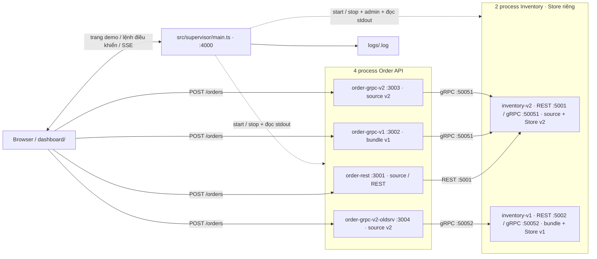

# Báo cáo: Các lựa chọn kỹ thuật trong demo REST → gRPC

**Web nâng cao · Block 3 · Cập nhật 14/10/2026**

Trong bài, trình duyệt gửi yêu cầu đặt hàng đến Order API, rồi Order gọi Inventory để giữ hàng. Nhóm chuyển giao tiếp giữa hai backend từ REST sang gRPC và thử thêm dữ liệu vào response để kiểm tra việc client, server nâng cấp ở những thời điểm khác nhau.

Các lựa chọn dưới đây ưu tiên một demo dễ chạy, dễ quan sát và đủ để kiểm chứng mục tiêu của bài. Những phương án khác được cân nhắc theo mức phù hợp, chưa được triển khai để so hiệu năng riêng.

## 1. Kiến trúc tổng quan

Sơ đồ dưới đây thể hiện **các process được supervisor chạy để demo phiên bản**, cùng đường gọi giữa Browser, Order API và Inventory.

### 1.1. Các process thực tế khi chạy demo

Supervisor chạy **bốn Order API và hai Inventory**. Instance v1 chạy từ bundle đã giữ lại, còn các instance hiện tại chạy từ source.

Supervisor phục vụ dashboard, quản lý process, gọi endpoint admin để làm chậm/reset Inventory và gom stdout thành log file cùng sự kiện SSE. Browser vẫn gửi đơn trực tiếp đến Order API. Hai Inventory có Store độc lập; bản v1 được build từ `frozen/v1/` qua `src/scripts/build-v1.ts` thành bundle trong `builds/`.

## 2. Stack backend: Node.js, TypeScript và Express

- **Quyết định:** Dùng Node.js + TypeScript + Express để service và công cụ demo cùng một bộ công cụ. TypeScript giúp phát hiện lỗi khi contract đổi; Express giữ luồng xử lý dễ đọc.
- **Lựa chọn thay thế:** Spring Boot hoặc Go sẽ thêm hệ công cụ khác. NestJS có cấu trúc sẵn nhưng chưa cần thiết với số route ít của bài.
- **Trade-off:** Tự duy trì cấu trúc ứng dụng, validation và xử lý lỗi. Kiểm tra kiểu không thay thế kiểm tra dữ liệu lúc chạy.

## 3. Giao tiếp: REST bên ngoài, gRPC bên trong

- **Quyết định:** Giữ REST/JSON cho browser, dùng gRPC giữa Order–Inventory để thử giao tiếp nội bộ và nâng cấp độc lập mà người gọi vẫn dùng API quen thuộc.
- **Lựa chọn thay thế:** REST toàn bộ dễ debug hơn nhưng không thể hiện mục tiêu thử Protobuf. gRPC-Web sẽ thêm công việc tích hợp phía giao diện.
- **Trade-off:** Duy trì hai dạng giao tiếp và chuyển lỗi gRPC sang HTTP. Dữ liệu nhị phân khó đọc trực tiếp hơn JSON.

## 4. Contract và codegen: Protobuf cùng ts-proto

- **Quyết định:** Dùng Protobuf và ts-proto để kiểu dữ liệu, client và service xuất phát từ cùng schema; phát hiện ảnh hưởng khi contract đổi qua kiểm tra kiểu.
- **Lựa chọn thay thế:** Tự viết interface phải cập nhật nhiều nơi. Nạp proto lúc chạy có thể giảm bước sinh code nhưng chưa đáp ứng cách kiểm chứng codegen và phiên bản của bài.
- **Trade-off:** Schema đổi phải sinh lại code, quản lý công cụ sinh code và xử lý trường hợp server cũ chưa gửi dữ liệu mới.

## 5. Dữ liệu: Store trong RAM

- **Quyết định:** Lưu tồn kho trong RAM với dữ liệu mẫu cố định để reset nhanh và lặp lại các tình huống đủ hàng, thiếu hàng, timeout.
- **Lựa chọn thay thế:** PostgreSQL hoặc database khác lưu dữ liệu bền vững nhưng thêm cấu hình, migration và truy vấn vào bài đang tập trung ở giao tiếp.
- **Trade-off:** Restart mất trạng thái; chưa lưu đơn hàng bền vững hay hoàn thiện vòng đời giữ hàng. Cần thay đổi khi phát triển thành hệ thống thực tế.

## 6. Logging và documentation: phục vụ trực tiếp cho demo

- **Quyết định:** Dùng log JSON do supervisor gom và hiển thị ngay cạnh response. README hướng dẫn chạy, proto mô tả giao tiếp, report giải thích kết quả.
- **Lựa chọn thay thế:** ELK hoặc Loki/Grafana thêm hệ thống quản lý log riêng. Swagger UI hỗ trợ REST nhưng không thay thế proto và phần giải thích thí nghiệm gRPC.
- **Trade-off:** Khả năng quản lý, tìm kiếm log còn hạn chế; tài liệu REST chưa có đặc tả máy đọc như OpenAPI.

## 7. Tổ chức demo: dashboard thuần và các phiên bản chạy song song

- **Quyết định:** Dùng dashboard HTML/CSS/JavaScript thuần do supervisor phục vụ. Chạy các phiên bản song song để so trực tiếp; giữ v1 thành bundle riêng để không lẫn source mới.
- **Lựa chọn thay thế:** React/Vue hoặc Docker Compose sẽ thêm công cụ giao diện hoặc bước đóng gói cho demo nhỏ này.
- **Trade-off:** Tự quản lý trạng thái giao diện, process và cổng; môi trường chạy chưa được container hóa.

## 8. Payload và giới hạn phép đo

Số liệu lấy từ `evidence/payload.json`, đo ngày **13/10/2026** trên cùng máy qua loopback, Node v24.10.0, Windows x64. Các thống kê có **7 mẫu**; cold là lượt đầu trên kết nối mới, warm là các lượt dùng lại kết nối.

### Message đã serialize · byte, median

| Tình huống | REST request | REST response | gRPC v2 request | gRPC v2 response |
|---|---|---|---|---|
| Đủ hàng | 30 | 89 | 11 | 67 |
| Thiếu hàng | 31 | 53 | 11 | 0 |

### Wire bytes · tổng hai chiều

| Tình huống | REST | gRPC v2 |
|---|---|---|
| Đủ hàng, cold | 627 | 484 |
| Đủ hàng, warm · median | 627 | 178 |
| Thiếu hàng, warm · median | 593 | 88 |

### Thời gian phản hồi · ms, median (min–max)

| Phạm vi | REST | gRPC |
|---|---|---|
| Adapter gọi Inventory | 1,70 (1,00–2,30) | 2,40 (1,90–3,10) |
| Toàn bộ POST /orders | 4,09 (3,47–6,01) | 3,22 (2,53–4,02) |

**Cách đo:**

- Message: số byte UTF-8 của body JSON hoặc Buffer Protobuf tại bước serialize/deserialize; không tính header/frame.
- Wire: TCP proxy đếm byte ứng dụng mỗi chiều, gồm header/frame/trailer; chưa gồm TCP/IP hay TLS.
- Thời gian: bỏ hai lượt warm-up, reset tồn trước mỗi ca và không tính thời gian reset vào latency.

**Giới hạn:**

- Chỉ có 7 mẫu, chạy tuần tự trên cùng máy; chưa đo tải đồng thời, mạng liên máy hay p95/p99.
- gRPC v2 có thêm field hết hạn còn REST chưa có; hai response chưa hoàn toàn cùng dữ liệu. Response message gRPC bằng 0 khi thiếu hàng vì lỗi đi qua status/trailer, không phải không truyền dữ liệu.
- gRPC dùng ít byte hơn trong phép đo này, nhưng chưa đủ để kết luận luôn nhanh hơn REST. Hai phạm vi latency đo các lượt request khác nhau, không thể trừ chúng để suy ra chi phí riêng của Order API.

Ghi chú về codegen, lỗi compile và trải nghiệm debug nằm trong `evidence/dx-notes.md`.
