# BLOCK 05 — BÁO CÁO LỰA CHỌN KỸ THUẬT VÀ KẾT QUẢ TRIỂN KHAI

**Đề tài:** OAuth2 giữa ứng dụng Taxi, Wallet Authorization Server và Wallet Resource API.  
**Ngày đối chiếu:** 22/10/2026.  
**STT nhóm:** `[Điền STT nhóm]`.  
**Thành viên — MSSV:** `[Điền họ tên và MSSV của từng thành viên]`.

Báo cáo này phát triển từ bảy quyết định kiến trúc ban đầu, bổ sung lý do chọn stack, cách triển khai các quyết định trong hệ thống, tài liệu API, logging và bằng chứng kiểm chứng. [Bản HTML](Report.html) và bản Markdown được đồng bộ nội dung; các sơ đồ trong HTML được nhúng thành SVG để xem offline. Các lựa chọn thay thế được phân tích để giải thích phạm vi của bản cuối; không có benchmark giữa các stack hoặc chứng nhận an toàn production.

## 1. Bài toán và kiến trúc tổng thể

Taxi cần được Alice cho phép truy cập ví để xem số dư và thanh toán chuyến đi. Một số khoản thanh toán phải chạy được sau khi Alice đã đăng xuất Taxi. Vì vậy, session đăng nhập Taxi và quyền truy cập Wallet phải được quản lý riêng: đăng xuất ứng dụng không đồng nghĩa với thu hồi quyền đã cấp cho ứng dụng.

Nhóm chia hệ thống thành ba ứng dụng chạy ở ba process riêng trong mỗi mode:

| Thành phần | Trách nhiệm trong bản cuối | Mã nguồn chính |
|---|---|---|
| Wallet AS | Đăng nhập chủ ví, hỏi consent, cấp code/token, xoay refresh token và thu hồi quyền | [apps/wallet-as.ts](apps/wallet-as.ts) |
| Wallet API | Xác minh access token, kiểm scope/principal, đọc ví và xử lý charge | [apps/wallet-api.ts](apps/wallet-api.ts) |
| Taxi | Đăng nhập người dùng Taxi, làm OAuth client, giữ token phía server, đặt vé và chạy job thanh toán | [apps/taxi.ts](apps/taxi.ts) |

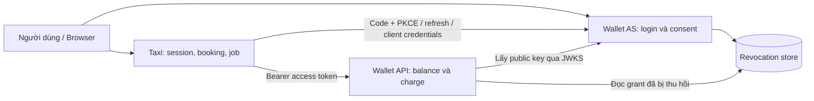

Browser nhận session cookie, URL điều hướng và kết quả đã che thông tin nhạy cảm. Access token và refresh token được Taxi sử dụng qua kênh server; không đưa token vào localStorage để browser tự gọi Wallet API.

## 2. Vì sao nhóm chọn stack hiện tại?

### 2.1. Node.js + TypeScript + Fastify

**Quyết định.** Nhóm dùng Node.js, TypeScript strict và Fastify cho cả ba ứng dụng. Cùng một ngôn ngữ được dùng cho server, script kiểm thử và phần JavaScript của dashboard, giúp việc đọc luồng và đối chiếu lỗi thuận tiện hơn trong phạm vi bài.

**Triển khai trong hệ thống.** Ba file trong `apps/` dùng chung phần cấu hình, HTTP/session, SQL và crypto ở `shared/`. `scripts/run.ts` khởi động ba process cho mỗi mode. Fastify đăng ký cookie, form parser, security headers, rate limit và error handler chung; các route vẫn tự kiểm các điều kiện nghiệp vụ/OAuth tương ứng. TypeScript kiểm kiểu khi chạy `npm.cmd run build`, còn ứng dụng được chạy bằng `tsx`.

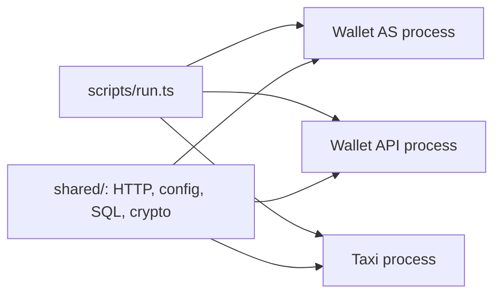

| Phương án | Nếu áp dụng vào bài này | Vì sao nhóm không chọn cho bản cuối |
|---|---|---|
| Spring Boot | Ba ứng dụng Java, cấu hình security/persistence và bộ chạy kiểm thử tương ứng | Là phương án khả thi, nhưng phải chuyển toolchain và cách chia sẻ mã sang Java; nhóm giữ một luồng TypeScript thống nhất cho ứng dụng và HTTP tests |
| Express | Giữ Node.js, tự kết hợp middleware cho validation, cookie và xử lý lỗi | Nhóm chọn cách đăng ký plugin/schema và lifecycle của Fastify để thống nhất ba server; không có phép đo kết luận Express chậm hơn |
| NestJS | Tổ chức server theo module, controller và dependency injection | Ba entrypoint hiện còn gọn; nhóm chưa cần thêm lớp tổ chức đó cho phạm vi bài OAuth |

**Đánh đổi.** TypeScript không tự xác thực dữ liệu nhận qua HTTP. Hệ thống vẫn cần parse/validation ở runtime, kiểm token, kiểm quyền và transaction; chọn framework không thay thế những bước này.

### 2.2. Thư viện và phiên bản đã dùng

Các phiên bản dưới đây lấy theo lockfile của bản triển khai. `package.json` mô tả dependency; `package-lock.json` cố định phiên bản để `npm ci` cài lại nhất quán.

| Thành phần | Phiên bản đã ghi nhận | Vai trò |
|---|---|---|
| Node.js / npm | 22.17.1 / 10.9.2 | Runtime và cài dependency trong môi trường kiểm chứng |
| Fastify | 5.12.7 | HTTP server cho ba ứng dụng |
| openid-client | 6.8.8 | OAuth client phía Taxi |
| jose | 6.2.13 | Ký/xác minh JWT và xử lý JWKS |
| argon2 | 0.44.0 | Băm mật khẩu và client secret |
| better-sqlite3 | 12.11.1 | SQLite và transaction |
| TypeScript / tsx | 5.9.3 / 4.23.15 | Kiểm kiểu / chạy TypeScript |
| Playwright | 1.64.1 | Kiểm thử browser bằng Edge headless |

Các plugin Fastify và dependency còn lại được liệt kê đầy đủ trong [package-lock.json](package-lock.json); manifest evidence cũng lưu thông tin phiên bản của lượt chạy.

## 3. Bảy quyết định kiến trúc từ bản HTML

### 3.1. Chọn ES256 và JWKS thay cho secret ký dùng chung

**Vì sao chọn.** Về vai trò, Wallet AS cấp token, còn Wallet API chỉ cần xác minh token. Cặp khóa bất đối xứng cho phép tách hai quyền này: chỉ có public key thì không thể ký token mới. Để có ranh giới bảo mật thực tế, việc phân phối cấu hình cũng phải giữ private key ngoài các service chỉ xác minh.

**Triển khai.** `scripts/setup.ts` sinh cặp khóa ES256/P-256 và `kid` khi khởi tạo lần đầu, lưu cấu hình theo từng mode. AS dùng private key để ký JWT; endpoint `/.well-known/jwks.json` công bố public JWK. Wallet API dùng `jose` để xác minh chữ ký, issuer, audience, thời hạn và các claim bắt buộc trước khi kiểm quyền.

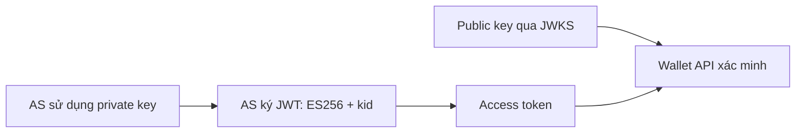

| Lựa chọn | Cách hoạt động trong Taxi/Wallet | Đánh đổi so với bản hiện tại |
|---|---|---|
| ES256 — đã chọn | AS ký; API kiểm bằng public key | Phải quản lý private key, `kid`, JWKS và kế hoạch xoay khóa |
| HS256 | AS và API cùng giữ secret để ký/kiểm HMAC | Cấu hình đơn giản, nhưng bên giữ secret xác minh cũng có thể ký token |
| RS256 | AS giữ private RSA key, API lấy public RSA key | Giữ được ranh giới quyền ký như ES256; khác thuật toán, kích thước khóa/chữ ký và cấu hình |

**Giới hạn.** Bản hiện tại giữ khóa qua các lần restart, nhưng chưa tự động xoay signing key hoặc lưu khóa trong KMS/HSM. Ngoài ra, `scripts/run.ts` đang truyền cùng cấu hình lab qua `LAB_CONFIG` cho cả ba process; cấu hình đó chứa cả private JWK. API thực hiện xác minh bằng public JWKS, nhưng bản chạy local chưa cô lập việc phân phối private key theo service. Khi triển khai thực tế phải tách secret/config theo quyền tối thiểu, không chỉ đổi thuật toán ký. Không có kết quả đo tốc độ để khẳng định ES256 tốt hơn RS256 trong mọi tình huống.

### 3.2. Chọn JWT xác minh tại API, bổ sung revocation store cục bộ

**Vì sao chọn.** Nhóm cần API tự kiểm token, đồng thời vẫn chặn được token đã cấp khi xảy ra code replay hoặc refresh reuse. Chỉ kiểm chữ ký và `exp` sẽ chưa phản ánh các sự kiện thu hồi đó.

**Triển khai.** Wallet API xác minh JWT bằng JWKS, rồi tra `grant_id` trong `revocations.sqlite`. AS ghi grant bị thu hồi vào store này; API mở store ở chế độ đọc. Nếu không đọc được trạng thái thu hồi, API trả 503 thay vì tiếp tục cho phép request.

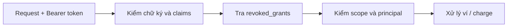

| Lựa chọn | Cách ghép vào hệ thống | Lý do chưa chọn |
|---|---|---|
| JWT + shared store — đã chọn | API kiểm JWT và đọc store cùng host | Gọn cho lab; đổi lại AS/API phụ thuộc filesystem chung |
| Token introspection | API hỏi AS trạng thái token qua một endpoint được bảo vệ | Thêm lượt gọi mạng và phụ thuộc khả dụng của AS; cần quyết định cache/timeout |
| Revocation event + outbox | AS phát sự kiện, API cập nhật denylist riêng | Phù hợp khi tách host nhưng cần cơ chế phân phối, retry và xử lý độ trễ đồng bộ |

Introspection là cơ chế để resource server hỏi authorization server về trạng thái hoạt động của token; cache kết quả cũng cần cân nhắc độ mới của trạng thái thu hồi. Tham chiếu: [RFC 7662](https://www.rfc-editor.org/rfc/rfc7662).

**Giới hạn.** Đây không phải hệ thống hoàn toàn độc lập với AS: API vẫn cần public key hợp lệ và store thu hồi. Thiết kế shared SQLite chỉ được kiểm chứng trong mô hình một máy.

### 3.3. Tự xây Wallet AS để làm rõ các kiểm tra OAuth

**Vì sao chọn.** Trọng tâm bài là chỉ ra AS phải kiểm điều gì, sai thì trả lỗi nào và các kiểm tra đó chặn tấn công nào. Tự xây phần điều phối OAuth giúp nhóm quan sát trực tiếp sự khác biệt giữa baseline và secure.

**Triển khai.** `apps/wallet-as.ts` xử lý `/authorize`, đăng nhập, consent, `/token` và gỡ quyền. Nhóm tự viết logic client/redirect/scope binding, consume code, quản lý refresh family và transaction. Các thao tác ký JWT, băm mật khẩu và sinh số ngẫu nhiên vẫn dùng thư viện tương ứng, không tự thiết kế thuật toán mật mã.

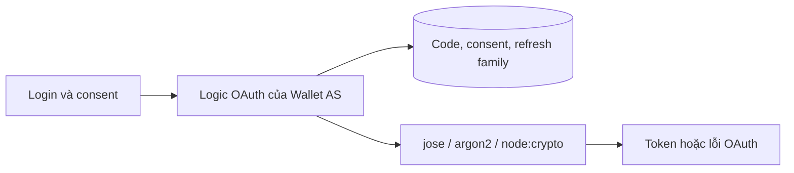

| Lựa chọn | Nếu sử dụng | Vì sao chưa chọn |
|---|---|---|
| AS tự xây — đã chọn | Nhóm sở hữu từng bước kiểm tra và có thể tạo baseline có chủ đích | Đổi lại phải chịu trách nhiệm về lỗi protocol và policy |
| Keycloak/ORY/provider khác | Cấu hình AS, client và scope; Taxi/API tích hợp với provider | Giảm phần tự viết, nhưng không thể hiện trực tiếp việc nhóm hiện thực từng kiểm tra theo yêu cầu bài |
| OAuth server framework | Framework xử lý engine grant; nhóm viết adapter và policy | Giảm một phần mã lõi nhưng phải hiểu thêm hợp đồng adapter và hành vi framework |

**Giới hạn.** Kết quả kiểm thử local không đủ để xem AS tự xây là một provider đã được kiểm chứng cho hệ thống tiền thật. Khi chuyển mục tiêu sang sản phẩm, nhóm cần đánh giá provider, khả năng vận hành, cập nhật bảo mật và quản lý khóa.

### 3.4. Chọn SQLite riêng cho từng ứng dụng

**Vì sao chọn.** Bài cần persistence, unique constraint và transaction, nhưng ưu tiên người chấm có thể chạy lại bằng ít bước. SQLite tránh yêu cầu dựng thêm database server cho ba ứng dụng local.

**Triển khai.** Mỗi mode có `as.sqlite`, `wallet.sqlite`, `taxi.sqlite` và `revocations.sqlite`. Dữ liệu nghiệp vụ vẫn tách theo ứng dụng. Riêng AS dùng `ATTACH` với revocation DB để cập nhật dữ liệu thu hồi trong transaction liên quan. Các kết nối ghi đặt `journal_mode=DELETE`, `synchronous=FULL`, foreign keys và busy timeout.

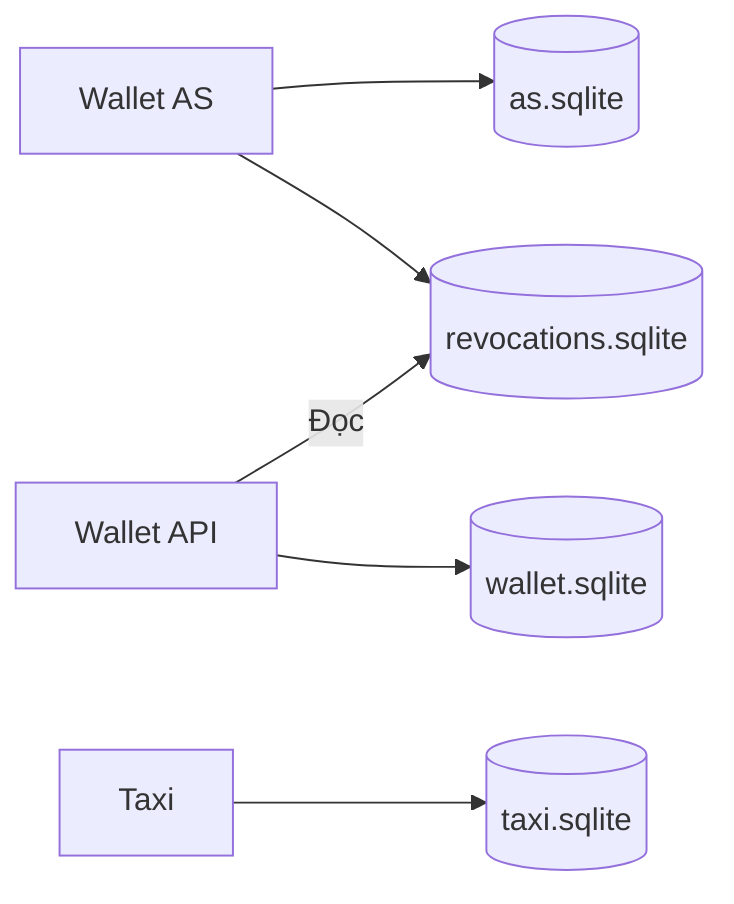

| Lựa chọn | Cách triển khai thay thế | Lý do chưa chọn |
|---|---|---|
| SQLite — đã chọn | File DB theo service/mode, SQL trực tiếp | Dễ chạy local; hạn chế khi tăng số process ghi hoặc tách nhiều host |
| PostgreSQL | Database/schema và kết nối riêng cho từng ứng dụng | Cần thêm dịch vụ DB, cấu hình kết nối, backup và migration khi bàn giao |
| PostgreSQL + Redis | PostgreSQL giữ dữ liệu gốc; Redis hỗ trợ session/cache/queue | Tăng số thành phần và bài toán đồng bộ trạng thái; chưa cần cho quy mô lab |

**Đánh đổi quan trọng.** Tính nguyên tử của transaction qua các database `ATTACH` phụ thuộc điều kiện của SQLite; nhóm không xem `ATTACH` là distributed transaction. Cấu hình file DB và rollback journal cần được giữ đúng; không suy diễn kết quả sang WAL hoặc nhiều host. Tham chiếu: [SQLite ATTACH](https://www.sqlite.org/lang_attach.html).

### 3.5. Chọn refresh token rotation và phát hiện reuse

**Vì sao chọn.** Refresh token cho phép Taxi hoạt động khi Alice offline, nhưng cũng là credential có thời gian sống dài hơn access token. Nhóm cần phát hiện khi một refresh token cũ xuất hiện lại sau khi đã được thay thế.

**Triển khai.** AS lưu hash của refresh token và quan hệ family. Ở secure mode, mỗi lần refresh hợp lệ đánh dấu token cũ đã dùng, phát token mới và cập nhật liên kết thay thế trong transaction. Reuse làm thu hồi family và grant. Taxi đưa mọi đường refresh qua cùng khóa theo user, lưu token mới vào vault trước khi nhả khóa.

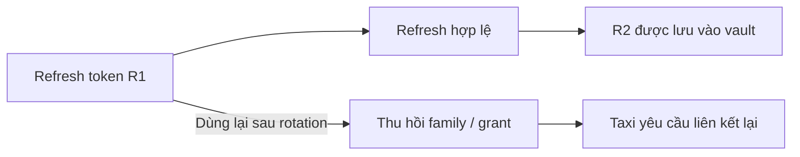

| Lựa chọn | Lợi ích | Lý do chưa chọn |
|---|---|---|
| Rotation — đã chọn | Có tín hiệu phát hiện token cũ bị dùng lại | Phải xử lý race và trạng thái không chắc chắn khi mất response |
| Refresh token cố định | Client ít phải cập nhật token | Token bị lộ có thể tiếp tục bị dùng trong thời gian còn hiệu lực |
| Sender-constrained token | Yêu cầu thêm bằng chứng gắn với khóa của client | Cần quản lý key/proof hoặc chứng chỉ và tích hợp DPoP/mTLS; bản hiện tại chưa có |

Rotation và sender-constraining là các hướng bảo vệ refresh token được thảo luận trong [RFC 9700 §4.14](https://www.rfc-editor.org/rfc/rfc9700#section-4.14). Trong bản này, nếu refresh thất bại hoặc kết quả không xác định, Taxi chuyển sang yêu cầu liên kết lại, không gửi lại vô hạn token cũ.

**Giới hạn.** Khóa theo user hiện nằm trong một process Taxi. Crash sau khi AS rotate nhưng trước khi Taxi lưu token mới vẫn có thể làm mất khả năng refresh; nhóm không tuyên bố đã giải quyết transaction xuyên hai hệ thống.

### 3.6. Chọn một worker trong Taxi, đặt idempotency tại Wallet API

**Vì sao chọn.** Người dùng có thể logout trước khi thanh toán chạy. Do đó công việc phải được lưu phía server. Đồng thời, retry do lỗi mạng không được tạo thêm khoản trừ tiền cho cùng request.

**Triển khai.** Taxi lưu job bền vững trong SQLite. Worker lấy job đến hạn, lấy/refresh token khi cần rồi gọi `POST /wallet/charges`. Logout chỉ xóa session; không xóa job hoặc quyền đã cấp. Wallet API ràng buộc key theo user/client, so sánh payload và thực hiện cập nhật số dư cùng insert charge trong transaction. Cùng key/cùng payload trả kết quả duplicate; khác payload trả 409.

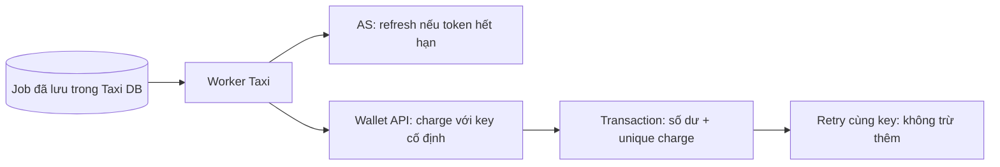

| Lựa chọn | Cách hoạt động | Đánh đổi |
|---|---|---|
| Worker trong Taxi — đã chọn | Một vòng xử lý và khóa refresh theo user | Ít dependency; process dừng thì job chờ khởi động lại |
| Queue + worker độc lập | Taxi ghi job vào broker, worker khác nhận và xử lý | Thuận lợi cho tách tải, nhưng cần broker, coordinator và khóa phân tán |
| Chỉ thanh toán khi online | Thực hiện charge trong thời gian user còn session | Giảm nhu cầu giữ token lâu nhưng không đáp ứng yêu cầu thanh toán sau logout |

**Giới hạn.** Idempotency bảo vệ hiệu ứng charge theo key trong Wallet DB. Nó không bảo đảm mọi job sẽ hoàn tất đúng một lần bất kể crash, mất mạng hoặc nhiều worker. Retry thất bại cũng không được làm mất trạng thái `confirmed` của vé đã thanh toán trước đó.

### 3.7. Chọn một codebase với hai mode tách dữ liệu

**Vì sao chọn.** Nhóm muốn giữ cùng logic nghiệp vụ và chỉ làm khác các kiểm tra AS cần so sánh. Hai codebase độc lập dễ phát sinh chênh lệch do sửa lỗi hoặc thay đổi nghiệp vụ ở một phía.

**Triển khai.** Mode được chọn ở server khi khởi động, không lấy từ tham số browser. Baseline và secure có cổng, issuer, key, database và cookie name riêng. Baseline cố ý thiếu một số kiểm tra OAuth; Wallet API vẫn kiểm JWT/quyền, và charge vẫn idempotent.

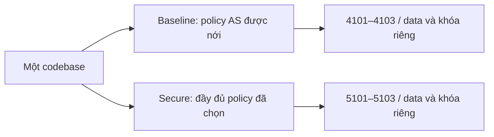

| Lựa chọn | Lợi ích | Đánh đổi |
|---|---|---|
| Chung code, hai mode — đã chọn | Giảm lệch nghiệp vụ; dễ chạy lại cùng case | Phải cô lập cấu hình để tránh gọi nhầm mode |
| Hai codebase/commit độc lập | Dễ chỉ ra source trước và sau | Phải quản lý các thay đổi chung và tránh lệch bản |
| Feature flag cho từng kiểm tra | Có thể minh họa tác dụng từng gate | Số tổ hợp tăng; dễ có cấu hình thiếu bảo vệ ngoài dự kiến |

**Ranh giới bằng chứng.** Output baseline/secure hiện chứng minh khác biệt hành vi của hai policy. Nó không tự chứng minh lịch sử đã chạy baseline trước khi viết secure. Muốn chứng minh mốc phát triển cần output hoặc lịch sử thật được lưu từ thời điểm đó.

## 4. Những quyết định triển khai bổ sung cho bản cuối

### 4.1. Dùng OAuth client library, giữ token ở Taxi server

**Lý do.** Nhóm tự xây AS để học và kiểm tra protocol, nhưng không cần tự viết thêm OAuth client cho Taxi. `openid-client` được dùng để tạo/kiểm state, PKCE, đổi code và refresh; `jose` xử lý JWT. Điều này giảm lượng logic giao thức phải tự duy trì ở phía client.

**Cách triển khai.** Browser giữ session ID; session server-side gắn với tài khoản Taxi. Mật khẩu Taxi được kiểm độc lập với mật khẩu Wallet. Code/refresh token tại AS được lưu dưới dạng hash; token cần dùng lại tại Taxi được mã hóa AES-256-GCM, với AAD gắn mode/user/client. Hash phù hợp cho kiểm tra giá trị xuất trình; mã hóa phù hợp cho credential Taxi phải giải mã để gửi lại AS/API.

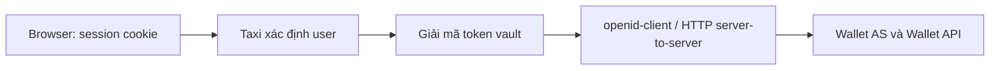

**Phương án khác.** Đưa token vào browser khiến browser phải giữ bearer credential và không giải quyết được job chạy sau logout. Lưu token plaintext tại Taxi làm tăng tác động khi chỉ DB bị đọc. Vault cục bộ được chọn cho lab; nếu cả DB và khóa mã hóa cùng bị lộ thì biện pháp này không đủ bảo vệ token.

### 4.2. Tách ý định đặt vé khỏi việc tạo vé, bắt buộc consent trước

**Lý do.** Bản cuối cần thể hiện đầy đủ cấp quyền trước khi đặt vé, đồng thời ngăn client gọi thẳng API tạo vé để bỏ qua màn hình consent. Chỉ thêm một nút hoặc một bước vẽ trên sơ đồ không đủ thực thi điều kiện này.

**Cách triển khai.** `POST /api/booking-intents` lưu ý định gắn user/session/chuyến và thời hạn; chưa tạo vé hoặc charge. Callback OAuth hợp lệ và đổi code thành công mới chuyển intent sang `authorized`. `POST /api/bookings` kiểm intent đó trước khi tạo booking và job trong cùng transaction. Giá/tuyến lấy từ catalog phía server. Yêu cầu lặp cùng intent trả cùng booking/job; API đọc/gửi lại vé kiểm chủ sở hữu.

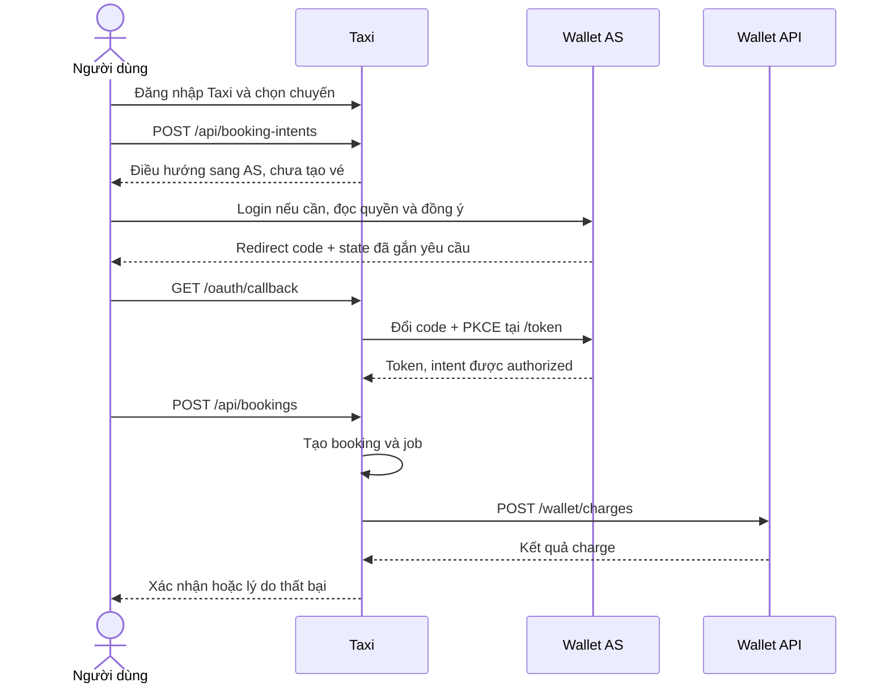

**Phương án khác.** Tạo vé ngay rồi mới hỏi quyền sẽ phải quản lý thêm vé chưa được phép thanh toán và dễ gây hiểu nhầm. Chỉ kiểm trạng thái “đã liên kết ví” cũng chưa chứng minh user đã hoàn tất lần cấp quyền cho flow đặt vé đang xét.

**Quy tắc của ứng dụng.** Mỗi vé mới hỏi consent mới, kể cả đã có liên kết ví. Nếu user đã đăng nhập AS, AS có thể dùng session hiện hữu nhưng vẫn hiện consent. Retry cùng vé và job offline dùng quyền đã cấp. Yêu cầu consent lại mỗi vé là lựa chọn nghiệp vụ của nhóm, không phải quy tắc bắt buộc cho mọi ứng dụng OAuth2. Luồng authorization code và vai trò của quyết định cấp quyền được mô tả tại [RFC 6749 §4.1](https://www.rfc-editor.org/rfc/rfc6749#section-4.1).

### 4.3. Chọn Markdown và dashboard trace cho tài liệu, chưa tích hợp Swagger

**Lý do.** Người chấm cần hiểu cả request, redirect, consent, lỗi và tác động lên dữ liệu. Nhóm dùng Markdown cho contract/chính sách, còn dashboard cho kết quả thực tế. Chỉ một trang mô tả endpoint chưa thể hiện hết chuỗi OAuth đi qua browser và nhiều server.

**Cách triển khai.** [API_FLOW.md](docs/API_FLOW.md) mô tả endpoint nghiệp vụ và điều kiện tạo vé; [TOKEN_CONTRACT.md](docs/TOKEN_CONTRACT.md) ghi claims/scope; [AS_CHECKLIST.md](docs/AS_CHECKLIST.md) ánh xạ kiểm tra sang lỗi và tấn công. Kết quả UI có tab Thông báo và Sequence diagram, bấm mũi tên mở popup payload đã che credential. Trace AS được ghi từ request thực tế, nối với callback/token và booking.

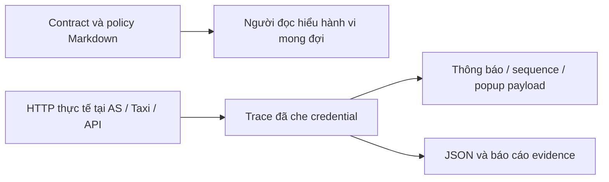

**So với Swagger/OpenAPI.** OpenAPI sẽ hữu ích để mô tả schema, sinh client hoặc tương tác API. Bản hiện tại chưa có OpenAPI/Swagger UI, nên không tuyên bố đã có tài liệu API sinh tự động. Nhóm chấp nhận việc phải cập nhật Markdown khi route thay đổi; nếu mở rộng hệ thống, có thể thêm OpenAPI nhưng vẫn cần trace riêng cho login/consent/redirect.

### 4.4. Chọn audit event trong SQLite, chưa dựng ELK

**Lý do.** Bài cần chứng minh sự kiện OAuth và thanh toán, không cần vận hành một cụm tìm kiếm log. Nhóm ưu tiên nhật ký có cấu trúc, dữ liệu đã che và người chấm có thể xem lại ngay khi chạy lab.

**Cách triển khai.** `shared/http.ts` cấu hình logger Fastify/Pino ở mức `warn`, tắt request logging tự động. Nhật ký nghiệp vụ đi qua `audit()` trong `shared/db.ts`, lưu timestamp, service, action, status và detail JSON vào bảng `events`; có cơ chế giới hạn số sự kiện giữ lại. AS còn lưu trace OAuth đã chọn trường. Endpoint nội bộ đọc log/trace yêu cầu xác thực giữa service; dashboard chỉ nhận dữ liệu đã chọn để hiển thị.

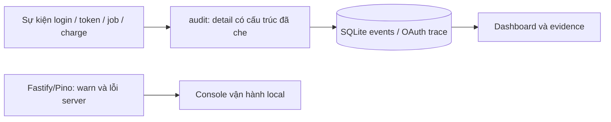

| Lựa chọn | Cách áp dụng nếu mở rộng | Vì sao chưa dùng |
|---|---|---|
| SQLite audit — đã chọn | Query sự kiện ngay trong lab, xuất JSON/report | Không có full-text search hay kho log phân tán; retention còn đơn giản |
| ELK | Thu thập log sang Elasticsearch, xử lý và xem bằng Kibana | Phải thêm pipeline, lưu trữ, phân quyền và redaction xuyên nhiều thành phần |
| Loki/Grafana | Gửi log có nhãn vào hệ thống quan sát tập trung | Vẫn cần collector và chính sách nhãn/retention; chưa cần ở quy mô hiện tại |

**Giới hạn.** Có cột `trace_id` không đồng nghĩa hệ thống đã có distributed tracing xuyên suốt mọi request. SQLite audit cũng chưa là kho kiểm toán chống chỉnh sửa. Bản cuối không dùng ELK và không ghi mọi request/body vào Pino.

### 4.5. Chọn HTTP loopback và setup tự động cho bài local

**Lý do.** Theo phạm vi demo đã chốt, nhóm giữ HTTP localhost để người chạy lại không phải cài chứng chỉ. Lựa chọn này phục vụ khả năng tái hiện trên máy local; không phải khuyến nghị bỏ TLS khi triển khai mạng thực tế.

**Cách triển khai.** Các server chỉ bind loopback. Cookie có HttpOnly/SameSite và kiểm CSRF, nhưng không bật Secure trên HTTP. `setup:local` sinh key/secret/vault key khi chưa có, tạo schema và seed tài khoản. Chạy lại không tự thay key hoặc số dư đã tồn tại. `dev` gọi setup và mở sáu process cho hai mode.

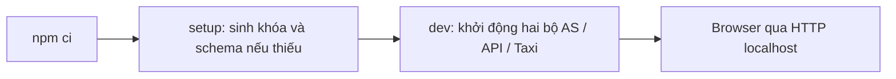

**Phương án khác.** HTTPS với CA local cần thêm bước cấp và tin cậy chứng chỉ. Docker Compose có thể đóng gói môi trường, nhưng sẽ thêm yêu cầu Docker và cấu hình volume/network. Nhóm chọn npm + process supervisor cho bản hiện tại. Khi đưa dịch vụ ra ngoài loopback, phải đánh giá lại TLS, cookie, origin, quản lý secret và cấu hình triển khai.

## 5. Contract bảo mật và cách kiểm thử các quyết định

### 5.1. Các kiểm tra quan trọng tại AS

Bảng dưới tóm tắt các kiểm tra của secure mode. Bảng chi tiết ở [AS_CHECKLIST.md](docs/AS_CHECKLIST.md).

| Endpoint / bước | Kiểm tra | Khi sai | Tấn công / lỗi được ngăn |
|---|---|---|---|
| `/authorize` | Client và exact redirect URI | 400 tại AS, không gửi Location sang URI lạ | Code exfiltration / open redirect |
| `/authorize` | Scope allowlist, response/grant phù hợp | Lỗi OAuth tại callback đã tin cậy | Scope escalation / grant confusion |
| `/authorize` | PKCE S256 và challenge hợp lệ | Callback `invalid_request` | Xin code không có ràng buộc PKCE |
| `/login`, `/consent`, revoke | Session, CSRF và origin tương ứng | Từ chối tại AS | Form CSRF / thao tác thiếu phiên hợp lệ |
| `/token` | Form parse và Basic client auth | 400 `invalid_request` / 401 `invalid_client` | Request mơ hồ / mạo danh client |
| Đổi authorization code | Client, redirect, verifier, hạn 60 giây, chưa dùng | 400 `invalid_grant` | Cross-client use, code interception, expiry/replay |
| Refresh | Đúng client, family/token/consent còn hiệu lực | 400 `invalid_grant` | Dùng quyền sau thu hồi hoặc sai chủ token |
| Refresh reuse | Rotate và phát hiện dùng lại token cũ | Thu hồi family/grant, `invalid_grant` | Replay refresh token |
| Refresh scope | Không tăng quyền so với token hiện hành | 400 `invalid_scope` | Scope escalation |
| Client Credentials | Grant/scope của client được phép | Từ chối scope không hợp lệ | Client tự xin quyền người dùng |

Việc API nhận được JWT hợp lệ vẫn chưa đủ để charge: Wallet API còn kiểm scope `wallet:charge`, `principal_type=user` và điều kiện idempotency/số dư. Client Credentials chỉ có `rates:read` không được trừ tiền ví.

### 5.2. Script tấn công gọi API nào?

`scripts/attacks.ts` và HTTP client trong `shared/cases.ts` gửi request tới chính AS/Wallet API đang chạy. Fixture chuẩn bị grant bằng login/consent thật trước khi thử đổi tham số hoặc replay. Route `/testing/cases/:id/runs` chỉ điều khiển các test này từ dashboard; không có implementation giả của thanh toán hay cấp token. API nghiệp vụ không nằm dưới `/demo/*`.

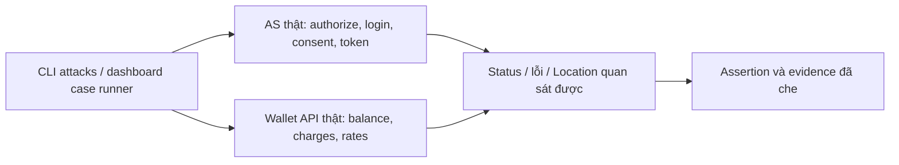

Nhóm dùng script HTTP cho lỗi protocol và transaction; dùng Playwright cho điều hướng browser, consent, UI, popup và kiểm token không xuất hiện trong response browser. Mỗi loại kiểm thử quan sát một phần khác nhau của hệ thống.

## 6. Kết quả đã quan sát và giới hạn của bằng chứng

### 6.1. Snapshot evidence được dùng trong báo cáo

Lượt security evidence được đối chiếu: **`2026-10-22T14-26-06-069Z`**, có [REPORT.html](evidence/2026-10-22T14-26-06-069Z/REPORT.html) và [manifest.json](evidence/2026-10-22T14-26-06-069Z/manifest.json). Manifest ghi **PASS**, secret scan **PASS**, phiên bản và hash source/artifact của lượt chạy.

Sau lượt này, `public/dashboard.js`, `public/style.css` và `scripts/ui.ts` đã thay đổi để bổ sung hai tab và popup payload. Kết quả UI hiện có tại [evidence/ui-booking/result.json](evidence/ui-booking/result.json) ghi PASS. Vì vậy, security evidence trên là bằng chứng của snapshot được lưu, chưa phải manifest khớp toàn bộ source giao diện cuối. Cần chạy lại bộ evidence khi chốt gói nộp.

### 6.2. Output so sánh baseline và secure

Các kết quả sau đọc từ `baseline/attacks.json`, `secure/attacks.json` và `code-expiry.json` của lượt trên. Mã lỗi/status dưới đây là kết quả của bước bị kiểm tra, không phải toàn bộ status của các bước login chuẩn bị grant.

| Case | Baseline quan sát | Secure quan sát |
|---|---|---|
| Callback không đăng ký | Hoàn tất luồng và cấp code tới callback thử nghiệm | 400 tại AS |
| Thiếu PKCE | Vẫn cấp code sau login/consent | Callback `invalid_request` |
| Dùng lại code | Đổi code lần hai còn được chấp nhận | 400; token từ grant cũ bị API từ chối 401 |
| Sai verifier | Token endpoint vẫn chấp nhận | 400 `invalid_grant` |
| Sai client secret | Token endpoint vẫn chấp nhận | 401 `invalid_client` |
| Đổi code bằng client khác | Vẫn chấp nhận | 400 `invalid_grant` |
| Replay refresh token cũ | Token cũ còn được chấp nhận | 400; token mới cùng family cũng bị chặn |
| Refresh bằng client khác | Vẫn chấp nhận | 400; đúng client vẫn refresh được |
| Code hết hạn | Chờ thật 61 giây nhưng vẫn đổi được | 400 `invalid_grant` |

Đây là so sánh hai policy có thể chạy lại. Repo hiện chưa có commit baseline độc lập hay bằng chứng Git cho mốc chạy trước khi harden. Không dùng bảng này để khẳng định đã lưu đầy đủ lịch sử phát triển.

### 6.3. Redirect trace và log job offline

`happy-path.json` lưu trace `/authorize` → `/login` → `/consent` → `/oauth/callback`, với token exchange bên trong callback. Code, state, mật khẩu và token được che; không cần nộp callback URL hoặc cookie nguyên bản.

`offline-job.json` ghi được các mốc sau; các số thời gian là Unix timestamp, không phải số đo latency:

| Mode | `exp` access token trước job | Quan sát job hoàn tất | Session Taxi khi job chạy | Counter charge |
|---|---:|---:|---:|---|
| Baseline | 1792679300 | 1792679303 | 0 | 1 → 2 |
| Secure | 1792679300 | 1792679302 | 0 | 1 → 2 |

Worker đã refresh và charge sau khi access token hết hạn thật. Counter tăng đúng một cho job được kiểm; test gửi lại cùng vé cũng kiểm `duplicate=true` và không tăng thêm counter.

### 6.4. Bảng grant điền từ response quan sát

Bảng lấy từ [secure/grants.json](evidence/2026-10-22T14-26-06-069Z/secure/grants.json). Trường `refresh_token` chỉ biểu thị có/không; không lưu credential. Các claim được trích sau khi xác minh JWT trong bộ thu evidence.

| Grant | Có refresh token? | `sub` | `aud` | `scope` | `principal_type` | `expires_in` |
|---|---|---|---|---|---|---:|
| Authorization Code + offline_access | Có | alice | wallet-api | offline_access wallet:charge wallet:read | user | 120 |
| Authorization Code không offline_access | Không | alice | wallet-api | wallet:read | user | 120 |
| Refresh Token | Có | alice | wallet-api | offline_access wallet:charge wallet:read | user | 120 |
| Client Credentials | Không | taxi-m2m | wallet-api | rates:read | client | 120 |

Đây là giá trị đã đo ở lượt chạy nêu trên, không phải dữ liệu giả định. `sub`, `aud`, `principal_type` là contract của hệ thống; không phải mọi trường này đều do RFC 6749 §5.1 bắt buộc. Phần token response tiêu chuẩn và các trường mở rộng cần được phân biệt khi đối chiếu [RFC 6749 §5.1](https://www.rfc-editor.org/rfc/rfc6749#section-5.1).

### 6.5. Policy thu hồi đã chọn

| Sự kiện | Hành vi secure | Tác động tới access token còn hạn |
|---|---|---|
| Alice gỡ consent | Revoke consent và refresh family/token; refresh tiếp theo thất bại, Taxi unlinked | Token đã cấp vẫn được API chấp nhận tới `exp` ban đầu nếu chưa có thu hồi grant do replay |
| Authorization code bị replay đúng binding | Thu hồi grant và refresh family liên quan | API từ chối token thuộc grant đó sau khi trạng thái thu hồi được commit |
| Refresh token cũ bị reuse | Thu hồi family và grant | Token liên quan chịu kiểm tra denylist của API |
| API không đọc được revocation store | Trả 503 | Không cho request tiếp tục khi thiếu trạng thái cần kiểm tra |

Evidence revoke quan sát đọc số dư ngay sau gỡ quyền vẫn 200, còn yêu cầu refresh của Taxi ở secure trả 409 với `invalid_grant`; token endpoint AS là nơi trả lỗi OAuth. Baseline vẫn refresh được do cố ý chưa enforce policy này. Chi tiết tại [REVOCATION_POLICY.md](docs/REVOCATION_POLICY.md).

### 6.6. Những điều các kết quả trên chưa chứng minh

- Không có benchmark so sánh tốc độ/chi phí Node.js với Spring Boot, ES256 với RS256 hoặc SQLite với PostgreSQL.
- Race checks là HTTP song song với một process mỗi service; chưa chứng minh multi-host, nhiều worker hoặc power-loss consistency.
- Chưa có signing-key rotation tự động, MFA, KMS/HSM, load/soak test hoặc audit bảo mật độc lập.
- Cấu hình lab còn được phân phối chung cho ba process; chưa chứng minh được private key/secret đã được cô lập theo từng service.
- Bản booking có catalog, vé và thanh toán bền vững; chưa có tồn chỗ hay điều phối xe bên ngoài.
- Kết quả local HTTP không thay thế đánh giá cấu hình và vận hành production.

## 7. Chạy lại hệ thống và tạo sản phẩm nộp

Chạy từ thư mục repo với Node.js 22.17+ và npm:

```powershell
npm.cmd ci --include=dev
npm.cmd run setup:local
npm.cmd run dev
```

`dev` cũng tự gọi setup; lệnh setup riêng ở trên giúp người chấm thấy rõ bước sinh khóa/schema. Setup chỉ sinh khóa khi chưa có cấu hình. Không gửi private key hoặc secret đã sinh cùng bài nộp.

| Thành phần | Baseline | Secure |
|---|---|---|
| Wallet AS | http://localhost:4101 | http://localhost:5101 |
| Wallet API | http://localhost:4102 | http://localhost:5102 |
| Taxi | http://localhost:4103 | http://localhost:5103 |

Đăng nhập Taxi bằng `alice / Taxi-alice-2026!`; đăng nhập Wallet AS bằng `alice / Alice-demo-2026!`. Tài khoản Bob tương ứng là `bob / Taxi-bob-2026!` và `bob / Bob-demo-2026!`. Đây là tài khoản seed để tái hiện bài lab, không phải credential của dịch vụ thật.

Trong terminal khác khi dev đang chạy:

```powershell
npm.cmd run build
npm.cmd test
npm.cmd run attacks -- --target baseline --all
npm.cmd run attacks -- --target secure --all
npm.cmd run test:e2e
```

`--all` thêm case chờ code hết hạn thật. Kiểm thử browser cần Edge theo hướng dẫn [README.md](README.md). Bộ evidence đầy đủ tự khởi động hệ thống với data/cổng riêng, không cần dùng data demo đang mở:

```powershell
npm.cmd run evidence:submission
```

Lượt evidence ghi thư mục mới, không ghi đè báo cáo cũ. Chỉ dùng lượt có manifest PASS làm bằng chứng đạt; giữ các lượt FAIL như lịch sử và chỉ rõ nguyên nhân. Chi tiết reset dữ liệu, khóa và cách dừng process ở README.

## 8. Đối chiếu sản phẩm nộp và những việc còn phải chốt

| Yêu cầu | Vị trí hiện có | Trạng thái / việc cần chốt |
|---|---|---|
| Hướng dẫn chạy lại, sinh khóa và attacks | [README.md](README.md), [scripts/setup.ts](scripts/setup.ts) | Có; cần thử lại từ checkout/gói giải nén sạch trước khi nộp |
| Plan gồm quyết định trước hiện thực | [Plan.md](Plan.md) | Có nội dung; báo cáo viết sau triển khai không thay thế được bằng chứng mốc Plan trước code |
| Source ba app, scripts, library và version | `apps/`, `shared/`, `scripts/`, [package-lock.json](package-lock.json) | Có; cần đưa đầy đủ vào repo/gói nộp |
| Bảng kiểm tra AS | [AS_CHECKLIST.md](docs/AS_CHECKLIST.md), mục 5 | Có endpoint, điều kiện, lỗi và tấn công |
| Output attacks trước/sau | `baseline/attacks.json`, `secure/attacks.json`, `code-expiry.json` trong lượt evidence | Có so sánh policy; cần đính kèm output ban đầu nếu còn, hoặc ghi rõ baseline tái hiện |
| Redirect trace đã che | `happy-path.json` của mỗi mode | Có login/consent/callback và token exchange |
| Log job, exp và counter | `offline-job.json` của mỗi mode, mục 6.3 | Có chờ TTL thật, session=0 và counter trước/sau |
| Bảng grant từ response | `grants.json` của mỗi mode, mục 6.4 | Có bốn trường hợp quan sát |
| Policy thu hồi | [REVOCATION_POLICY.md](docs/REVOCATION_POLICY.md), mục 6.5 | Có mô tả access token còn hạn và evidence revoke |
| Trade-off và giới hạn | Mục 3–6, [TRADEOFFS.md](docs/TRADEOFFS.md) | Có lựa chọn hiện tại, phương án thay thế và giới hạn |

Các tên JSON trong bảng thuộc [lượt evidence được dẫn ở mục 6](evidence/2026-10-22T14-26-06-069Z/REPORT.html). Người nộp cần chốt các việc sau, thay vì coi việc viết thêm báo cáo là đã hoàn tất bằng chứng:

- [ ] Điền STT nhóm, họ tên và MSSV ở đầu báo cáo.
- [ ] Đưa các file cần nộp vào Git và ghi commit của bản chốt; trạng thái đối chiếu hiện tại vẫn có nhiều file chưa được theo dõi, Git mới có commit README ban đầu.
- [ ] Chạy lại evidence trên snapshot cuối có tab/popup; ghi run ID và commit vào mục bàn giao. Không sửa manifest cũ để làm khớp source mới.
- [ ] Bổ sung lịch sử/output có thật cho mốc Plan và lần chạy trước khi harden nếu còn; không tạo commit lùi ngày hoặc gọi baseline tái hiện là output lịch sử.
- [x] Đồng bộ toàn bộ nội dung HTML/Markdown: đủ bảy quyết định chính, phần triển khai/evidence bổ sung và 15 sơ đồ; bản HTML nhúng SVG để xem offline, phân biệt PASS của snapshot với phân tích kiến trúc.
- [ ] Mở gói giải nén ở vị trí khác, kiểm link tương đối, cài dependency và chạy theo README.

### Quy ước tên file và nội dung ZIP

Mẫu được cung cấp là:

```text
<STTNhom>-<Block02>-MSSV...zip
```

Nội dung repo này là **Block 05**, trong khi mẫu ghi **Block02**. Cần xác nhận mã khối theo quy định nộp của học phần trước khi thay placeholder; chưa có STT nhóm/MSSV nên báo cáo không tự đặt tên ZIP cụ thể. Nếu mẫu chỉ dùng `Block02` để minh họa vị trí mã khối và học phần xác nhận dùng Block05, tên sẽ theo dạng `<STTNhom>-Block05-<MSSV1>-<MSSV2>-....zip`.

Gói nộp nên chứa source, package/lockfile, README, Plan, `Report.md`, `Report.html`, `docs/` và thư mục evidence đã chọn. Không đóng gói `.local/`, private key, client secret, token vault, `.env` hoặc `node_modules/`. Các link tới source/evidence trong báo cáo là link tương đối để tiếp tục dùng được sau khi giải nén.

## 9. Tài liệu đối chiếu

| Tài liệu | Dùng để đối chiếu |
|---|---|
| [Report.html](Report.html) | Bản HTML đồng bộ với Markdown, có sơ đồ SVG xem offline |
| [Plan.md](Plan.md) | Phạm vi, contract, baseline/secure và các quyết định đã chốt |
| [API_FLOW.md](docs/API_FLOW.md) | API chính, login/consent/booking và trace của bản triển khai |
| [PROGRESS.md](PROGRESS.md) | Kết quả từng lượt kiểm chứng và ranh giới snapshot |
| [Security evidence](evidence/2026-10-22T14-26-06-069Z/REPORT.html) | Output đã quan sát, log job, grant và thu hồi |
| [RFC 6749](https://www.rfc-editor.org/rfc/rfc6749) | Authorization Code, token response và vai trò cấp quyền |
| [RFC 9700](https://www.rfc-editor.org/rfc/rfc9700) | Security BCP, đặc biệt bảo vệ refresh token |
| [RFC 7662](https://www.rfc-editor.org/rfc/rfc7662) | Phương án token introspection được so sánh |
| [SQLite ATTACH](https://www.sqlite.org/lang_attach.html) | Điều kiện transaction qua nhiều file database |
