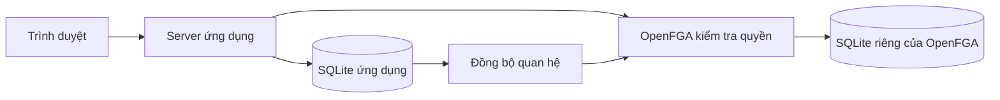
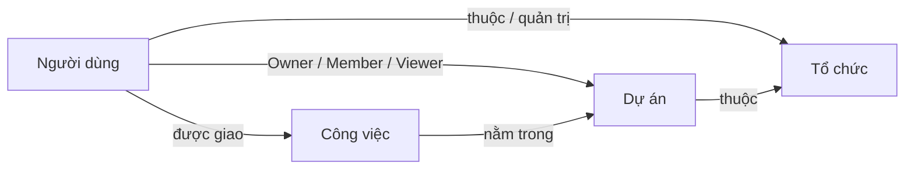
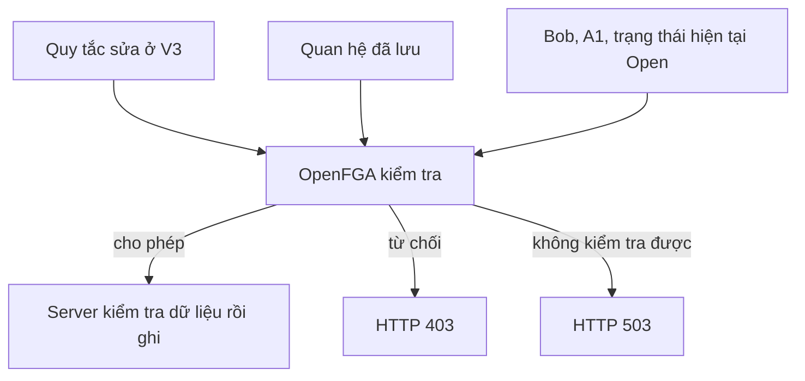
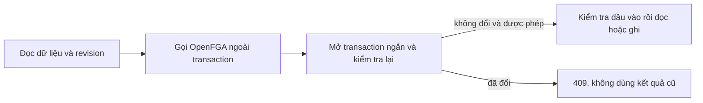

# Kiểm tra quyền truy cập với OpenFGA

Task Authorization Minilab · Cập nhật ngày 04/11/2026

## 01. Bài lab giải quyết vấn đề gì?

Một người đã đăng nhập không có nghĩa là họ được xem hoặc sửa mọi công việc. Ví dụ, Alice phụ trách dự án Alpha. Nếu Alice đổi ID trong request sang công việc B1 của Beta, server phải kiểm tra quyền ở Beta trước khi trả nội dung.

Bài lab dùng ứng dụng quản lý dự án và công việc để minh họa vấn đề này. Cùng một dữ liệu được chạy với năm bộ quy tắc: **Starter, V1, V2, V3 và V4**. Starter cố ý thiếu kiểm tra quyền trên tài nguyên. Các bản sau lần lượt giới hạn theo thành viên dự án, vai trò, người được giao việc và tổ chức.

**OpenFGA là service kiểm tra quyền được tích hợp vào ứng dụng.** Từ V1 đến V4, server hỏi OpenFGA trước khi cho đọc hoặc sửa tài nguyên. OpenFGA trả kết quả cho phép hoặc từ chối; server vẫn chịu trách nhiệm xử lý HTTP và thay đổi dữ liệu.



Ứng dụng web chạy trên máy local ở cổng 3000, OpenFGA ở cổng 8080 theo cấu hình mặc định. Có **hai database SQLite riêng**: một lưu dữ liệu ứng dụng, một do OpenFGA quản lý trên Docker volume. OpenFGA không đọc trực tiếp các bảng SQL của ứng dụng.

Cần phân biệt hai bước: **xác thực** là biết ai đang gửi yêu cầu; **kiểm tra quyền** là quyết định người đó có được làm việc cụ thể với tài nguyên cụ thể hay không. Lab mô phỏng xác thực bằng token demo, chưa có hệ thống đăng nhập thật.

## 02. Dữ liệu mẫu và các khái niệm cần biết

Trong report, project là dự án; task là công việc trong dự án; membership là việc một người tham gia dự án với một vai trò. Tenant được hiểu là tổ chức: người và dự án đều thuộc một tổ chức xác định.

| Tài khoản hoặc công việc | Dữ liệu ban đầu |
| --- | --- |
| Alice | Owner của dự án Alpha, thuộc tổ chức Alpha |
| Bob | Member của Alpha; được giao A1 đang Open và A2 đang Closed |
| Vera | Viewer của Alpha |
| Charlie | Owner của Beta, thuộc tổ chức Beta |
| Admin Alpha / Admin Beta | Quản trị viên của tổ chức tương ứng; ban đầu chưa tham gia dự án |
| A3 / A4 trong Alpha | A3 chưa giao cho ai; A4 được giao cho Alice |

Viewer, Member và Owner là **vai trò trong từng dự án**. Một người là Owner ở dự án này không tự có quyền ở dự án khác. Tenant admin là quyền quản trị ở cấp tổ chức, chỉ được dùng từ V4.



Được giao công việc và tham gia dự án là hai quan hệ khác nhau. Từ V3, Bob phải vừa là Member của Alpha, vừa được giao công việc đang Open thì mới sửa được. Nếu bị xóa khỏi Alpha, Bob mất quyền dù công việc vẫn ghi tên Bob là người được giao.

Dữ liệu gốc nằm ở `data/lab.sqlite`. Khi đồng bộ, ứng dụng chuyển các quan hệ cần cho việc xét quyền sang OpenFGA. Tiêu đề và mô tả công việc vẫn nằm trong SQLite ứng dụng, không được gửi sang OpenFGA.

## 03. OpenFGA trả lời câu hỏi về quyền như thế nào?

Giả sử Bob muốn sửa A1 ở V3. Server xác thực Bob, đọc A1 từ SQLite và biết rằng A1 thuộc Alpha, đang Open. Sau đó server hỏi OpenFGA: **“Bob có quyền sửa A1 theo quy tắc V3 không?”**

OpenFGA cần ba loại thông tin. **Model** mô tả quy tắc suy ra quyền. **Tuple** là một quan hệ đã lưu, chẳng hạn “Bob là Member của Alpha”. **Context** là dữ liệu bổ sung cho lần kiểm tra, ở đây là trạng thái hiện tại của A1 do server đọc từ SQLite.



| Thành phần | Ví dụ Bob sửa A1 |
| --- | --- |
| Quy tắc | Owner được sửa; Member chỉ được sửa việc được giao và đang Open. |
| Quan hệ đã lưu | Bob là Member Alpha; A1 thuộc Alpha; A1 được giao cho Bob. |
| Dữ liệu lần kiểm tra | Server truyền `current_status: Open`. |
| Câu hỏi trong API | `Check(user:bob, can_edit_v3, task:A1)` |
| Kết quả | Cho phép. Nếu thay A1 bằng A2 đang Closed, Bob bị từ chối. |

OpenFGA chỉ trả lời về quyền, không tự sửa công việc. Server chỉ tiếp tục khi nhận `allowed === true` và xác nhận dữ liệu chưa thay đổi trong lúc chờ. Nếu OpenFGA lỗi, server trả 503 thay vì tự cấp quyền.

Quy tắc nằm trong `openfga/model.fga`. Các quyền V1–V4 ở cùng một model; bộ chọn phiên bản quyết định server hỏi quyền nào. Store là vùng dữ liệu của lab trong OpenFGA. ID của store và model được lưu cố định trong SQLite ứng dụng để lần sau dùng lại đúng cấu hình.

## 04. Vì sao cần lần lượt Starter, V1, V2, V3 và V4?

Mỗi phiên bản xử lý một điểm còn thiếu của bản trước. Bảng dưới áp dụng với dữ liệu mẫu, trước khi người dùng sửa hoặc xóa dữ liệu.

| Phiên bản | Điểm còn thiếu trước đó | Quy tắc bổ sung và ví dụ |
| --- | --- | --- |
| Starter | Chưa kiểm tra quyền trên từng tài nguyên | Chỉ cần token hợp lệ. Alice đọc B1 của Beta được dù không tham gia Beta. Đây là lỗi cố ý của lab. |
| V1 | Biết ID là có thể truy cập | Yêu cầu tham gia dự án chứa tài nguyên. Alice không còn đọc được B1. Tuy nhiên, mọi vai trò trong dự án vẫn có quyền thao tác rộng. |
| V2 | Viewer và Member có thể sửa, xóa hoặc quản lý thành viên như Owner | Phân quyền theo vai trò. Vera là Viewer nên vẫn đọc A1 được, nhưng không được sửa. |
| V3 | Member sửa được mọi công việc trong dự án | Member chỉ sửa việc được giao cho mình và đang Open. Bob sửa A1 được; A2 Closed, A3 chưa giao và A4 giao Alice đều bị chặn. |
| V4 | Chưa giới hạn theo tổ chức và chưa có quyền admin tổ chức | Phải cùng tổ chức với dự án. Admin Alpha được quản trị Alpha dù chưa tham gia, nhưng không được truy cập Beta. |

V4 giữ điều kiện V3 với người dùng thường và thêm quyền quản trị có phạm vi. Admin chỉ có đặc quyền trong tổ chức của mình. Ở V1–V3, tài khoản admin chưa có membership vẫn bị từ chối như người ngoài dự án.

V1–V3 chưa kiểm tra ranh giới tổ chức. Nếu membership khác tổ chức được tạo ở một bản trước, V4 vẫn chặn người đó truy cập dự án khác tổ chức.

Việc được chọn Starter hay V1 chỉ phục vụ so sánh trong lab. Khi triển khai ứng dụng thực tế, server phải quyết định bộ quy tắc được dùng; người dùng không được chọn bản yếu hơn để bỏ qua kiểm tra.

Trong thuật ngữ phân quyền, V2 minh họa **RBAC**: gán quyền theo vai trò. Quan hệ tham gia dự án và được giao việc thể hiện **ReBAC**: xét quyền theo quan hệ giữa người và tài nguyên. Điều kiện trạng thái Open và tổ chức thuộc **ABAC**: xét thêm thuộc tính của người hoặc tài nguyên. Các cách này được kết hợp trong cùng quy tắc.

## 05. Quyền cụ thể và những trường hợp dễ nhầm

| Hành động | Viewer | Member | Owner |
| --- | --- | --- | --- |
| Đọc dự án và công việc từ V2 | Có | Có | Có |
| Sửa công việc ở V2 | Không | Có | Có |
| Sửa công việc ở V3/V4 | Không | Chỉ việc được giao và đang Open | Có, kể cả Closed |
| Xem/thêm/đổi/xóa thành viên từ V2 | Không | Không | Có |
| Xóa dự án từ V2 | Không | Không | Có |

Ở V4, mọi quyền trên đều cần cùng tổ chức. Admin trong tổ chức có quyền tương đương Owner mà không cần membership. Admin vẫn chịu kiểm tra dữ liệu đầu vào và quy tắc nghiệp vụ.

**Trạng thái được xét là trạng thái trước khi sửa.** Bob có thể đóng A1 đang Open. Sau khi A1 đã Closed, Bob không thể gửi `status: Open` để tự mở lại: server đọc trạng thái Closed từ database trước khi xét quyền. Owner hoặc admin hợp lệ có thể mở lại.

**Được phép quản lý thành viên chưa có nghĩa được đổi Owner.** Lab giữ Owner cố định. Kể cả người có quyền quản lý cũng nhận HTTP 409 nếu cố xóa hoặc hạ vai trò Owner. Tương tự, người có quyền sửa vẫn có thể nhận HTTP 400 nếu gửi dữ liệu không hợp lệ.

**Danh mục tên dự án không phải nội dung dự án.** Lab cho tài khoản đã xác thực thấy ID/tên mọi dự án để thử truy cập. Mở dự án, đọc công việc và quản lý thành viên vẫn được kiểm tra riêng. Các nút vẫn hiện khi thiếu quyền để người học quan sát server từ chối request thật.

Server lấy vai trò, tổ chức, người được giao và trạng thái từ dữ liệu của mình. Header/query tự khai vai trò không làm tăng quyền. API sửa task chỉ nhận tiêu đề, mô tả và trạng thái; client không được tự chọn model hay tên quyền OpenFGA ngoài ánh xạ đã định nghĩa.

## 06. Nếu dữ liệu đổi trong lúc chờ OpenFGA thì sao?

OpenFGA là service riêng nên một lần kiểm tra quyền phải đi qua mạng. Trong thời gian chờ, công việc có thể bị đóng hoặc Bob có thể bị thu hồi quyền. Kết quả cho phép dựa trên dữ liệu cũ khi đó không còn đủ để thực hiện thao tác.

Server xử lý theo ba bước: đọc dữ liệu cùng số phiên bản thay đổi; gọi OpenFGA; rồi kiểm tra lại số phiên bản trước khi trả nội dung hoặc ghi dữ liệu. Số này được gọi là **revision**. Nếu revision khác, server trả HTTP 409 với mã `AUTHORIZATION_CONTEXT_CHANGED`.



Ví dụ: server đọc A1 đang Open và bắt đầu hỏi quyền của Bob. Trong lúc chờ, Owner đóng A1. Dù OpenFGA trả cho phép theo thông tin trước đó, server thấy revision đã đổi và không sửa A1 bằng kết quả cũ. Cách kiểm tra này áp dụng cả khi kết quả cũ là từ chối.

Transaction là nhóm thao tác SQL cùng thành công hoặc cùng được hoàn tác. Server dùng transaction ngắn cho bước đọc ban đầu và bước kiểm tra rồi thực hiện cuối cùng. Server không giữ transaction SQLite mở trong lúc chờ HTTP, để tránh giữ khóa database quá lâu.

Các trigger SQL tăng revision khi dữ liệu thay đổi, gồm cả xóa liên quan và reset. Revision theo dõi nội dung và revision cần đồng bộ quyền có mục đích khác nhau: đổi tiêu đề làm quyết định đang chờ trở nên cũ, nhưng không cần tạo tuple mới.

Khi gặp 409 do dữ liệu thay đổi, người dùng nên tải lại thông tin trước khi thao tác lại. Đây khác với lỗi 403 thiếu quyền hoặc lỗi 503 không kiểm tra được quyền.

## 07. Vì sao phải đồng bộ và HTTP 202 có nghĩa gì?

Khi đổi Bob từ Member thành Viewer, SQLite ứng dụng phải lưu vai trò mới và OpenFGA cũng phải bỏ quan hệ Member cũ. Hai database không có một transaction chung, nên không thể coi hai lần ghi luôn thành công cùng lúc.

Ứng dụng ghi thay đổi nghiệp vụ và một dấu mốc cần đồng bộ vào SQLite trong cùng transaction. Dấu mốc này nằm trong **outbox**: nơi ghi lại rằng dữ liệu quyền cần được cập nhật. Sau đó bộ đồng bộ đối chiếu các quan hệ trong OpenFGA với SQLite, xóa quan hệ cũ và ghi quan hệ mới.

Trong lúc đồng bộ chưa xong, ứng dụng tạm chặn các API được bảo vệ ở V1–V4. Chỉ khi quan hệ đã khớp và store/model đúng, các API này mới sẵn sàng trở lại. Cách này tránh dùng quyền cũ khi việc thu hồi quyền chưa hoàn tất.

| Kết quả | Ý nghĩa đối với người dùng |
| --- | --- |
| 200/201 sau thay đổi quan hệ | Dữ liệu đã lưu và quyền đã đồng bộ xong. |
| 202, `committed: true` | Dữ liệu đã lưu, nhưng đồng bộ quyền chưa thành công. Không gửi lại thao tác thêm/xóa. |
| 403 | Đã kiểm tra và xác định không có quyền; thao tác bị chặn. |
| 503 | Engine lỗi hoặc dữ liệu quyền chưa sẵn sàng; không thể thực hiện yêu cầu được bảo vệ. |
| 409 do context thay đổi | Dữ liệu thay đổi khi đang kiểm tra; cần tải lại. |

Với HTTP 202, giao diện báo **đã lưu thay đổi, đang cập nhật quyền truy cập**. Người gọi có thể xem trạng thái thao tác hoặc chọn **Đồng bộ lại**. Mỗi thao tác có operation ID; API chỉ cho tài khoản đã thực hiện xem trạng thái của nó.

Thông tin chờ đồng bộ được giữ qua lần khởi động lại. Có thể phục hồi bằng nút trên giao diện, lệnh `fga:sync` hoặc khởi động lại app. Chưa có worker nền tự thử lại liên tục. Cơ chế giữ lượt đồng bộ có thời hạn 30 giây; nếu process bị tắt đột ngột, có thể cần chờ hết hạn trước khi đồng bộ lại.

## 08. Những lựa chọn kỹ thuật và chi phí đi kèm

| Lựa chọn | Vì sao chọn và phải chấp nhận điều gì? |
| --- | --- |
| SQLite lưu dữ liệu gốc của ứng dụng | Giữ truy vấn danh sách thành viên, ràng buộc SQL và reset dữ liệu mẫu. Đổi lại, phải đồng bộ quan hệ sang OpenFGA. |
| Lưu quan hệ thật trong OpenFGA | Quan sát được cách engine lưu và suy ra quyền. Đổi lại, cần xử lý khi hai bên chưa đồng bộ. |
| Dùng cùng một model cho V1–V4 | Dễ so sánh trên cùng dữ liệu. Model có nhiều quyền theo phiên bản; việc đổi model đã gắn với database phải được xử lý riêng. |
| Truyền trạng thái hiện tại khi Check | Đóng công việc không cần ghi lại tuple. Server phải lấy trạng thái từ database và kiểm tra revision trước khi dùng kết quả. |
| Đối chiếu toàn bộ quan hệ của store lab | Dễ xác định trạng thái đúng sau lỗi. Cách này chưa được tối ưu cho dữ liệu lớn. |
| OpenFGA dùng SQLite trên Docker volume | Chạy local với ít service, giữ dữ liệu qua restart. Chưa kiểm chứng tải lớn hoặc nhiều engine cùng truy cập file. |

**Lưu membership ở cả hai bên là lựa chọn của ứng dụng này.** OpenFGA không bắt buộc sao chép bảng membership. Một phương án khác là quản lý membership trực tiếp trong OpenFGA, rồi ghép tên người dùng từ SQLite khi hiển thị. Phương án đó chưa được triển khai và sẽ cần sửa các API thành viên, reset và xóa dự án.

Ba bảng `authorization_state`, `authorization_outbox`, `authorization_operations` lần lượt lưu cấu hình/trạng thái đồng bộ, dấu mốc cần cập nhật, và thông tin theo dõi thao tác đã lưu nhưng còn chờ. Đây là các bảng của ứng dụng để phối hợp hai hệ thống.

OpenFGA Check có timeout và không tự retry trong SDK của lab. Server không dùng một bộ quy tắc local để tự cấp quyền khi engine lỗi. Phần giải thích lý do bị từ chối chỉ giúp hiển thị thông báo; kết quả cấp quyền vẫn đến từ OpenFGA.

OpenFGA là dự án mã nguồn mở lấy cảm hứng từ mô hình quan hệ của Zanzibar. Report mô tả cách tích hợp trong lab, không khẳng định lab đạt quy mô hoặc mức nhất quán của hệ thống Google. Có thể xem [mã nguồn OpenFGA](https://github.com/openfga/openfga) và [hướng dẫn chọn nơi lưu dữ liệu gốc](https://openfga.dev/docs/best-practices/source-of-truth).

## 09. Đã kiểm chứng những gì?

Bộ bằng chứng được lưu tại `evidence/openfga/`, cập nhật ngày 04/11/2026. Log kiểm thử ghi **69/69 tests đạt**; riêng ma trận model kiểm tra **432 quyết định quyền** trên OpenFGA thật. Manifest ghi thời điểm, hash nguồn và artifact của lần chạy đã lưu; mở report không tự chạy lại test.

| Nhóm kiểm tra | Điều cần xác nhận |
| --- | --- |
| Quyền theo tài khoản/phiên bản | Kết quả cho phép hoặc từ chối đúng với quy tắc; bị chặn thì không sửa dữ liệu. |
| Quan hệ bị thay đổi | Đổi role hoặc thu hồi membership không để lại quyền cũ; V4 vẫn chặn khác tổ chức. |
| Dữ liệu đổi khi đang Check | Sửa trạng thái, thu hồi quyền, reset hoặc xóa dự án làm quyết định cũ không còn được dùng. |
| Lỗi engine và đồng bộ | Timeout, model sai, ghi quan hệ dở và trạng thái pending được xử lý; phục hồi không lặp thao tác nghiệp vụ. |
| Giao diện | Thử form, đổi phiên bản/tài khoản, pending và màn hình nhỏ; khôi phục từ 503 sau điều hướng/tải lại trang, không lặp mutation, bỏ qua phản hồi đồng bộ của tài khoản cũ. |
| Khởi động lại | Dữ liệu ứng dụng, store/model ID và quyền được giữ qua restart; init lặp không tự reset dữ liệu. |

Regression IDOR cố ý thất bại ở Starter vì Alice đọc được công việc của Beta. Cùng yêu cầu đó phải bị chặn ở V1. Kết quả đỏ ở Starter là dấu hiệu tái hiện đúng lỗ hổng, không phải mục tiêu phải sửa cho xanh.

Snapshot `before` trong bằng chứng là bản authentication-only được tái dựng để so sánh; không phải lịch sử commit gốc. Các artifact ở thư mục `evidence/` cấp ngoài thuộc bản trước khi tích hợp OpenFGA. Khi đối chiếu, cần đọc đúng manifest và hash của từng bộ.

Kiểm thử dùng SQLite và store riêng để không reset dữ liệu đang demo. Các lệnh tái hiện và yêu cầu môi trường nằm trong README. Bằng chứng local chưa thay thế nghiệm thu trực tiếp, chạy CI trên môi trường hosted hoặc kiểm thử tải.

## 10. Các API hiện có

Ứng dụng có **10 API nghiệp vụ** và **4 API hỗ trợ lab**. Địa chỉ mặc định là `http://127.0.0.1:3000`. Các API nghiệp vụ dùng tiền tố `/api/:version`, trong đó `:version` là `starter`, `v1`, `v2`, `v3` hoặc `v4`. Ví dụ: `GET /api/v3/tasks/A1`.

Mọi API nghiệp vụ cần header `Authorization: Bearer <token>`, chẳng hạn `Bearer demo-alice`. Các phiên bản có cùng endpoint, chỉ khác quy tắc kiểm tra quyền.

| Method | Đường dẫn sau `/api/:version` | Chức năng |
| --- | --- | --- |
| GET | `/projects` | Liệt kê ID/tên mọi dự án để thử truy cập; không trả nội dung. |
| GET | `/projects/:id` | Xem thông tin một dự án theo quyền. |
| GET | `/projects/:id/tasks` | Xem danh sách công việc trong dự án theo quyền. |
| GET | `/tasks/:id` | Xem chi tiết một công việc. |
| PATCH | `/tasks/:id` | Sửa `title`, `description`, `status` (Open/Closed). |
| DELETE | `/projects/:id` | Xóa dự án cùng công việc và membership liên quan. |
| GET | `/projects/:id/members` | Xem danh sách thành viên; cần quyền quản lý thành viên. |
| POST | `/projects/:id/members` | Thêm thành viên bằng `userId` và `role` (Viewer/Member). |
| PATCH | `/projects/:id/members/:userId` | Đổi `role` thành Viewer hoặc Member; không đổi Owner. |
| DELETE | `/projects/:id/members/:userId` | Xóa thành viên khỏi dự án; không xóa Owner. |

Các API hỗ trợ lab nằm ngoài tiền tố phiên bản:

| Method | Đường dẫn | Chức năng và yêu cầu |
| --- | --- | --- |
| GET | `/lab/config` | Lấy phiên bản, tài khoản/token demo và ID mẫu; không cần token. |
| POST | `/lab/reset` | Nạp lại dữ liệu mẫu và đồng bộ quyền; không bắt buộc token, có kiểm tra Origin. |
| POST | `/lab/sync` | Đồng bộ lại quyền; cần token hợp lệ và kiểm tra Origin. |
| GET | `/lab/operations/:operationId` | Xem trạng thái đồng bộ; chỉ tài khoản đã thực hiện được xem. |

Tab Thành viên giữ danh sách cùng nút đổi vai trò/xóa ở từng hàng. Để thử API thêm thành viên hoặc request tùy chỉnh, dùng **Công cụ demo nâng cao**. Hiện chưa có API tạo dự án, tạo/xóa công việc hoặc đăng ký/đăng nhập thật; dữ liệu ban đầu được nạp bằng seed/reset.

## 11. Khởi động và trình bày demo

Trên Windows, cài Node.js từ 22.17 và mở Docker Desktop trước. Sau khi clone, chạy `start.bat`. Script tự tạo `.env` nếu thiếu, cài dependency, chạy OpenFGA, đồng bộ quyền và mở server ứng dụng. Lần sau vẫn chạy cùng file; cấu hình và dữ liệu cũ được giữ lại.

Nếu muốn chạy từng bước bằng PowerShell tại thư mục dự án:

```powershell
if (-not (Test-Path .env)) { Copy-Item .env.example .env }
npm.cmd ci
docker compose up -d --wait
npm.cmd run fga:init
npm.cmd start
```

Mở `http://127.0.0.1:3000`, hoặc cổng đã đặt trong `.env`. Chọn Alice, mở Beta ở Starter rồi chuyển sang V1 để thấy server từ chối. Tiếp theo dùng Vera sửa A1 ở V1/V2, Bob sửa A2 ở V2/V3, và Admin Alpha mở Alpha/Beta ở V4. Dùng dữ liệu mẫu để kết quả khớp với ví dụ trong report.

Mở **Chi tiết kỹ thuật** sau mỗi thao tác. `OpenFGA Check` cho biết lần hỏi quyền; `Authorization decision` cho biết cho phép hay từ chối; `Request outcome` là kết quả cuối của cả request. Có quyền chưa chắc thao tác thành công vì còn kiểm tra đầu vào và quy tắc Owner cố định.

Nhấn Ctrl+C để dừng web app. `docker compose down` dừng OpenFGA và giữ volume. Muốn khôi phục dữ liệu mẫu, dùng nút trên giao diện hoặc `npm.cmd run db:reset` khi OpenFGA đang chạy; lệnh này xóa các chỉnh sửa nghiệp vụ hiện có.

Hướng dẫn đầy đủ về `.env`, chạy từng service, kiểm thử và xử lý lỗi ở [README.md](README.md). Lab hiện phục vụ học và demo trên máy local: token giả lập, Starter cố ý yếu, có bộ chọn phiên bản và công cụ reset. Chưa có đăng nhập thật, triển khai hosted hoặc kiểm chứng nhiều app instance.

## 12. Danh sách thành viên nhóm

| Nhóm | MSSV | Họ và tên |
| --- | --- | --- |
| 5 | 23127271 | Võ Ngọc Bích Trâm |
| 5 | 23127158 | Nguyễn Thanh Gia Bảo |
| 5 | 23127207 | Đặng Đăng Khoa |
| 5 | 23127006 | Trần Nguyễn Khải Luân |
| 5 | 23127179 | Nguyễn Bảo Duy |
