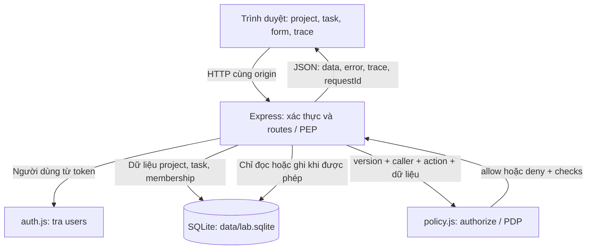
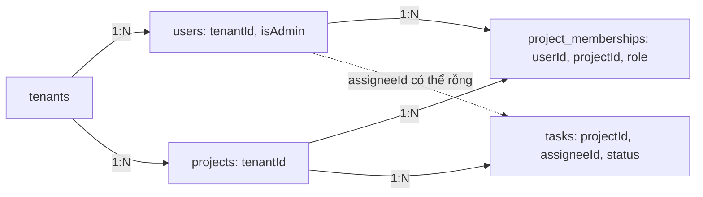
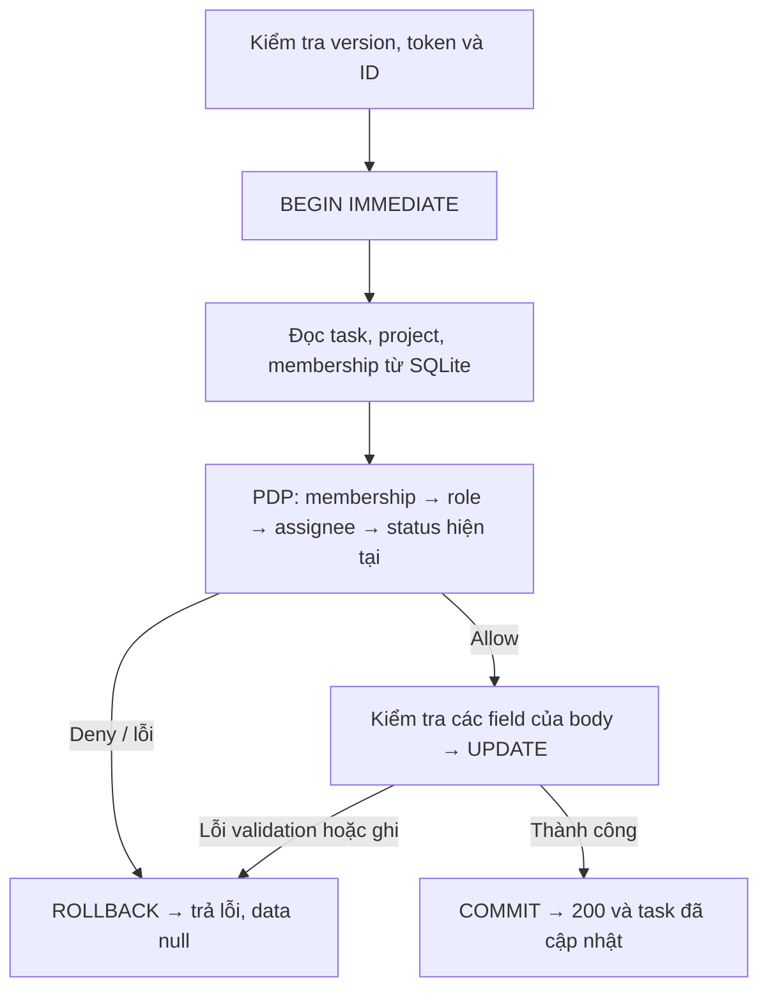

# Triển khai Task Authorization Minilab

Báo cáo hiện trạng · 29/10/2026 · Đọc theo thứ tự 01–09

## 01. Kiến trúc: quyền nằm ở server

Ứng dụng mô phỏng quản lý công việc trong hai tổ chức (tenant) Alpha và Beta. Người dùng mở project, đọc/sửa task, quản lý thành viên và xóa project. Cùng một thao tác được chạy qua năm mức policy **Starter → V1 → V2 → V3 → V4** để thấy chính xác lớp kiểm tra nào thay đổi kết quả.

Câu hỏi xuyên suốt là: **đăng nhập được rồi, liệu người này có quyền trên đúng tài nguyên đang yêu cầu?** Starter cố ý bỏ qua câu hỏi đó. V1 bắt đầu kiểm tra membership; các bản sau bổ sung role, người được giao task, trạng thái và ranh giới tenant.

**Cách đọc sơ đồ.** Trình duyệt gửi yêu cầu, Express xác định người gọi và tải dữ liệu cần xét quyền. Hàm `authorize()` quyết định cho phép hay từ chối. Route nhận quyết định đó rồi mới trả nội dung hoặc ghi thay đổi. SQLite lưu cả dữ liệu nghiệp vụ lẫn thông tin dùng để xét quyền. Đây là các khối logic trong cùng một process, không phải nhiều dịch vụ mạng.

**PEP** (Policy Enforcement Point) là nơi thực thi quyết định, nằm trong wrapper `endpoint()` của route. **PDP** (Policy Decision Point) là nơi tính quyết định, nằm trong `policy.js`. PDP không tự ghi database; PEP phải chặn trước khi gọi phần xử lý nghiệp vụ.

UI và API được Express phục vụ tại `http://127.0.0.1:3000`. UI dùng HTML/CSS/JavaScript thuần; server chỉ bind loopback. Các nút vẫn xuất hiện để người học thử cả trường hợp bị từ chối. Việc ẩn hoặc hiện nút không quyết định quyền truy cập.

**Phạm vi hiện có:** đọc project và task, sửa task, quản lý membership, xóa project, reset dữ liệu và xem trace. Chưa có tạo project/task, xóa task, đăng nhập thật hay triển khai nhiều process.

## 02. Dữ liệu: phân biệt danh tính, role và quan hệ

SQLite có năm bảng. `users` xác định một người thuộc tenant nào và có phải tenant admin hay không. Role Viewer/Member/Owner nằm ở `project_memberships`, vì một người có thể có quyền khác nhau trong từng project. `tasks.assigneeId` ghi người được giao việc; quan hệ này không tự cấp quyền thành viên.

### Dữ liệu mẫu để đối chiếu

| Tài khoản | Tenant | Vai trò trong dữ liệu seed |
| --- | --- | --- |
| Alice | Alpha | Owner của project Alpha |
| Bob | Alpha | Member của Alpha; được giao A1 và A2 |
| Vera | Alpha | Viewer của Alpha |
| Charlie | Beta | Owner của project Beta |
| Admin Alpha / Admin Beta | Tương ứng | Tenant admin, ban đầu không có membership |

Alpha có A1 (Bob, Open), A2 (Bob, Closed), A3 (chưa giao, Open), A4 (Alice, Open). Beta có B1 (Charlie, Open) và B2 (chưa giao, Open). Các ID cố định giúp so sánh policy mà không cần tạo thêm dữ liệu.

### Danh tính được xác định như thế nào?

Client gửi `Authorization: Bearer demo-bob`. `authenticate()` chỉ nhận các định danh demo đã liệt kê, sau đó truy vấn bảng `users`. Principal dùng để xét quyền gồm thông tin người dùng từ database. Đây là mô phỏng xác thực bằng token công khai; màn hình chọn tài khoản không kiểm tra mật khẩu, không phát JWT và không có phiên đăng nhập bảo mật.

Role của caller được đọc lại từ membership của **đúng project chứa tài nguyên**. Query `role=Admin`, header `X-Role` hay `X-Tenant-Id` không được dùng làm đầu vào cấp quyền. Với task, project được lấy từ `task.projectId` trong database, không lấy từ một project do caller tự khai.

**Ví dụ:** Bob vẫn là assignee của A1 sau khi Alice xóa membership của Bob. Request tiếp theo của Bob bị từ chối vì bước membership thất bại trước bước assignee. Được giao việc và còn quyền tham gia project là hai điều kiện riêng.

## 03. Năm policy thay đổi điều gì?

Mỗi version dùng cùng routes và database. Bảng dưới áp dụng cho các API nội dung/nghiệp vụ; danh mục tên project có ngoại lệ riêng ở trang 05. Starter và V1 vẫn kiểm tra dữ liệu đầu vào, ràng buộc database và Owner cố định.

| Version | Cơ chế quyết định | Hành vi dễ quan sát |
| --- | --- | --- |
| Starter | Có token hợp lệ là qua bước xét quyền đối tượng | Alice đọc B1 của Beta được; đây là lỗi IDOR cố ý |
| V1 | Phải có membership trong project chứa tài nguyên | Alice bị chặn ở Beta; Vera vẫn sửa task trong Alpha được |
| V2 | Sau membership, xét role theo action | Viewer chỉ đọc; Member đọc/sửa; Owner quản lý và xóa |
| V3 | Member sửa task phải là assignee và task hiện tại còn Open | Bob sửa A1 được; A2, A3, A4 bị chặn |
| V4 | Xét tenant trước; admin cùng tenant được quyền tương đương Owner | Admin Alpha mở Alpha được dù chưa có membership; Beta bị chặn |

### Role không đủ để diễn tả mọi điều kiện

Membership tạo danh sách quyền truy cập theo project (ACL). V2 gom quyền theo role (RBAC). V3 bổ sung quan hệ người dùng–task (ReBAC) và thuộc tính trạng thái (ABAC). V4 thêm điều kiện tenant. Các khái niệm này cùng xuất hiện trong một chuỗi kiểm tra; hệ thống không chạy bốn engine phân quyền riêng.

Từ V2, action `read` cho mọi role có membership; `edit` cho Member/Owner; `delete` và `members` cho Owner. Vì vậy, **Viewer đọc được task nhưng không được xem danh sách thành viên**: API members dùng action `members`, không dùng `read`.

### Các ngoại lệ có chủ đích

**Owner ở V3/V4** được sửa cả task Closed và task giao cho người khác. Điều kiện assignee/Open chỉ áp dụng với Member. Member có thể đóng task Open của mình, nhưng request mở lại bị chặn vì trạng thái trước khi ghi đã là Closed.

**Admin ở V4** được xét sau khi kiểm tra tenant. Nếu khác tenant, server trả `TENANT_MISMATCH` ngay; cờ admin không vượt qua bước này. Nếu cùng tenant, PDP cho phép mà không cần membership. Phần xử lý nghiệp vụ vẫn kiểm tra payload, Owner cố định và tenant của người được thêm vào project.

V1–V3 không có tenant boundary riêng. V4 cũng không hoàn toàn là “thêm một điều kiện”: nó vừa siết ranh giới tenant, vừa mở ngoại lệ admin trong tenant. Không có đặc quyền admin ở V1–V3 khi người đó chưa có membership.

## 04. Một lần sửa task đi qua những bước nào?

Xét Bob gửi `PATCH /api/v3/tasks/A1` với body `{"status":"Closed"}`. Token chứng minh danh tính demo; quyết định sửa vẫn dựa vào project, membership, assignee và trạng thái hiện tại lấy từ server.

### Vì sao đọc, xét quyền và ghi trong cùng transaction?

Wrapper `endpoint()` đưa các thao tác khác GET vào `transaction(db, execute)`. `BEGIN IMMEDIATE` bắt đầu transaction ghi trước khi tải tài nguyên và membership. Các truy vấn tiếp theo, lời gọi PDP và câu UPDATE chạy đồng bộ trên cùng connection. Thành công thì `COMMIT`; ném lỗi ở bất kỳ bước nào trong callback thì `ROLLBACK`.

Nhờ vậy, quyết định dựa trên trạng thái vừa đọc trong transaction ghi; không có bước `await` ra ngoài giữa xét quyền và cập nhật. SQLite chỉ cho một writer tại một thời điểm. `busy_timeout = 3000` cho phép chờ khóa trong giới hạn cấu hình, không chứng minh khả năng chịu tải đồng thời.

### Không xét quyền bằng trạng thái người dùng muốn ghi

A1 đang Open, Bob là Member và assignee nên được đóng task. Ở request tiếp theo, dù Bob gửi `{"status":"Open"}`, PDP vẫn nhìn thấy A1 đang Closed trong database và từ chối. Nếu xét theo status trong body, caller có thể tự khai Open để vượt điều kiện.

`PATCH` chỉ nhận `title`, `description`, `status`; không nhận `assigneeId`, `projectId`, `tenantId` hoặc role. Sau khi được cấp quyền, route kiểm tra field hợp lệ rồi mới UPDATE. Caller thiếu quyền có thể nhận 403 trước khi lỗi field được đánh giá; lỗi JSON hỏng được middleware bắt sớm hơn.

**Đọc dữ liệu:** GET tải tài nguyên và membership rồi xét quyền trước khi trả nội dung, nhưng không được bọc trong transaction ghi này. Chưa kiểm thử tranh chấp nhiều process; không suy rộng cơ chế local thành bảo đảm cho hệ thống phân tán.

## 05. API và ranh giới dữ liệu trả về

Các đường dẫn dưới có prefix `/api/:version`, với version là `starter`, `v1`, `v2`, `v3`, `v4`. Mọi API trong nhóm này yêu cầu token hợp lệ. Hai endpoint hỗ trợ lab `/lab/config` và `/lab/reset` nằm ngoài nhóm đó.

| Method và đường dẫn | Ý nghĩa / action |
| --- | --- |
| GET `/projects` | Danh mục ID/tên project; ngoại lệ khám phá của lab |
| GET `/projects/:id` | Nội dung project / `read` |
| GET `/projects/:id/tasks` | Danh sách task của project / `read` |
| GET `/tasks/:id` | Một task / `read` |
| PATCH `/tasks/:id` | Sửa title, description, status / `edit` |
| DELETE `/projects/:id` | Xóa project và dữ liệu phụ thuộc / `delete` |
| GET, POST `/projects/:id/members` | Xem hoặc thêm membership / `members` |
| PATCH, DELETE `/projects/:id/members/:userId` | Đổi role hoặc xóa membership / `members` |

### Thấy tên project không có nghĩa là xem được task

Danh mục cố ý trả ID/tên mọi project đang tồn tại cho người đã xác thực, ở mọi version. Nó không trả tenant, task count, task hay members. Nhờ vậy Alice có thể chọn Beta để thử một lần truy cập bị từ chối. API mở project và liệt kê task vẫn đi qua PDP; từ V1, Alice không nhận được nội dung Beta nếu chưa có membership phù hợp.

Đây là quyết định phục vụ demo, có đánh đổi là tên project được khám phá ngoài phạm vi tenant. Nếu triển khai thật, cần quyết định lại danh mục có phải lọc theo quyền hay không; không mặc nhiên giữ ngoại lệ này.

### Kết quả có cùng khuôn dạng

Response API dùng `{ data, error, trace, requestId }`. Khi bị từ chối, `data` là `null`; trace ghi những bước đã thực sự chạy và lý do dừng. Trace không chứa bearer token hoặc nội dung task bị chặn. `requestId` là UUID cho request, chưa có kho audit log bền vững để tra cứu lại.

| HTTP status | Khi nào xuất hiện |
| --- | --- |
| 200 / 201 | Đọc hoặc mutation thành công / tạo membership thành công |
| 400 | ID, JSON hoặc payload không hợp lệ |
| 401 / 403 | Thiếu/sai token / đã xác thực nhưng bị policy hoặc quy tắc nghiệp vụ chặn |
| 404 / 409 | Không có tài nguyên, version, route / membership trùng hoặc đổi/xóa Owner |

Xóa hiện trả **200 kèm JSON**, không trả 204. Phân biệt 403 và 404 giúp giải thích policy, nhưng có thể tiết lộ một ID tồn tại. Response đặt `Cache-Control: no-store`; trace chi tiết chỉ thích hợp với mục đích lab hiện tại.

## 06. Quyết định kỹ thuật: tổ chức ứng dụng và policy

Các quyết định dưới đây phản ánh cách triển khai hiện tại. Mỗi lựa chọn được giải thích bằng cơ chế và giới hạn cụ thể.

### 1. Một process Node.js, Express phục vụ cả UI và API

**Lý do chọn:** bài toán chính là authorization; một lệnh khởi động giúp tập trung vào luồng request thay vì dựng nhiều dịch vụ. UI gọi URL tương đối `/api/...`, nên HTML và API cùng origin, không cần cấu hình trao đổi giữa hai frontend/backend origin riêng.

**Cơ chế:** `server.js` mở app tại loopback; `createApp()` gắn router API và middleware phục vụ thư mục `public`. Node dùng ESM, Express 5, SQLite tích hợp qua `node:sqlite`; không có bước build UI.

**Đánh đổi:** UI tự quản lý DOM, form và trạng thái; database đồng bộ có thể chặn event loop khi truy vấn lâu. React với API tách riêng hoặc PostgreSQL có thể phù hợp khi nhu cầu tăng, nhưng thêm cấu hình mà bài lab hiện chưa cần.

### 2. Cùng code và dữ liệu, đổi policy qua URL

**Lý do chọn:** giữ nguyên người dùng và tài nguyên khi so sánh giúp nhìn ra tác động của từng policy. Nếu tách thành năm ứng dụng, khác biệt fixture hoặc route dễ làm sai kết luận.

**Cơ chế:** middleware đọc `:version`, chỉ chấp nhận năm giá trị khai báo; routes gọi cùng `authorize(version, principal, action, context)`. Dữ liệu sửa ở V1 cũng được thấy ở V4 vì không có database riêng theo version.

**Lưu ý về tenant và chuyển version:** đây là một ứng dụng dùng chung schema và file `data/lab.sqlite`, không phải năm bản database theo lịch sử nâng cấp. Bảng `tenants`, các trường `tenantId` và cờ `isAdmin` đã có trong seed từ đầu, nhưng **chỉ V4 dùng chúng để enforce tenant boundary và đặc quyền tenant admin**. Starter–V3 chưa áp dụng lớp bảo vệ này; chẳng hạn V1 chặn Alice đọc B1 vì thiếu membership, còn V4 chặn vì khác tenant.

Khi bấm đổi version, UI đổi prefix request (ví dụ `/api/v1/tasks/B1` → `/api/v4/tasks/B1`), dọn dữ liệu hiển thị/lịch sử cũ rồi tải lại; server chọn policy theo URL. **Không đổi database, chạy migration hoặc tự reset dữ liệu.** Đây là lựa chọn để so sánh policy trên cùng tài nguyên; chưa mô phỏng quá trình thêm schema tenant ở giai đoạn V4. Nếu bài nộp yêu cầu chứng minh cả lịch sử nâng cấp schema, cần bổ sung migration hoặc các bản checkout tương ứng.

**Đánh đổi:** phải reset trước các ca làm thay đổi trạng thái hoặc xóa dữ liệu. Starter cố ý cho truy cập trái quyền; cơ chế chọn bản yếu qua URL chỉ dùng để học, không phải cách cung cấp nhiều mức bảo vệ cho một dịch vụ thật.

### 3. PDP tập trung, PEP bắt buộc trước nội dung/nghiệp vụ

**Lý do chọn:** viết điều kiện ở từng route dễ bỏ sót kiểm tra hoặc dùng các cách hiểu role khác nhau. Một hàm policy nhỏ giúp đối chiếu trực tiếp với bảng quyền.

**Cơ chế:** `endpoint(action, kind, work)` tải tài nguyên theo ID, tìm project chứa nó và membership của caller, rồi gọi PDP. Chỉ khi `allowed` mới chạy `work`. Kết quả PDP kèm `checks`, nên trace phản ánh nhánh thực tế, kể cả các bước bị bỏ qua ở Starter.

**Đánh đổi:** route mới vẫn phải gắn wrapper/action đúng; hàm policy tập trung không tự bảo vệ một route viết ngoài wrapper. Danh mục project là ngoại lệ được viết riêng. Chưa cần policy engine ngoài process; việc đó chỉ có ích khi nhiều dịch vụ cần chung một hệ chính sách.

## 07. Quyết định kỹ thuật: lưu trữ và tính toàn vẹn

### 4. SQLite bền vững, SQL trực tiếp có tham số

**Lý do chọn:** cần chứng minh thay đổi được lưu qua restart và các quan hệ được ràng buộc, nhưng không cần một database server riêng. Dữ liệu RAM/JSON đơn giản hơn nhưng không cung cấp cùng cơ chế transaction và foreign key.

**Cơ chế:** `DatabaseSync` mở `data/lab.sqlite`, bật foreign keys và tạo schema nếu chưa có. Giá trị nhận từ request được truyền qua tham số `?` trong prepared statement. Index hỗ trợ tìm membership theo user và task theo project; khóa chính ghép `(projectId, userId)` ngăn trùng thành viên.

**Đánh đổi:** SQL do ứng dụng tự quản lý; chưa có hệ migration schema có version. Truy vấn đồng bộ và khả năng ghi của một file SQLite phù hợp với lab nhỏ; chưa đo hiệu năng hay tải ghi đồng thời.

### 5. Transaction bảo vệ thao tác ghi; database giữ ràng buộc

**Lý do chọn:** policy phải dùng dữ liệu hiện tại, còn ghi dữ liệu phải toàn vẹn. Chỉ có foreign key không trả lời được “Bob có được sửa A2 không”; chỉ có policy cũng không ngăn được mọi lỗi quan hệ dữ liệu.

**Cơ chế:** transaction bao cả đọc–authorize–write như trang 04. Xóa project dùng `ON DELETE CASCADE` để xóa task và membership liên quan. `CHECK` giới hạn role/status; unique index `one_owner` cho phép tối đa một Owner trong project. Route không cho thêm role Owner hoặc đổi/xóa Owner đang có, nên Owner seed được giữ cố định.

**Đánh đổi:** unique index chỉ đảm bảo **tối đa** một Owner, không tự bảo đảm project luôn có Owner. Quy tắc Owner cố định vẫn cần code ứng dụng. V4 kiểm tra tenant người được thêm ở route; foreign key đơn lẻ không tự áp đặt quan hệ cùng tenant.

### 6. Seed khi khởi tạo; reset là thao tác riêng

**Lý do chọn:** restart phải giữ kết quả sửa để minh họa persistence, đồng thời cần cách đưa bài demo về trạng thái có thể lặp lại.

**Cơ chế:** `openDatabase()` seed khi bảng tenants rỗng; với dữ liệu bình thường, mở lại file giữ nguyên thay đổi. Reset xóa và nạp lại seed trong một transaction. Năm version cùng nhìn thấy kết quả reset. Kiểm tra dùng file SQLite tạm riêng, không dùng `data/lab.sqlite` đang demo.

**Đánh đổi:** reset ghi đè dữ liệu lab. Endpoint reset không yêu cầu đăng nhập; chỉ từ chối Origin được gửi khác origin hiện tại, vẫn nhận request không có Origin. Đây là tiện ích local, không phải cơ chế bảo vệ quản trị đầy đủ.

**Evidence để nộp:** [evidence/README.md](evidence/README.md) liệt kê response Alice/B1 trước/sau, 11 ca HTTP, logs regression đỏ/xanh, `tests-after.txt` và `ui-after.txt`. `manifest.json` ghi thời điểm, exit code và SHA-256 của code/artifact. Tái tạo bằng `npm.cmd run evidence` với SQLite tạm.

**Nguồn gốc code diff:** `evidence/authorization.diff` là diff **tái dựng**, không phải hai commit lịch sử. Before bỏ khối object authorization, after giữ code hiện tại. Cùng regression V1 chạy đỏ/xanh ở hai snapshot; patch đã qua `git apply --check`. Chi tiết tái dựng nằm trong README evidence.

## 08. Giao diện và cách trình bày một lần demo

### 7. Giải thích kết quả bằng thao tác thật và trace

**Lý do chọn:** người xem nên thao tác như một ứng dụng quản lý task, rồi mở chi tiết khi muốn hiểu tại sao được phép hoặc bị chặn. Chỉ đưa một form gọi API sẽ khó thấy ảnh hưởng lên dữ liệu.

**Cơ chế:** UI có danh sách project, bảng task, form sửa, tab thành viên và xác nhận xóa/reset. Popup từ chối giải thích theo mã lỗi; popup thành công xuất hiện sau thao tác ghi thành công. Request/response, status, requestId và checks nằm trong **Chi tiết kỹ thuật**, với lịch sử tối đa 30 request. Các lần tải lại nền giữ kết quả thao tác trước đó đang được chọn.

**Đánh đổi:** nút vẫn cho bấm dù caller không đủ quyền, vì mục đích là gửi request bị từ chối thật. Ứng dụng sử dụng thực tế có thể hướng dẫn/giới hạn thao tác sớm hơn, nhưng server vẫn cần giữ cùng kiểm tra.

### 8. Bỏ response cũ khi ngữ cảnh đã đổi

**Lý do chọn:** response cho Starter có thể về sau khi người dùng đã chuyển V1. Nếu tiếp tục hiển thị nó, UI có thể đưa nội dung từ ngữ cảnh cũ trở lại màn hình.

**Cơ chế:** mỗi lần đổi ngữ cảnh, bộ đếm `generation` tăng và UI dọn nội dung/form cũ. `api()` giữ giá trị đếm lúc gửi; sau khi nhận response, nếu giá trị đã đổi thì ném `Stale` trước khi lưu lịch sử hoặc cập nhật màn hình. Đổi tài khoản/version còn xóa lịch sử kỹ thuật và dữ liệu bảo vệ. Khi một lần lưu bị từ chối trong cùng ngữ cảnh, form giữ bản nháp để người dùng sửa tiếp.

**Đánh đổi:** cơ chế này loại kết quả hiển thị đã cũ, không hủy hay đảo ngược request đã tới server. Quyền ghi vẫn do server quyết định tại thời điểm xử lý.

### Bốn phép thử đủ để kể câu chuyện chính

| Thử trên dữ liệu mẫu | Kết quả cần giải thích |
| --- | --- |
| Alice đọc B1: Starter → V1 | 200 → 403: membership chặn IDOR |
| Vera sửa A1: V1 → V2 | 200 → 403: Viewer mất quyền edit |
| Bob sửa A2 Closed: V2 → V3 | 200 → 403: status hiện tại quyết định |
| Admin Alpha mở Alpha/Beta ở V4 | Alpha 200; Beta 403: tenant trước admin |

Khôi phục seed trước khi so sánh các thao tác ghi, nhất là đóng task hoặc xóa project. **So sánh tự động chỉ gửi GET** để tránh thực hiện mutation hai lần. Sau mỗi phép thử, mở trace và chỉ ra đúng bước FAIL; tài nguyên bị xóa trả 404 không chứng minh được policy 403.

## 09. Kiểm chứng, giới hạn và điểm cần nhớ

### 9. Kiểm tra cả response lẫn dữ liệu sau request

**Lý do chọn:** một API trả 403 vẫn có thể đã ghi sai nếu thứ tự xử lý có lỗi. Kiểm tra status đơn lẻ không đủ để chứng minh thao tác bị từ chối an toàn.

**Cơ chế hiện có:** `node:test` khởi tạo Express trên cổng tạm, dùng `fetch` gửi HTTP thật; mỗi fixture dùng SQLite tạm riêng. Test đối chiếu status, body, trace và trạng thái database. Ca IDOR khẳng định Starter đọc B1 được và V1–V4 bị chặn trong cùng bộ test; không có bộ mặc định cố tình thất bại.

### Kết quả chạy tại workspace ngày 29/10/2026

| Kiểm tra | Kết quả đã quan sát |
| --- | --- |
| `npm.cmd test` | **47/47 đạt**, 0 fail, 0 skipped |
| `npm.cmd run test:ui` | **PASS**, không có lỗi JavaScript trình duyệt được script ghi nhận |
| Regression IDOR riêng | Starter: **1 fail / 2 pass**; V1: **3 pass** |
| `npm.cmd run evidence` | **PASS** · 11 ca HTTP, logs và diff |
| Môi trường | Node.js 22.17.1, Express cài tại workspace 5.3.0; Windows, Chrome headless |

Hướng dẫn và artifact bài nộp: [evidence/README.md](evidence/README.md). Nguồn gốc diff tái dựng được giải thích tại mục 07.

Bộ HTTP kiểm tra token, ma trận role/action, membership, assignee/status, admin cùng/khác tenant, giả mạo quyền, validation, Owner cố định, dữ liệu sau deny, cascade, persistence, reset và quyền đọc project/list task. Bộ UI đi qua đăng nhập demo, form task, quản lý thành viên, popup, xóa/reset, so sánh GET, response đến muộn và màn hình mobile 390 px.

Lần chạy UI trong sandbox dừng ở `CDP timeout: Runtime.enable`; chạy lại ngoài sandbox đạt. Kết quả trên là kiểm chứng local trên mã hiện tại, không phải xác nhận CI hoặc môi trường triển khai. Node 22 có cảnh báo SQLite experimental; cảnh báo này không làm bộ test thất bại.

### Những việc chưa được chứng minh hoặc chưa có

- **Xác thực thật:** token demo công khai, chưa có mật khẩu, cấp/thu hồi token hay session bảo mật.
- **Vận hành:** chưa có deployment, kiểm thử tải ghi đồng thời/nhiều process, migration có version hoặc audit log lưu bền vững.
- **Phạm vi nghiệp vụ:** chưa tạo project/task, xóa task, chuyển Owner hoặc bulk API.
- **Nghiệm thu:** bộ evidence local đã có; chưa có xác nhận của giảng viên hoặc hosted CI. Báo cáo không tự đánh dấu toàn bộ các checkbox nghiệm thu của `plan.md`.

Nếu phát triển tiếp, cần bỏ khả năng chọn Starter ở môi trường thật, thay adapter xác thực và quyết định lại phạm vi danh mục/trace/reset trước. Sau đó mới đánh giá truy vấn, khóa ghi và tải thực tế để chọn cách mở rộng lưu trữ. Đây là đề xuất tiếp theo, chưa phải phần đã triển khai.

**Điểm cần nhớ:** quyền của một người phụ thuộc vào tài nguyên, hành động và dữ liệu hiện tại. Server chịu trách nhiệm quyết định; UI giúp người dùng quan sát và hiểu quyết định đó.
