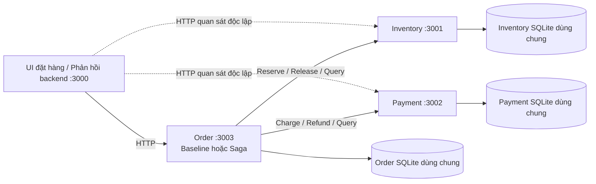
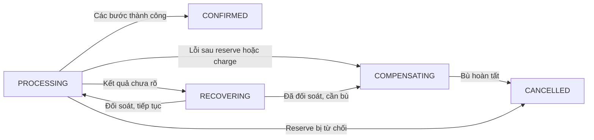

# Checkout với Baseline và Saga

Block 7 · Giao dịch qua nhiều service

Lab minh họa việc đặt hàng qua ba service: Order, Inventory và Payment. Người dùng có thể tạo đơn, thanh toán, hủy và xem dữ liệu thực trong SQLite. Hai lựa chọn **Baseline** và **Saga** cho thấy hệ thống xử lý khác nhau thế nào khi một bước gặp lỗi.

## 1. Bài toán: đơn lỗi nhưng hàng và tiền vẫn còn

Luồng nghiệp vụ là **Tạo đơn → Giữ hàng → Thu tiền → Xác nhận đơn**. Mỗi service có DB riêng, nên transaction tại Order không thể rollback khoản thu đã được lưu ở Payment.

Ví dụ, mua một đèn bàn giá **450.000 ₫**: Inventory giữ một sản phẩm, Payment đã thu tiền, nhưng Order gặp lỗi ở bước xác nhận. Nếu chỉ dừng luồng và báo lỗi, hàng vẫn bị giữ và khoản thu vẫn tồn tại. Đây là lỗi mà Baseline dùng để minh họa.

Một đơn hoàn tất phải thỏa trạng thái của cả ba bên:

| Kết quả | Order | Inventory | Payment |
| --- | --- | --- | --- |
| Thành công | `CONFIRMED` | Một reservation `HELD` theo đơn | Một charge thành công |
| Hủy đã xử lý xong | `CANCELLED` | Không còn hàng bị giữ | Chưa thu tiền hoặc đã `REFUNDED` |

Đơn đang đối soát tiền hoặc đang hoàn tiền, nhả hàng vẫn chưa hoàn tất.

## 2. Kiến trúc và vai trò các thành phần



| Thành phần | Trách nhiệm |
| --- | --- |
| UI/launcher | Phục vụ giao diện, chuyển tiếp API và điều khiển dừng/khởi động service khi demo. |
| Order | Tính tổng tiền, lưu đơn và điều phối các bước. Với Saga, tiếp tục công việc còn dở sau lỗi hoặc khởi động lại. |
| Inventory | Giữ chỗ làm giảm tồn kho; nhả hàng cộng lại tồn kho. |
| Payment | Trừ ví khi thu tiền, cộng ví khi hoàn tiền. Lịch sử giữ cả khoản thu lẫn khoản hoàn. |
| SQLite | Mỗi service sở hữu một DB, giữ dữ liệu qua lần khởi động lại. |

Ba service chạy trong **ba process riêng**, trao đổi qua HTTP. UI chạy độc lập nên khi Order dừng, người xem vẫn đọc được kho và lịch sử thanh toán.

Baseline và Saga dùng chung dữ liệu trong **ba file**: `data/order.sqlite`, `data/inventory.sqlite`, `data/payment.sqlite`. Đổi nút Baseline/Saga chỉ chọn cách xử lý cho đơn mới; không đổi kho, ví hay lịch sử. Đơn cũ tiếp tục dùng cơ chế đã lưu trong `orders.mode`.

Nếu máy đã có hai bộ DB cũ, lần chuyển đổi đầu tiên sẽ gộp tồn kho, số dư và lịch sử. Vì vậy số lượng hiện tại có thể khác dữ liệu mẫu của một lần cài mới; dữ liệu nguồn vẫn được giữ lại.

Stack được giữ gọn: **Node.js 22.17.1+, TypeScript strict, Express 5, SQLite qua `node:sqlite`**, UI HTML/CSS/TypeScript thuần. `tsx` chạy mã TypeScript; `node:test` kiểm thử HTTP và Playwright kiểm tra UI. Payment là mô phỏng có dữ liệu thật trong SQLite, không kết nối cổng thanh toán ngoài.

## 3. Hai cách xử lý cùng một đơn hàng

Thanh chọn ở đầu trang có hai cách chạy. **Thủ công** cho phép tạo đơn, chọn ví rồi thanh toán hoặc hủy. Sau khi tạo, đơn ở trạng thái chờ thanh toán; hệ thống không tự thu tiền. **Chạy lab** thực hiện cả luồng theo tình huống H0–F6 đã chọn để minh họa lỗi.

### Baseline: dừng ở bước lỗi

Order lần lượt giữ hàng, thu tiền rồi xác nhận. Nếu một bước bị từ chối, đơn báo chưa hoàn tất (`FAILED`); những bước đã thành công trước đó vẫn giữ nguyên. Nếu mất phản hồi, đơn cần kiểm tra (`REQUIRES_REVIEW`) vì chưa biết bên kia đã xử lý hay chưa. Baseline không tự khôi phục toàn bộ luồng sau khi Order khởi động lại.

### Saga: lưu bước trước khi gọi, bù khi cần

Saga lưu bước đang làm vào DB trước khi gọi service khác. Mỗi thao tác có một mã cố định, dùng lại khi thử lại hoặc phục hồi. Nhờ đó, Order có thể hỏi kết quả cũ thay vì thu tiền hay hoàn tiền thêm lần nữa.

Order đóng vai trò điều phối: tiếp tục khi đã rõ kết quả, đối soát khi mất phản hồi và bù khi không thể hoàn tất đơn. **Bù** là một hành động nghiệp vụ mới, chẳng hạn hoàn lại khoản đã thu rồi nhả hàng; không phải xóa lịch sử thanh toán.



Mặc định, mỗi bước có **một lần gọi đầu và tối đa ba lần thử lại**. Bộ đếm được lưu trong DB, nên khởi động lại không làm mới giới hạn. Khi hết lượt, hệ thống dừng gọi tự động và giữ công việc còn dở để xử lý tiếp.

| Trường hợp | Trạng thái hiển thị | Cần hiểu thế nào? |
| --- | --- | --- |
| Đã giữ hàng, khách chưa thanh toán | Chờ thanh toán (`AWAITING_PAYMENT`) | Chờ người dùng bấm thanh toán hoặc hủy. |
| Bước xử lý thông thường hết lượt thử | Cần kiểm tra (`REQUIRES_REVIEW`) | Khắc phục lỗi rồi tiếp tục cùng đơn. |
| Hoàn tiền hoặc nhả hàng chưa xong | Đang bù (`COMPENSATING`) | Chưa thể báo hủy hoàn tất, kể cả khi đã hết lượt thử. |
| F4: chưa rõ kết quả thu tiền | Đang kiểm tra (`RECOVERING`) | Chờ Payment trở lại để tra cứu khoản thu cũ; không thu tiền mới. |

Ví dụ, đã thu 450.000 ₫ nhưng hoàn tiền đang lỗi: đơn vẫn **Đang bù** cho đến khi hoàn tiền và nhả hàng xong. Hết lượt thử không có nghĩa là đã hủy thành công.

**Chống xử lý trùng (idempotency):** gửi lại cùng mã thao tác và nội dung sẽ nhận kết quả đã lưu. Nếu dùng lại mã đó với nội dung khác, API trả `409`. Kết quả và thay đổi tiền/hàng được lưu cùng một transaction tại service xử lý.

## 4. Đọc phản hồi backend như thế nào?

Trong tab **Phản hồi backend**, chọn đơn cần xem. Ba thẻ trạng thái cho biết Order, Inventory và Payment đang ghi nhận gì. Phần **Tiến trình Saga** giải thích bước đang chạy, việc còn chờ và số lượt thử lại. Lịch sử thanh toán bên dưới chứa khoản thu và hoàn tiền của tất cả đơn.

Tab **Kho hàng** hiển thị một số **Tồn kho** cho mỗi sản phẩm, đọc trực tiếp từ `stock.available` trong DB. Giữ chỗ làm số này giảm, release làm số này tăng lại. Xác nhận đơn không trừ thêm lần nữa; reservation của đơn thành công vẫn là `HELD` vì lab chưa có bước giao hàng. Lịch sử bên dưới ghi từng lần giữ/nhả, mới nhất ở trên.

Nhật ký xử lý ghi bằng câu dễ đọc; bấm một dòng để xem request, response hoặc sự kiện gốc. Log mới nhất ở trên, cuộn xuống để xem log cũ. Một số dòng là xử lý nội bộ hoặc dừng/khởi động service nên không có HTTP response. Kho và thanh toán vẫn đọc được khi Order dừng; nếu service tương ứng cũng dừng, UI ghi rõ dữ liệu cũ hoặc chưa đọc được.

Một response mô tả **kết quả của lượt gọi đó**; snapshot mô tả **trạng thái hiện tại**. Ví dụ, response charge trước đó vẫn ghi `CHARGED`, dù snapshot Payment hiện là `REFUNDED`. Cả hai đều đúng ở thời điểm tương ứng.

### Ví dụ F3: đã thu tiền nhưng xác nhận đơn bị lỗi

Với đơn Saga trị giá 450.000 ₫, nhật ký có thể được đọc theo thứ tự sau. Các lượt `query` là bước kiểm tra kết quả cũ trước khi gửi thao tác.

| Lượt gọi | HTTP | Cần hiểu điều gì? |
| --- | --- | --- |
| `reserve` | `201` | Reservation được tạo, trạng thái `HELD`. |
| `charge` | `201` | Payment đã ghi nhận thu 450.000 ₫, trạng thái `CHARGED`. |
| `refund` | `200` | Payment chuyển sang `REFUNDED`; ledger vẫn giữ charge và thêm refund. |
| `release` | `200` | Reservation chuyển sang `RELEASED`; hàng được trả lại tồn khả dụng. |

Confirm chạy trong local transaction của Order, nên không có dòng HTTP gọi service confirm riêng. Nhật ký `ORDER_TRANSITION` ghi thay đổi trạng thái này. Sau khi refund và release xong, snapshot là **`CANCELLED / RELEASED / REFUNDED`**.

### Những phản hồi dễ hiểu nhầm

| Phản hồi | Ý nghĩa trong lab |
| --- | --- |
| Order trả `202` | Đơn đã được lưu và tiếp nhận xử lý; chưa có nghĩa đã xác nhận. |
| Query operation trả `404` | Chưa thấy kết quả đã lưu. Đây có thể là bước kiểm tra bình thường; không chứng minh request cũ sẽ không tới muộn. Retry vẫn phải dùng cùng ID. |
| Query operation trả `200` | Tra cứu thành công. Đọc `status`, `httpStatus`, `result` để biết operation đã thành công hay bị từ chối dứt khoát. |
| Payment trả `402` và `PAYMENT_DECLINED` | Thanh toán bị từ chối rõ ràng; Saga release hàng rồi hủy đơn. |
| `409` | Có thể là hết hàng hoặc xung đột idempotency; đọc trường `error` để phân biệt. |
| Refund trả `503` | Hoàn tiền tạm chưa thực hiện được. Giữ `COMPENSATING`; hết lượt dừng gọi và chờ khắc phục. Chưa được báo đã hủy xong. |
| `TIMEOUT` / `NETWORK_ERROR` | Không nhận được response hợp lệ; không phải HTTP status do Payment trả và không chứng minh chưa thu tiền. |
| `UNAVAILABLE` trong snapshot | Service hiện không truy cập được; không diễn giải thành “không có charge”. |
| Trace `complete=0` | Order chưa lưu response của lượt gọi đó. Không phải trạng thái `PENDING` của operation. |

API tra cứu operation đọc kết quả đã lưu theo đúng mã thao tác. Bản hiện tại ghi `SUCCEEDED` hoặc `FAILED`, chưa tạo bản ghi `PENDING`. Tiếp tục Saga dùng lại đơn và các mã thao tác cũ.

## 5. Danh sách API đã triển khai

Các bảng ghi **route gốc tại từng service**. Ngoài health và `/lab`, tiền tố chung là `/api/:mode`, với `mode` bằng `baseline` hoặc `saga`. Hai cơ chế đọc cùng dữ liệu.

### Order — cổng 3003

| Phương thức | Route sau `/api/:mode` | Chức năng |
| --- | --- | --- |
| `GET` | `/config` | Cấu hình fault, giới hạn retry, chu kỳ worker và thời gian dừng F4 mặc định. |
| `GET` | `/products` | Catalog có giá server và tồn khả dụng đọc từ Inventory. |
| `POST` | `/orders` | Tạo đơn; trả `202`, `order_id`, `saga_id`, create ID và đường dẫn đọc đơn. |
| `GET` | `/orders` | Toàn bộ đơn Baseline/Saga, mới nhất ở trên. |
| `GET` | `/orders/:id` | Đơn và Saga record nếu có. |
| `POST` | `/orders/:id/pay` | Thanh toán đơn thủ công đang chờ; chọn `walletId`. |
| `POST` | `/orders/:id/cancel` | Yêu cầu hủy đơn thủ công trước khi bắt đầu thanh toán. |
| `GET` | `/orders/:id/saga` | Phase, intent, pending work, retry, lịch sử và operation IDs. |
| `GET` | `/sagas/:id` | Cùng dữ liệu với `/orders/:id/saga`. |
| `POST` | `/sagas/:id/resume` | Cấp lại lượt cho Saga đã dừng, tiếp tục bước cũ với ID cũ; trả `202`. |
| `GET` | `/orders/:id/traces` | Các lượt HTTP của Order, gồm request, response, lỗi kết nối và cờ `complete`. |
| `GET` | `/orders/:id/snapshot` | Tổng hợp trạng thái Order, Inventory và Payment; báo riêng service không đọc được. |

Tạo đơn nhận `sku`, `quantity`, `checkout_mode`, `scenario`; F4 có thêm `f4_downtime_ms` (0–60000). Gửi lại yêu cầu tạo đơn dùng cùng `Idempotency-Key` hoặc `create_op_id`. Giá và tổng tiền do server tính; xác nhận/hủy cuối Saga xử lý nội bộ tại Order.

### Inventory — cổng 3001

| Phương thức | Route sau `/api/:mode` | Chức năng |
| --- | --- | --- |
| `GET` | `/stock` | Tồn khả dụng theo SKU. |
| `GET` | `/items` | Catalog, tồn khả dụng và tổng số đang giữ cho từng sản phẩm. |
| `GET` | `/movements` | Toàn bộ lịch sử giữ/release; lọc bằng `orderId`, `sku`, `kind` (`RESERVE` hoặc `RELEASE`). |
| `POST` | `/reservations` | Giữ hàng bằng `orderId`, `sku`, `quantity`, `operationId`; thành công trả `201`. |
| `POST` | `/reservations/:id/release` | Nhả reservation bằng `orderId`, `operationId`; replay không tăng kho thêm. |
| `GET` | `/operations/:operationId` | Kết quả reserve/release đã lưu của đúng operation. |
| `GET` | `/orders/:orderId/state` | Reservation, tồn kho và movements liên quan để đối chiếu đơn. |

### Payment — cổng 3002

| Phương thức | Route sau `/api/:mode` | Chức năng |
| --- | --- | --- |
| `GET` | `/wallets` | Ví và số dư hiện tại dùng chung cho hai cơ chế. |
| `GET` | `/ledger` | Toàn bộ charge/refund, kèm đơn, ví và ID; có bộ lọc `orderId`. |
| `POST` | `/payments` | Thu tiền bằng `orderId`, `amount`, `walletId`, `operationId`; thành công trả `201`. |
| `POST` | `/payments/:id/refund` | Hoàn payment gốc bằng `orderId`, `operationId`; giữ cả charge và refund trong ledger. |
| `GET` | `/operations/:operationId` | Kết quả charge/refund đã lưu; đây là API Order dùng đối soát F4/F6. |
| `GET` | `/orders/:orderId/state` | Payment và ledger của một đơn. |
| `POST` | `/faults/:orderId/restore` | Gỡ lỗi refund F5 của đơn; chỉ bật khi cho phép fault injection. |

Mã operation chứa dấu `/` phải được encode khi đặt vào URL. API tra cứu chỉ đọc kết quả, không thay đổi tiền hay kho.

### Health và launcher/UI — cổng 3000

| Phương thức | Route | Chức năng |
| --- | --- | --- |
| `GET` | `/health` | Có ở cả bốn cổng 3000–3003. Trả service, trạng thái và PID; ba service nghiệp vụ có thêm `instanceId`. |
| `GET` | `/api/:mode/config` | Cấu hình lab từ launcher để UI chọn case, thời gian F4 và hiển thị retry. |
| `GET` | `/lab/health` | Health của ba service, quyền điều khiển và trạng thái/thời điểm tự phục hồi F4. |
| `GET` | `/lab/events` | Sự kiện launcher, service và lệnh UI; lọc bằng `orderId`, `mode`, `since`. |
| `POST` | `/lab/services/:service/:action` | `service`: order/inventory/payment; `action`: start/stop. Chỉ điều khiển child process của launcher. |

Qua cổng UI, thêm `/inventory` hoặc `/payments` trước route của service tương ứng. Ví dụ, tra cứu refund là `GET /api/saga/payments/operations/:operationId`. Khi người dùng thanh toán, UI gọi Order rồi Order gọi Payment.

Điều khiển service cần chạy launcher và bật fault. Service khởi động lại chưa có nghĩa là đơn đã xử lý xong.

## 6. Hướng dẫn demo trên UI

Chạy app theo mục 7 và mở **http://127.0.0.1:3000**. Dùng thanh chọn đầu trang để chọn cơ chế và cách chạy. Khi đổi tình huống, bấm **Tạo đơn mới** rồi tạo đơn khác. Đổi nút Baseline/Saga không thay đổi cơ chế của đơn cũ.

Các bước dưới đây thực hiện trực tiếp trên UI. Nút **Chạy lab** tạo lỗi có chủ đích để người trình bày quan sát; không cần chạy script kiểm thử.

### Đặt hàng, thanh toán và hủy thủ công

1. Chọn **Saga → Thủ công**, chọn một đèn bàn, số lượng 1 rồi bấm **Tạo đơn hàng**.
2. Khi đơn báo **Chờ thanh toán**, mở **Kho hàng**: tồn kho giảm 1, có một dòng giữ chỗ. Ví chưa bị trừ.
3. Trở lại **Đặt hàng**, chọn **Ví chính**, bấm **Thanh toán**. Đợi **Đã xác nhận**: ví giảm 450.000 ₫, tồn kho không giảm thêm.
4. Tạo đơn mới rồi bấm **Hủy đơn** trước khi thanh toán. Kho tăng lại 1, có dòng nhả hàng và không phát sinh khoản thu cho đơn này.

Đơn thành công vẫn có reservation `HELD`: lượng hàng đó đã dành cho đơn, lab chưa có bước xuất giao hàng. Đơn chờ thanh toán không tự hết hạn; hãy hủy nếu không dùng nữa.

### H0–F3: so sánh Baseline và Saga

Chọn **Baseline → Chạy lab**, chọn từng tình huống rồi bấm **Chạy lab** ở phần Đặt hàng. Xem kết quả trong **Phản hồi backend** và **Kho hàng**. Sau đó chọn **Saga**, tạo đơn mới với cùng tình huống và so sánh:

| Tình huống | Quan sát ở Baseline | Quan sát ở Saga |
| --- | --- | --- |
| H0 — thành công | Đơn xác nhận, có một khoản thu; tồn kho giảm theo số lượng đặt. | Kết quả tương tự. |
| F1 — không giữ được hàng | Đơn lỗi; kho và ví không đổi. | Đơn hủy; kho và ví không đổi. |
| F2 — từ chối thanh toán | Đơn lỗi, hàng vẫn bị giữ; chưa thu tiền. | Nhả hàng rồi hủy đơn; chưa thu tiền. |
| F3 — lỗi xác nhận sau khi thu tiền | Đơn lỗi, hàng còn giữ và tiền đã thu. | Hoàn tiền, nhả hàng rồi hủy; lịch sử giữ cả khoản thu và khoản hoàn. |

Hai cơ chế dùng chung kho và ví. Ví dụ, Baseline F2 giữ lại một sản phẩm; Saga F2 sau đó chỉ nhả phần hàng của đơn Saga, không xử lý hộ đơn Baseline trước đó.

### F4 — đã thu tiền nhưng mất phản hồi

1. Chọn **Saga → Chạy lab → F4**. Đặt **Payment dừng** khoảng **15 giây** để đủ thời gian quan sát, rồi bấm **Chạy lab F4**.
2. Mở **Phản hồi backend**. Payment không truy cập được; đơn ở `RECOVERING`. Kho vẫn giữ hàng. Payment đã lưu khoản thu và trừ ví, nhưng Order chưa nhận được phản hồi.
3. Chờ hết thời gian đã chọn. Payment tự khởi động lại; **không cần bấm Tiếp tục Saga**.
4. Quan sát log tra cứu khoản thu cũ. Order tìm thấy kết quả rồi chuyển sang **Đã xác nhận**.

Kết quả cần chỉ ra: **chỉ một khoản thu, ví chỉ bị trừ một lần**. Hết lượt thử trong thời gian Payment dừng không làm đơn bị hủy: hệ thống chờ Payment phục hồi rồi tra cứu lại. Với Baseline, Payment vẫn tự trở lại nhưng đơn còn **Cần kiểm tra**, không tự xác nhận.

### F5 — hoàn tiền lỗi và hết lượt thử

1. Chọn **Saga → Chạy lab → F5**, tạo đơn rồi mở **Phản hồi backend**.
2. Đơn báo **Đang bù**: đã thu tiền nhưng xác nhận lỗi, còn bước hoàn tiền đang bị chặn. Payment là `CHARGED`, Inventory là `HELD`.
3. Đợi bộ đếm đạt **3 / 3** với cấu hình mặc định. Đơn vẫn `COMPENSATING`, còn việc **refund → release → cancel**; hệ thống dừng thử tự động.
4. Bấm **Gỡ lỗi refund và tiếp tục**. Đợi hoàn tiền, nhả hàng rồi hủy xong.

Kết quả cuối: **CANCELLED / RELEASED / REFUNDED**. Lịch sử thanh toán có một khoản thu và một khoản hoàn; ví được cộng lại một lần. Hết lượt thử chỉ làm dừng gọi tự động, chưa có nghĩa là đã xử lý xong cho khách.

### F6 — Order dừng giữa quá trình bù

1. Chọn **Saga → Chạy lab → F6**, tạo đơn rồi mở **Phản hồi backend**.
2. Order bị dừng sau khi Payment đã hoàn tiền, trước khi Order lưu kết quả đó. UI vẫn đọc được Payment là `REFUNDED` và Inventory là `HELD`. Tiến trình đã lưu trước khi dừng còn chờ hoàn tiền (`REFUND_PENDING`).
3. Bấm **Khôi phục service** trên thẻ **Order**. Giữ nguyên đơn đang xem, không tạo đơn mới.
4. Theo dõi log: Order tra cứu kết quả hoàn tiền cũ, sau đó nhả hàng và hủy đơn.

Kết quả cuối cũng là **CANCELLED / RELEASED / REFUNDED**. Chỉ có một lần hoàn tiền và một lần nhả hàng. Điểm cần chứng minh là Order tiếp tục được công việc từ DB sau khi khởi động lại, dù lần trước chưa kịp lưu phản hồi.

### Phân biệt demo và kiểm thử tự động

Demo trên dùng giao diện để giải thích hành vi. Các lệnh `npm.cmd test`, `npm.cmd run test:f4`, `npm.cmd run test:retry`, `npm.cmd run test:ui:recovery` chạy kiểm thử với DB và cổng riêng; không phải các bước cần bấm khi demo.

Bộ ảnh và dữ liệu F5/F6 đã lưu được trỏ bởi `evidence/latest-v3.json`. Bộ matrix/video tổng thể ở `evidence/latest-run.json` thuộc phiên bản trước, chưa phản ánh đầy đủ UI hiện tại.

## 7. Chạy lab và đọc dữ liệu

Cần Node.js 22.17.1 trở lên. Cài dependencies, tạo `.env` nếu chưa có rồi chạy launcher:

```powershell
npm.cmd install
if (!(Test-Path .env)) { Copy-Item .env.example .env }
npm.cmd run dev
```

Mở `http://127.0.0.1:3000`. `.env` có `ENABLE_FAULTS=true`, `SAGA_MAX_RETRIES=3` và `F4_DOWNTIME_MS=4000`. Thời gian dừng F4 cũng chọn được trên UI, áp dụng cho đơn mới. Muốn chạy từng service, dùng các lệnh `start:inventory`, `start:payment`, `start:order`, `start:ui` trong các terminal riêng; chế độ này không có launcher quản lý kill/restore.

Để đối chiếu một đơn, bấm **Sao chép mã đơn** trên UI rồi chạy:

```powershell
$orderId = 'DAN_MA_DON_VAO_DAY'
npm.cmd run db:inspect -- saga $orderId
```

Lệnh đọc trực tiếp ba DB, không thay đổi dữ liệu. Với đơn Baseline, thay `saga` bằng `baseline`. Đọc các nhóm sau:

| Nhóm dữ liệu | Cách đối chiếu |
| --- | --- |
| `order`, `saga` | Trạng thái đơn, bước còn chờ và số lượt thử lại. F5 hết lượt vẫn đang bù; F6 trước khôi phục còn chờ kết quả refund. |
| `stock`, `reservations`, `movements` | Tồn kho hiện tại, hàng của đơn đang `HELD` hay `RELEASED`, các lần giữ/nhả đã ghi. |
| `payments`, `ledger`, `wallets` | Khoản thu/hoàn của đơn và số dư ví hiện tại. F4 chỉ có một `CHARGE`; F5/F6 sau hoàn tất có một `CHARGE` và một `REFUND`. |
| `paymentOperations` | Mã thao tác và kết quả đã lưu; dùng để thấy F4/F6 tra cứu lại đúng thao tác cũ. |

Trong lúc Payment hoặc Order dừng, lệnh vẫn đọc được DB của chúng. Đây là cách thấy F4 đã thu tiền hoặc F6 đã hoàn tiền dù Order chưa ghi nhận kết quả. Tồn kho và số dư ví là dữ liệu chung của mọi đơn, nên cần đối chiếu lịch sử của đúng mã đơn.

Nếu muốn xem bằng SQLite viewer, chạy `npm.cmd run db:export` rồi mở các file tại đường dẫn được in ra. Bản xuất đã gồm dữ liệu WAL; xuất lại khi cần xem thay đổi mới. Không chỉ sao chép file `.sqlite` đang chạy vì giao dịch mới có thể còn trong file WAL.

Chỉ dùng `npm.cmd run db:reset` sau khi dừng app và muốn xóa dữ liệu demo. Không cần reset giữa các bước của cùng một demo.
