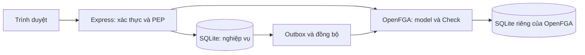
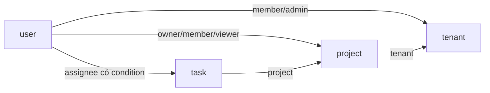
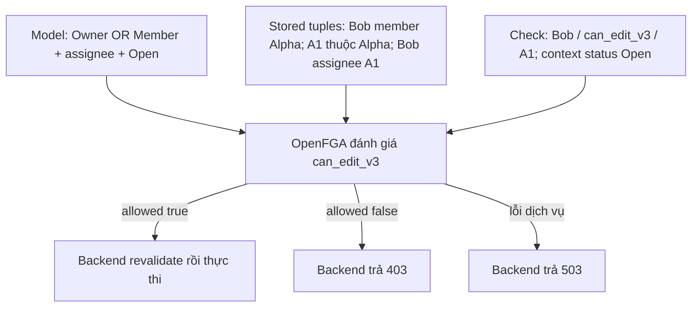
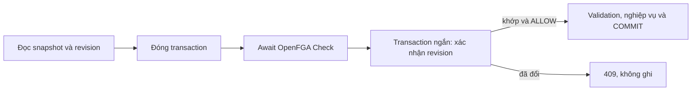

# Triển khai OpenFGA vào Task Authorization Minilab

Báo cáo local · 02/11/2026 · Branch Block-6-Advance

## 01. Kiến trúc: OpenFGA quyết định, server thực thi

Demo quản lý project/task giữ năm mức **Starter → V1 → V2 → V3 → V4**. Starter chỉ xác thực để tái hiện IDOR. Từ V1, backend gọi OpenFGA thật để kiểm tra quyền trên đúng đối tượng. Bộ chọn version, dữ liệu SQLite và giao diện tiếng Việt được giữ lại.



**Authentication** xác định người gọi từ token demo; chưa có JWT/OAuth2 thật. **Authorization** quyết định người đó được làm gì với tài nguyên. OpenFGA giữ mô hình quyền và quan hệ; Express là PEP, chỉ thực thi khi `allowed === true`.

SQLite của ứng dụng (`data/lab.sqlite`) là nguồn gốc nghiệp vụ. OpenFGA có database SQLite riêng (`/home/nonroot/openfga.sqlite`) trên Docker volume để lưu model/tuples. Dịch vụ được bind loopback: ứng dụng ở port 3000, OpenFGA HTTP ở port 8080. Không cần PostgreSQL và không mở Playground.

Chuyển datastore giữ nguyên store/model ID và quan hệ; vẫn dùng stored tuples. Hai file SQLite không dùng chung transaction, vì vậy outbox và kiểm tra revision tiếp tục cần thiết. SQLite của engine chạy một instance với một connection; chưa kiểm chứng tải ghi lớn hoặc nhiều node.

Dự án mã nguồn mở được áp dụng là [OpenFGA trên GitHub](https://github.com/openfga/openfga), một authorization engine lấy cảm hứng từ Google Zanzibar. Phần kế thừa là mô hình quan hệ và cách suy ra quyền; ứng dụng không gọi dịch vụ Zanzibar của Google và chưa chứng minh quy mô/external consistency tương đương.

Điểm tích hợp: `openfga/model.fga` khai báo policy; `relations.js` ánh xạ dữ liệu và quyền theo version; `sync.js` chiếu quan hệ sang engine; `client.js` gọi SDK `@openfga/sdk`; `policy.js` nhận verdict; wrapper `endpoint()` trong `src/app.js` enforce trước read/write. Các module tích hợp engine nằm trong `src/openfga/`.

## 02. Dữ liệu và quan hệ quyền

Mỗi user có một tenant và cờ tenant admin. Role project nằm trong membership; assignee của task là quan hệ riêng. Được giao task không thay thế membership.



| Dữ liệu mẫu | Ý nghĩa |
| --- | --- |
| Alice / Alpha | Owner project Alpha |
| Bob / Alpha | Member; assignee A1 Open và A2 Closed |
| Vera / Alpha | Viewer |
| Charlie / Beta | Owner project Beta |
| Admin Alpha / Beta | Admin trong tenant tương ứng, ban đầu chưa có membership |
| A3 / A4 | Chưa assign / assign Alice, giúp kiểm thử nhánh Member |

Projection chuyển dữ liệu sang `tenant.member/admin`, `project.tenant/owner/member/viewer` và `task.project/assignee`. Title/description không được gửi sang OpenFGA. `tenant.member` chỉ cùng tenant; `project.member` là role Member, hai quan hệ có nghĩa khác nhau.

Model chuẩn nằm trong `openfga/model.fga`; JSON sinh ra được kiểm tra khớp DSL. Một model chứa quyền V1–V4, dùng chung quan hệ. Model ID được pin trong database; tạo model mới trên engine không tự thay policy đang chạy.

## 03. Cơ chế OpenFGA: model, tuple và Check

OpenFGA đánh giá một câu hỏi cụ thể bằng **model đã pin + quan hệ đã lưu + context tin cậy**. Ví dụ Bob gửi PATCH task A1 ở V3: backend xác thực token, đọc snapshot SQLite rồi hỏi `Check(user:bob, can_edit_v3, task:A1)` với `current_status: Open`.



| Thành phần | Dữ liệu dùng trong ví dụ |
| --- | --- |
| Model | `can_edit_v3 = project_owner or assigned_member`; assigned Member phải thỏa condition Open |
| Stored tuples | Bob là Member Alpha; A1 thuộc Alpha; Bob là assignee A1 với condition `task_is_open` |
| Context | `current_status` lấy từ SQLite trước mutation, không lấy trạng thái mới do client đề nghị |
| Kết quả | Bob/A1 Open → true; Bob/A2 Closed → false; Owner vẫn có nhánh sửa Closed |

Chữ Member tự nó không có quyền mặc định: model định nghĩa hành động nào được suy ra từ quan hệ đó. Khi kiểm tra task, engine đi qua quan hệ project để tìm quyền; việc này thể hiện cơ chế ReBAC lấy cảm hứng từ Zanzibar. OpenFGA tự đọc datastore SQLite riêng, không tự JOIN bảng `project_memberships` của ứng dụng.

Backend chỉ thực thi khi Check trả true và snapshot còn hợp lệ. OpenFGA không tự sửa task hay chặn HTTP route. Đổi selector chọn relation `_v1`…`_v4` trong cùng model; Starter bỏ Check để minh họa IDOR. Context trạng thái dùng cho condition khác với contextual tuples: bản hiện tại **lưu quan hệ bền**, không gửi lại toàn bộ quan hệ theo từng Check.

## 04. Policy tiến hóa qua Starter–V4

| Version | Hạn chế trước đó | Kiểm tra áp dụng | Kết quả quan sát |
| --- | --- | --- | --- |
| Starter | Thiếu object authorization | Chỉ token hợp lệ | Alice đọc B1 được, cố ý có IDOR |
| V1 | Biết ID là truy cập được | Quan hệ membership project | Alice/B1 bị 403; Alice/A1 vẫn được |
| V2 | Thành viên có quyền quá rộng | Role kết hợp action | Viewer đọc được nhưng không sửa |
| V3 | Member sửa mọi task trong project | Member và assignee và trạng thái Open | Bob sửa A1 được, A2/A3/A4 bị chặn |
| V4 | Chưa enforce tenant | Cùng tenant; thêm admin tenant | Admin Alpha được ở Alpha, bị chặn ở Beta |

V1–V3 không thêm tenant boundary ngầm. Membership khác tenant có thể được tạo từ version trước nhưng không vượt qua V4. Tenant admin không có đặc quyền ở V1–V3 khi chưa có membership.

Member được đóng task Open của mình; không tự mở lại task Closed bằng payload `status: Open`. Backend lấy trạng thái **trước mutation** cho condition `task_is_open`. Owner/admin hợp lệ được sửa cả Closed.

Selector là công cụ lab để so sánh policy. Trong ứng dụng production, server phải cố định policy; người dùng không được chọn Starter để bỏ kiểm tra quyền.

## 05. Kiểm tra quyền và kết quả nghiệp vụ

| Hành động từ V2 | Viewer | Member | Owner | Tenant admin hợp lệ ở V4 |
| --- | --- | --- | --- | --- |
| Đọc project/task | Có | Có | Có | Có |
| Sửa task V2 | Không | Có | Có | Có |
| Sửa task V3/V4 | Không | Assignee và Open | Có | Có |
| Quản lý members / xóa project | Không | Không | Có | Có |

Quyền task kế thừa qua project chứa nó. Mapping version/action đến relation được khai báo ở server: `can_read_vN`, `can_edit_vN`, `can_delete_vN`, `can_manage_members_vN`. Client không được chọn model hoặc relation tùy ý.

Version/action/role lạ bị chặn trước cả nhánh Starter/admin. Role, tenant, assignee và trạng thái lấy từ server; query/header tự khai không làm tăng quyền. PATCH chỉ nhận title, description, status.

Owner cố định là quy tắc nghiệp vụ riêng. Một caller có thể được ALLOW quản lý members nhưng vẫn nhận 409 khi cố xóa/hạ quyền Owner. Tương tự, ALLOW không bỏ qua validation payload.

Ngoại lệ lab được khai báo rõ: danh mục mọi project chỉ trả ID/tên cho token hợp lệ; không cấp quyền đọc nội dung. Reset local kiểm tra Origin; giao diện vẫn hiện nút thiếu quyền để người học quan sát server từ chối.

## 06. Snapshot và transaction khi Check qua mạng

PDP cũ chạy đồng bộ trong transaction SQLite. OpenFGA là dịch vụ ngoài process; không được truyền callback async vào helper transaction cũ rồi COMMIT trước khi Check hoàn tất.



Revision tăng đơn điệu bằng trigger cho SQL writes, cascade và reset. Revision nội dung phát hiện snapshot cũ; revision quan hệ xác định graph đã đồng bộ. Đổi title/status không cần ghi tuple nhưng vẫn vô hiệu hóa quyết định đang chờ.

Sau Check, server kiểm tra revision, binding và readiness trong transaction ngắn trước đọc/ghi. Nếu task vừa đóng, membership bị thu hồi, reset hoặc project bị xóa trong thời gian chờ, trả **409 AUTHORIZATION_CONTEXT_CHANGED**. Áp dụng cho cả ALLOW và DENY cũ.

Không giữ transaction SQLite mở trong lúc chờ HTTP. Check có timeout và không tự retry. Kiểm thử race dùng barrier giữ response rồi thay đổi dữ liệu, không dùng sleep để mong race xảy ra. Cơ chế này phục vụ lab local; chưa đánh giá throughput hoặc nhiều application instances.

## 07. Đồng bộ quan hệ và phục hồi lỗi

Mutation membership/delete/reset ghi SQLite và outbox trong cùng transaction, kể cả khi chạy Starter. Sau COMMIT, synchronizer đọc snapshot, đối chiếu graph, xóa tuple dư/role cũ và ghi quan hệ mới. Read API có pagination; Write chia batch.

**Readiness đóng trước sync** và chỉ mở khi applied revision bằng desired revision, model/binding đúng. V1–V4 bị chặn trong thời gian graph có thể ghi dở. Lease SQLite 30 giây giới hạn một synchronizer; sau process crash cần chờ lease hết hạn rồi phục hồi.

| Tình huống | HTTP / trạng thái |
| --- | --- |
| Check xác định thiếu quyền | 403, data null |
| Engine lỗi hoặc graph chưa ready | 503, không thực hiện nghiệp vụ |
| Commit và sync hoàn tất | 200/201 |
| SQLite đã commit, sync lỗi | 202, committed true, operation pending |
| Snapshot đổi trong lúc Check | 409, không dùng quyết định cũ |

202 không có nghĩa mutation thất bại. UI không hướng dẫn gửi lại thao tác; caller xem operation hoặc đồng bộ lại. Job tồn tại qua restart; startup/CLI/UI sync có thể đối chiếu lại graph kể cả khi remote Write đã thành công nhưng process chưa cập nhật applied revision.

Check dùng HIGHER_CONSISTENCY; tùy chọn này không tạo transaction chung với SQLite. Chưa có worker nền tự retry vô hạn; recovery là thao tác rõ ràng hoặc startup. Lab chọn chặn toàn bộ V1–V4 khi pending để giảm độ phức tạp.

Ba bảng dưới là cơ chế của ứng dụng, không phải schema bắt buộc của OpenFGA:

| Bảng trong SQLite ứng dụng | Trách nhiệm |
| --- | --- |
| `authorization_state` | Pin store/model, kiểm tra revision và readiness; lease tránh sync đồng thời |
| `authorization_outbox` | Dấu mốc revision cần đồng bộ, ghi cùng transaction nghiệp vụ; sync đối chiếu graph, không replay từng event |
| `authorization_operations` | Liên kết operation với caller/revision để theo dõi HTTP 202; trạng thái suy ra từ revision đã áp dụng |

## 08. Các quyết định kỹ thuật và đánh đổi

| Quyết định | Phương án khác | Lý do và đánh đổi |
| --- | --- | --- |
| Lưu tuple thật trong OpenFGA | Gửi mọi relation bằng contextual tuples | Thể hiện lưu quan hệ và suy luận; phải xử lý đồng bộ |
| SQLite là nguồn gốc | OpenFGA là nguồn duy nhất cho membership | Giữ API/reset hiện có; phải có projection/outbox |
| Một model cho V1–V4 | Bốn model/store riêng | So sánh cùng dữ liệu; nhiều relation trong model |
| Status qua condition | Đồng bộ tuple mỗi lần đóng task | Tránh sync cho status; cần snapshot/revision tin cậy |
| Diff toàn graph lab | Delta worker quy mô lớn | Dễ phục hồi và quan sát; không tối ưu tải lớn |
| 202 sau commit pending | Trả lỗi dù dữ liệu đã lưu | Tránh người dùng lặp mutation; UI cần trạng thái riêng |
| SDK timeout, không retry Check | Retry quyết định quyền ngầm | Hành vi lỗi rõ ràng; cần người dùng phục hồi dịch vụ |
| Docker OpenFGA + SQLite | Datastore memory | Có persistence qua restart, giảm một DB service; SQLite phù hợp một instance local |

### Vì sao membership được lưu ở cả hai bên?

Bản hiện tại coi `project_memberships` là nguồn gốc và tuple trong OpenFGA là bản chiếu. Quyết định này giữ truy vấn danh sách thành viên, ràng buộc SQL, seed/reset và nghiệp vụ cũ; chi phí là lưu trùng quan hệ, đồng bộ thu hồi quyền và xử lý trạng thái ghi dở. Ba bảng kỹ thuật ở mục 07 phát sinh từ lựa chọn tích hợp này, không phải yêu cầu của Zanzibar.

**Phương án OpenFGA quản lý membership duy nhất chưa được triển khai.** Khi áp dụng, API members sẽ đọc/ghi relation trực tiếp qua engine và ghép tên user từ SQLite; không cần ghi thêm membership ở ứng dụng. Đánh đổi là phải sửa các luồng đó, còn xóa project/reset vẫn phối hợp dữ liệu giữa hai hệ thống. OpenFGA cho phép chọn nơi quản lý membership theo nhu cầu ứng dụng; không bắt buộc nhân đôi dữ liệu. [Hướng dẫn chọn nguồn dữ liệu gốc](https://openfga.dev/docs/best-practices/source-of-truth).

SDK pin 0.9.7; dependency Axios được override 1.21.0 vì SDK pin sẵn bản có advisory. TLS npm dùng CA hệ thống khi cần, không tắt xác thực chứng chỉ. Image engine/datastore có phiên bản cố định.

Không có local PDP cấp quyền thay OpenFGA khi dịch vụ lỗi. Chẩn đoán DENY dựa trên snapshot chỉ giúp thông báo thân thiện. Trace ghi relation/model và kết quả Check; không giả rằng engine trả đầy đủ đường suy luận.

## 09. Kiểm chứng và evidence local

Baseline trước sửa đạt **52/52 tests** và browser smoke. Bản OpenFGA có permission matrix chạy trên engine thật, kiểm tra mỗi tổ hợp user/version/task/action bằng expected độc lập; riêng model matrix gồm **432 quyết định**.

Các nhóm kiểm chứng bổ sung:

- Pin model ID khi có model mới; trạng thái condition thiếu/sai binding phải fail closed.
- Đổi Member thành Viewer xóa grant cũ; membership khác tenant vẫn bị V4 chặn.
- Revoke assignee, cascade delete, reset, pagination và batch cho graph lớn hơn seed.
- Ghi remote dở, pending operation và phục hồi qua service mới; không lặp mutation.
- Race thay đổi status/membership/reset/delete và cả DENY cũ; timeout HTTP thật không retry.
- Browser thật: selector, forms, popup, pending/recovery, stale response và mobile; không có JS errors.

`evidence/openfga/manifest.json` ghi số tests và trạng thái lần chạy hiện tại, hash source/artifacts và working tree. Cùng regression IDOR đỏ ở Starter/before, xanh ở V1/after. Before là snapshot authentication-only tái dựng đã lưu; after là source/model OpenFGA hiện tại. Không trình bày before là lịch sử commit gốc.

Evidence gốc ngày 29/10 ở thư mục cha được giữ riêng. Fixture tạo SQLite/store riêng và chỉ dọn tài nguyên mình sở hữu; không mở/reset dữ liệu demo. Kết quả local không thay thế nghiệm thu giảng viên hoặc hosted deployment.

## 10. Chạy và trình bày demo

```powershell
npm.cmd ci
docker compose up -d --wait
npm.cmd run fga:init
npm.cmd start
```

Mở `http://127.0.0.1:3000`. Starter/Alice đọc Beta thành công; chuyển V1 bị 403. Vera sửa A1 ở V1 được nhưng V2 bị chặn. Bob sửa A2 Closed ở V2 được nhưng V3 bị chặn. Admin Alpha chưa có membership chỉ có đặc quyền từ V4 và chỉ trong Alpha.

Mở Chi tiết kỹ thuật: V1–V4 có OpenFGA Check, relation/model và Authorization decision. Request outcome phân biệt SUCCESS, PENDING, REJECTED và ERROR. Phần nghiệp vụ giữ thông báo tiếng Việt; thông tin engine nằm ở tab kỹ thuật.

```powershell
npm.cmd test
npm.cmd run test:ui
npm.cmd run evidence
npm.cmd run db:reset
```

Reset chủ động thay dữ liệu bằng seed và đồng bộ graph. Restart bình thường giữ dữ liệu; không xóa volume SQLite của OpenFGA nếu muốn giữ store/model. Khi engine phục hồi, dùng Đồng bộ lại hoặc restart app; CLI sync có thể sửa graph từ outbox.

Giới hạn: token demo, Starter cố ý yếu, danh mục project discoverable, reset local, chưa có authentication thật, hosted CI/deployment, nhiều app instances hoặc benchmark tải. Mã nguồn được bàn giao trên nhánh `Block-6-Advance`; việc push repository không thay thế kiểm chứng hosted hoặc nghiệm thu trực tiếp.
