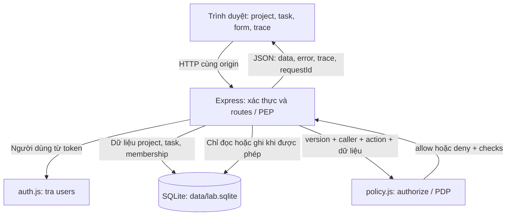
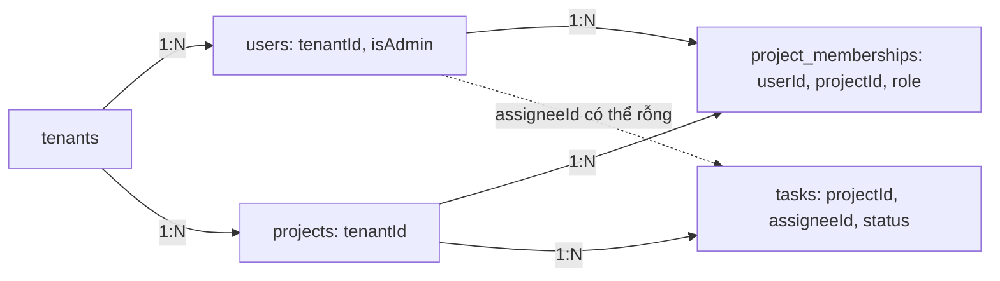
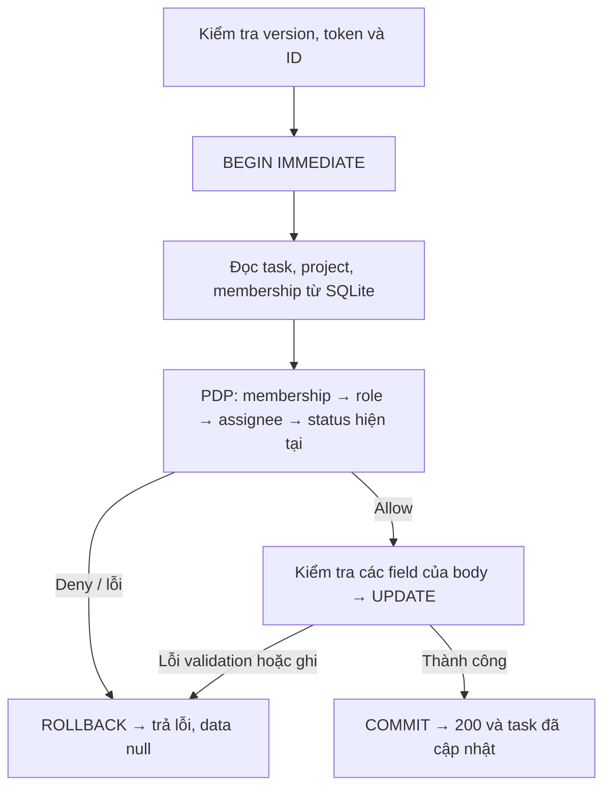

# Triển khai Task Authorization Minilab

Báo cáo triển khai · 29/10/2026

## 01. Kiến trúc: quyền nằm ở server

Ứng dụng mô phỏng quản lý công việc trong hai tổ chức (tenant) Alpha và Beta. Người dùng mở project, đọc/sửa task, quản lý thành viên và xóa project. Cùng một thao tác được chạy qua năm mức policy **Starter → V1 → V2 → V3 → V4** để thấy chính xác lớp kiểm tra nào thay đổi kết quả.

Đăng nhập thành công chỉ xác định người dùng là ai. Khi người đó mở hoặc sửa một task, server còn phải kiểm tra họ có quyền với task ấy hay không. Starter chỉ kiểm tra đăng nhập để minh họa lỗi thiếu phân quyền. Từ V1, ứng dụng lần lượt kiểm tra membership, role, người được giao task, trạng thái và tenant.

Luồng xử lý gồm ba bước: **xác định người gửi → kiểm tra quyền → đọc hoặc sửa dữ liệu**. Server chỉ thực hiện bước cuối khi người dùng được phép. Dữ liệu công việc và thông tin phân quyền đều nằm trong SQLite; các thành phần trên chạy trong cùng một ứng dụng.

**PDP** (Policy Decision Point) quyết định người dùng có được phép thao tác hay không. **PEP** (Policy Enforcement Point) thực thi quyết định đó: cho chạy nghiệp vụ hoặc dừng request. Trong code, PDP là hàm `authorize()` trong `policy.js`; PEP nằm trong hàm bọc route `endpoint()`.

UI và API được Express phục vụ tại `http://127.0.0.1:3000`. UI dùng HTML/CSS/JavaScript thuần; server chỉ bind loopback. Các nút vẫn xuất hiện để người học thử cả trường hợp bị từ chối. Việc ẩn hoặc hiện nút không quyết định quyền truy cập.

**Phạm vi hiện có:** đọc project và task, sửa task, quản lý membership, xóa project, reset dữ liệu và xem trace. Chưa có tạo project/task, xóa task, đăng nhập thật hay triển khai nhiều process.

## 02. Dữ liệu: phân biệt danh tính, role và quan hệ

SQLite lưu tổ chức, người dùng, project, danh sách thành viên và task trong năm bảng. Mỗi người thuộc một tổ chức, nhưng có thể giữ vai trò khác nhau ở từng project. Người được giao task được lưu riêng: được giao việc chưa có nghĩa là có quyền tham gia project.

### Dữ liệu mẫu để đối chiếu

| Tài khoản | Tenant | Vai trò trong dữ liệu seed |
| --- | --- | --- |
| Alice | Alpha | Owner của project Alpha |
| Bob | Alpha | Member của Alpha; được giao A1 và A2 |
| Vera | Alpha | Viewer của Alpha |
| Charlie | Beta | Owner của project Beta |
| Admin Alpha / Admin Beta | Tương ứng | Tenant admin, ban đầu không có membership |

Alpha có A1 (Bob, Open), A2 (Bob, Closed), A3 (chưa giao, Open), A4 (Alice, Open). Beta có B1 (Charlie, Open) và B2 (chưa giao, Open). Các ID cố định giúp so sánh policy mà không cần tạo thêm dữ liệu.

### Server xác định người dùng và kiểm tra quyền ra sao?

Khi chọn Bob, trình duyệt gửi token demo của Bob trong mỗi request. Server dùng token để tìm thông tin tài khoản; thông tin này gọi là **principal**, tức người đang yêu cầu thao tác. Đây chỉ là cách chọn tài khoản để demo, chưa có đăng nhập bằng mật khẩu hay phiên bảo mật.

Sau đó, server kiểm tra quyền trên task được yêu cầu. Ví dụ, khi Bob muốn sửa A1, server tìm project chứa A1 rồi đọc tư cách thành viên và vai trò của Bob trong project đó. Các thông tin này lấy từ database, không lấy từ quyền do trình duyệt tự khai.

Từ V3, Bob chỉ sửa được A1 khi còn là thành viên, có vai trò cho phép sửa, được giao A1 và task còn Open. Nếu bị xóa khỏi project, Bob mất quyền sửa dù A1 vẫn ghi tên Bob là người được giao.

**Scope và quyền trên task:** lab chưa dùng OAuth2 hay scope. Nếu sau này token có scope “đọc task”, server vẫn phải kiểm tra người dùng được đọc task nào. Scope đó không tự cho phép đọc mọi task như B1.

## 03. Năm policy thay đổi điều gì?

Mỗi version dùng cùng routes và database. Bảng dưới áp dụng cho các API nội dung/nghiệp vụ; danh mục tên project có ngoại lệ riêng ở mục 07. Starter và V1 vẫn kiểm tra dữ liệu đầu vào, ràng buộc database và Owner cố định.

| Version | Cơ chế quyết định | Hành vi dễ quan sát |
| --- | --- | --- |
| Starter | Có token hợp lệ là qua bước xét quyền đối tượng | Alice đọc B1 của Beta được; đây là lỗi IDOR cố ý |
| V1 | Phải có membership trong project chứa tài nguyên | Alice bị chặn ở Beta; Vera vẫn sửa task trong Alpha được |
| V2 | Sau membership, xét role theo action | Viewer chỉ đọc; Member đọc/sửa; Owner quản lý và xóa |
| V3 | Member sửa task phải là assignee và task hiện tại còn Open | Bob sửa A1 được; A2, A3, A4 bị chặn |
| V4 | Xét tenant trước; admin cùng tenant được quyền tương đương Owner | Admin Alpha mở Alpha được dù chưa có membership; Beta bị chặn |

### Role không đủ để diễn tả mọi điều kiện

Membership tạo danh sách quyền truy cập theo project (ACL). V2 gom quyền theo role (RBAC). V3 bổ sung quan hệ người dùng–task (ReBAC) và thuộc tính trạng thái (ABAC). V4 thêm điều kiện tenant. Các khái niệm này cùng xuất hiện trong một chuỗi kiểm tra; hệ thống không chạy bốn engine phân quyền riêng.

Từ V2, các thành viên đều được đọc task; Member và Owner được sửa; chỉ Owner được xóa project và quản lý thành viên. Việc xem danh sách thành viên cũng thuộc quyền quản lý, nên **Viewer đọc được task nhưng không xem được danh sách thành viên**.

### Các ngoại lệ có chủ đích

**Owner ở V3/V4** được sửa cả task Closed và task giao cho người khác. Điều kiện assignee/Open chỉ áp dụng với Member. Member có thể đóng task Open của mình, nhưng request mở lại bị chặn vì trạng thái trước khi ghi đã là Closed.

**Admin ở V4** chỉ được quản trị trong tổ chức của mình, kể cả khi chưa tham gia từng project. Admin Alpha vẫn bị chặn ở Beta. Quyền admin không bỏ qua kiểm tra dữ liệu đầu vào, quy tắc giữ nguyên Owner hay yêu cầu thành viên mới phải cùng tổ chức.

V1–V3 không có tenant boundary riêng. V4 cũng không hoàn toàn là “thêm một điều kiện”: nó vừa siết ranh giới tenant, vừa mở ngoại lệ admin trong tenant. Không có đặc quyền admin ở V1–V3 khi người đó chưa có membership.

## 04. Vì sao nâng cấp từ ACL đến RBAC, ReBAC và ABAC?

Mỗi version bổ sung một yêu cầu mà bản trước chưa xử lý. V1 dùng danh sách thành viên để giới hạn truy cập vào project; V2 phân biệt quyền theo role; V3 kiểm tra thêm người được giao task và trạng thái task. Những kiểm tra đã có vẫn được giữ khi thêm điều kiện mới.

Trong báo cáo này, danh sách thành viên ở V1 được gọi là ACL cấp project. Membership cũng là quan hệ user–project nên có thể được nhìn theo ReBAC ở nghĩa rộng. Khác biệt của V3 nằm ở điều kiện cụ thể hơn: người sửa phải là assignee của task, ngoài việc còn là thành viên project.

### Starter → V1: chặn truy cập ngoài project bằng ACL

Ở Starter, Alice đổi ID từ A1 sang B1 vẫn đọc được dữ liệu của Beta dù không tham gia project này. Đây là **IDOR/BOLA** (Broken Object Level Authorization): truy cập trái phép theo chiều ngang, sang tài nguyên ngoài quyền. V1 chặn trường hợp này bằng membership.

V1 tìm project chứa task, rồi kiểm tra người gửi có trong danh sách thành viên hay không. Danh sách này đóng vai trò ACL cho các tài nguyên trong project. V1 chưa xét người được giao task hoặc trạng thái, vì mục tiêu ở bước này là chặn người ngoài project.

Alice/B1 chuyển 200 → 403, còn Alice/A1 và Charlie/B1 vẫn 200. Tuy nhiên, Vera là Viewer vẫn sửa task, xóa project và quản lý members trong Alpha được. V1 mới trả lời “có trong danh sách truy cập không”, chưa phân biệt hành động; đây là lý do cần V2.

### V1 → V2: giữ ACL, thêm quyền theo role và action

V1 cấp quyền quá rộng cho thành viên. V2 bắt đầu áp dụng **least privilege** (quyền tối thiểu): Viewer chỉ đọc, Member đọc/sửa, Owner quản lý members và xóa project.

Viewer/Member gọi chức năng xóa project hoặc quản lý members trái với yêu cầu này là **BFLA** (Broken Function Level Authorization), vượt quyền theo chiều dọc. V1 còn cho phép để minh họa giới hạn; V2 chặn bằng role/action.

V2 vẫn kiểm tra người dùng có tham gia project, sau đó mới xét vai trò của họ có được thực hiện thao tác đang yêu cầu hay không. Vì vậy, người ngoài vẫn bị chặn, còn thành viên chỉ được dùng các chức năng phù hợp với vai trò.

Vera sửa A1 chuyển 200 → 403; Bob vẫn sửa A1 được nhưng không được xóa project hay quản lý members. Bob cũng vẫn sửa được A2 Closed, A3 chưa giao và A4 giao cho Alice: RBAC cho phép theo nhóm Member, chưa xét từng task. Giới hạn này dẫn tới V3.

### V2 → V3: giữ ACL/RBAC, thêm assignee và trạng thái

V2 vẫn cho Member sửa mọi task trong project. V3 tiếp tục áp dụng **least privilege**: Member chỉ sửa task được giao cho mình và hiện còn Open. Role Member chưa đủ để đáp ứng hai điều kiện này.

Sau bước kiểm tra thành viên và vai trò, V3 yêu cầu người sửa phải là người được giao task (ReBAC), đồng thời task đang Open (ABAC). Trạng thái được đọc từ database trước khi sửa. Hai điều kiện mới chỉ áp dụng với Member; Owner giữ quyền sửa rộng đã có từ V2.

Bob sửa A1 Open được; A2/A3/A4 chuyển từ 200 ở V2 sang 403 ở V3. Bob mất membership vẫn bị chặn dù còn là assignee. V3 giải quyết quyền theo task nhưng chưa có tenant boundary riêng hoặc quyền quản trị cấp tenant; đó là phạm vi mở rộng của V4.

## 05. V4 kế thừa thế nào để không làm version đi lùi?

### V3 → V4: bổ sung tenant boundary và quản trị trong tenant

V4 có hai yêu cầu: cách ly dữ liệu nghiệp vụ giữa các tổ chức và cho phép tenant admin quản trị project trong tổ chức mình mà không cần được thêm vào từng project.

V3 xét quyền theo membership, role và task, chưa kiểm tra trực tiếp tenant. Alice đã không đọc được B1 vì thiếu membership, nên ca này chưa cho thấy một lỗi truy cập khác tenant ở V3. V4 bổ sung kiểm tra tenant riêng để ranh giới giữa hai tổ chức không chỉ phụ thuộc vào danh sách thành viên của từng project.

V4 kiểm tra người dùng và project có cùng tổ chức trước. Nếu khác, request bị từ chối ngay. Nếu cùng tổ chức, admin được quyền tương đương Owner; người dùng thường tiếp tục qua các kiểm tra của V3. Khi thêm thành viên, server cũng kiểm tra người được thêm có cùng tổ chức với project.

Admin Alpha chưa có membership bị từ chối khi mở Alpha ở V3 (403), nhưng được phép ở V4 (200); mở Beta vẫn bị từ chối (403). Kết quả thay đổi vì V4 thêm quyền quản trị trong tenant. Quyền này vẫn chịu kiểm tra tenant, dữ liệu đầu vào và quy tắc Owner cố định. Riêng danh mục tên project được giữ mở để phục vụ demo như giải thích ở mục 07.

### Các kiểm tra được giữ qua từng version

Các ca so sánh dùng cùng dữ liệu mẫu. Với thao tác ghi hoặc xóa, cần reset trước ca tiếp theo để kết quả phản ánh thay đổi policy thay vì dữ liệu đã bị sửa.

| Bảo vệ đã có | Version phải tiếp tục giữ | Bằng chứng trong bộ test hiện có |
| --- | --- | --- |
| V1: người ngoài project không đọc nội dung | V2–V4, với ngoại lệ tenant admin hợp lệ ở V4 | Alice/B1 bị chặn; Alice/A1 và Charlie/B1 vẫn được đọc |
| V2: giới hạn theo role/action | V3–V4 cho caller không phải tenant admin | Viewer không sửa; Member không xóa project/quản lý members |
| V3: Member cần membership, đúng assignee và Open | V4 cho Member không phải tenant admin | A2/A3/A4 bị chặn; bị thu hồi membership vẫn không sửa được |
| V4: tenant trước admin | Mọi action nội dung/nghiệp vụ của V4 | Admin Alpha bị chặn ở task/project/members Beta |

### Cách tổ chức các version trong bài lab

Các điều kiện phân quyền nằm trong `src/policy.js`; các ca so sánh nằm trong `test/authorization.test.js`. V1 và V2 vẫn giữ những giới hạn đã nêu để người học thấy vì sao cần bước nâng cấp tiếp theo. Đây là các tình huống được dựng cho bài lab, không phải nhật ký sự cố trong quá trình lập trình.

Schema và dữ liệu mẫu có sẵn role, assignee, status và tenant để các version cùng dùng một bộ dữ liệu. Tuy nhiên, **V1 chỉ xét membership; V2 mới xét role; V3 mới xét assignee/status; V4 mới xét tenant/admin.** Các trường có sẵn chưa tham gia cấp quyền cho đến version tương ứng. Bài lab so sánh policy trong cùng một ứng dụng, chưa mô phỏng lịch sử migration hay lưu các commit nâng cấp tuần tự. Lựa chọn này phục vụ việc so sánh; khả năng mở rộng chưa được đo.

## 06. Một lần sửa task đi qua những bước nào?

Ví dụ Bob yêu cầu đóng A1 ở V3. Server xét quyền dựa trên:

- **Người thao tác (principal):** Bob, được xác định qua token.
- **Hành động (action):** sửa task; API ánh xạ thành `edit`.
- **Tài nguyên (resource):** A1 và project chứa A1.
- **Điều kiện:** Bob còn là thành viên, có role Member, được giao A1 và A1 đang Open.

Các điều kiện lấy từ database; tenant chỉ được xét từ V4. API cho thao tác này là `PATCH /api/v3/tasks/A1`.

### Vì sao đọc, xét quyền và ghi trong cùng transaction?

Server đọc dữ liệu, xét quyền và ghi trong cùng một transaction trên cùng connection. Nếu được phép và dữ liệu hợp lệ, thay đổi được lưu; nếu bị từ chối hoặc gặp lỗi, transaction hủy thay đổi.

Trong code, transaction bắt đầu bằng `BEGIN IMMEDIATE`, kết thúc bằng `COMMIT` hoặc `ROLLBACK`; không có bước chờ bất đồng bộ giữa xét quyền và cập nhật. SQLite chỉ cho một bên ghi tại một thời điểm và được cấu hình chờ khóa tối đa 3 giây. Khả năng chịu tải ghi đồng thời chưa được kiểm thử.

### Không xét quyền bằng trạng thái người dùng muốn ghi

A1 đang Open và được giao cho Bob, nên Bob có thể đóng task. Sau đó, Bob không thể tự mở lại: server đọc thấy A1 đã Closed và từ chối. Trạng thái muốn ghi trong request không thể thay thế trạng thái hiện tại trong database để vượt kiểm tra quyền.

API sửa task chỉ nhận tiêu đề, mô tả và trạng thái. Người dùng không thể qua API này đổi người được giao, project, tenant hay vai trò. Server xét quyền trước rồi mới kiểm tra các trường cần sửa; riêng JSON sai cú pháp bị chặn ngay khi nhận request.

**Đọc dữ liệu:** GET tải tài nguyên và membership rồi xét quyền trước khi trả nội dung, nhưng không được bọc trong transaction ghi này. Chưa kiểm thử tranh chấp nhiều process; không suy rộng cơ chế local thành bảo đảm cho hệ thống phân tán.

## 07. API và ranh giới dữ liệu trả về

Các đường dẫn dưới có prefix `/api/:version`, với version là `starter`, `v1`, `v2`, `v3`, `v4`. Mọi API trong nhóm này yêu cầu token hợp lệ. Hai endpoint hỗ trợ lab `/lab/config` và `/lab/reset` nằm ngoài nhóm đó.

| Method và đường dẫn | Ý nghĩa / action |
| --- | --- |
| GET `/projects` | Danh mục ID/tên project; ngoại lệ khám phá của lab |
| GET `/projects/:id` | Nội dung project / `read` |
| GET `/projects/:id/tasks` | Danh sách task của project / `read` |
| GET `/tasks/:id` | Một task / `read` |
| PATCH `/tasks/:id` | Sửa title, description, status / `edit` |
| DELETE `/projects/:id` | Xóa project và dữ liệu phụ thuộc / `delete` |
| GET, POST `/projects/:id/members` | Xem hoặc thêm membership / `members` |
| PATCH, DELETE `/projects/:id/members/:userId` | Đổi role hoặc xóa membership / `members` |

### Thấy tên project không có nghĩa là xem được task

Danh mục cố ý trả ID/tên mọi project đang tồn tại cho người đã xác thực, ở mọi version. Nó không trả tenant, task count, task hay members. Nhờ vậy Alice có thể chọn Beta để thử một lần truy cập bị từ chối. API mở project và liệt kê task vẫn đi qua PDP; từ V1, Alice không nhận được nội dung Beta nếu chưa có membership phù hợp.

Đây là quyết định phục vụ demo, có đánh đổi là tên project được khám phá ngoài phạm vi tenant. Nếu triển khai thật, cần quyết định lại danh mục có phải lọc theo quyền hay không; không mặc nhiên giữ ngoại lệ này.

### Cấu trúc phản hồi API

Mỗi phản hồi gồm dữ liệu, lỗi nếu có, các bước xét quyền và mã request. Khi bị từ chối, phần dữ liệu để trống; phần xét quyền cho biết request dừng ở đâu và vì sao. Token và nội dung task bị chặn không xuất hiện trong phần này.

Các trường tương ứng trong JSON là `data`, `error`, `trace` và `requestId`. Mã request là UUID để phân biệt từng lần gọi; hiện chưa có kho nhật ký lưu lâu dài để tra cứu lại.

| HTTP status | Khi nào xuất hiện |
| --- | --- |
| 200 / 201 | Đọc hoặc mutation thành công / tạo membership thành công |
| 400 | ID, JSON hoặc payload không hợp lệ |
| 401 / 403 | Thiếu/sai token / đã xác thực nhưng bị policy hoặc quy tắc nghiệp vụ chặn |
| 404 / 409 | Không có tài nguyên, version, route / membership trùng hoặc đổi/xóa Owner |

Xóa hiện trả **200 kèm JSON**, không trả 204. Phân biệt 403 và 404 giúp giải thích policy, nhưng có thể tiết lộ một ID tồn tại. Response đặt `Cache-Control: no-store`; trace chi tiết chỉ thích hợp với mục đích lab hiện tại.

## 08. Quyết định kỹ thuật: tổ chức ứng dụng và policy

Ứng dụng dùng một server và một database để việc chạy thử, đổi policy và theo dõi request thuận tiện hơn. Phần dưới giải thích cách tổ chức này và những giới hạn đi kèm.

### 1. Một process Node.js, Express phục vụ cả UI và API

Express phục vụ cả UI và API để bài lab có thể chạy bằng một lệnh. UI gọi đường dẫn tương đối `/api/...`, nên frontend và backend cùng origin. Cách tổ chức này giảm phần cấu hình khi chạy thử và giúp việc theo dõi request dễ hơn.

Server chỉ lắng nghe trên máy local. Express phục vụ các API và các file giao diện trong thư mục `public`. Ứng dụng dùng Node.js, Express 5 và SQLite tích hợp sẵn trong Node; giao diện không cần bước build riêng.

UI tự quản lý DOM, form và trạng thái; database đồng bộ có thể chặn event loop khi truy vấn lâu. React với API tách riêng hoặc PostgreSQL có thể phù hợp khi nhu cầu tăng, nhưng thêm cấu hình mà bài lab hiện chưa cần.

### 2. Cùng code và dữ liệu, đổi policy qua URL

Các version dùng cùng người dùng và tài nguyên để kết quả so sánh chỉ ra được ảnh hưởng của policy. Nếu mỗi version có dữ liệu mẫu hoặc route khác nhau, sẽ khó xác định vì sao cùng một thao tác lại cho kết quả khác.

Server chọn policy theo version trong URL. Tất cả các bản đều gọi chung một hàm xét quyền và dùng chung database, nên dữ liệu sửa ở V1 cũng xuất hiện khi chuyển sang V4.

Thông tin tổ chức và tài khoản admin đã có trong dữ liệu mẫu từ đầu, nhưng **chỉ V4 dùng để kiểm tra tenant và cấp quyền tenant admin**. Cùng một yêu cầu Alice đọc B1, V1 từ chối do thiếu membership còn V4 từ chối do khác tenant.

Khi đổi version, UI đổi prefix request, chẳng hạn `/api/v1/tasks/B1` thành `/api/v4/tasks/B1`, xóa nội dung và lịch sử cũ trên màn hình rồi tải lại. Server chọn policy theo URL; database và dữ liệu đang lưu vẫn giữ nguyên. Thao tác này không chạy migration hay reset, nên bài lab chưa mô phỏng bước bổ sung schema tenant khi nâng cấp lên V4.

Do dùng chung database, cần reset trước khi so sánh các ca sửa trạng thái hoặc xóa dữ liệu. Việc cho chọn Starter qua URL chỉ phục vụ bài lab; khi triển khai thực tế phải tắt policy cố ý thiếu bảo vệ này.

### 3. PDP tập trung, PEP bắt buộc trước nội dung/nghiệp vụ

Các điều kiện phân quyền được gom vào một hàm để tránh lặp ở từng route. Khi cần sửa quyền của một role, có thể đối chiếu bảng quyền với `authorize()` tại một chỗ.

Mỗi API nghiệp vụ đi qua hàm bọc route để tải tài nguyên, tìm project và đọc tư cách thành viên của người gửi. Hàm này hỏi PDP rồi chỉ cho chạy nghiệp vụ khi được phép. Các bước đã kiểm tra được ghi lại để hiển thị trên giao diện.

Hiện các test kiểm chứng việc chặn quyền tại API. Nếu thêm route hoặc đường gọi service khác, đường đó cũng phải kiểm tra quyền trước khi chạy nghiệp vụ và dùng chung PDP. Viết tập trung policy không tự bảo vệ những đường gọi bỏ qua kiểm tra. Danh mục tên project là ngoại lệ riêng của lab.

Mỗi request đều đọc lại danh sách thành viên. Vì vậy, nếu Bob bị xóa khỏi project, request tiếp theo của Bob sẽ bị chặn. Hiện chưa lưu tạm quyết định quyền (cache policy). Nếu bổ sung cache này, phải xóa hoặc cập nhật khi quyền thay đổi; chỉ dẫn `Cache-Control: no-store` cho cache HTTP không giải quyết việc đó.

## 09. Deny by default và least privilege được áp dụng ra sao?

### Chỉ cấp quyền khi policy nhận diện và cho phép

Trước khi sửa, cách kiểm tra còn quá rộng: role khác Viewer có thể được sửa task, còn thao tác chưa biết có thể được cho phép nếu người gọi là Owner. Các API và database đã giới hạn đầu vào, nhưng gọi trực tiếp hàm xét quyền với giá trị lạ vẫn có nguy cơ được cho phép.

Sau khi sửa, server từ chối version, hành động hoặc role không được nhận diện trước khi xét các nhánh Starter, V1 và admin. Từ V2, quyền được liệt kê rõ: Viewer chỉ đọc; Member đọc và sửa; Owner được đọc, sửa, xóa project và quản lý thành viên. Thao tác chưa khai báo luôn bị từ chối, kể cả với Owner hoặc admin. Đây là **deny by default**: chỉ cấp quyền khi có quy tắc cho phép rõ ràng.

Hàm xét quyền cũng từ chối khi thiếu người dùng, project hoặc task cần sửa, hay task không thuộc project đã cung cấp. Phần nghiệp vụ chỉ chạy khi nhận quyết định cho phép rõ ràng. Qua HTTP, token thiếu/sai trả 401, version hoặc route lạ trả 404, còn thiếu quyền trả 403.

### Quyền tối thiểu tăng dần theo yêu cầu nghiệp vụ

V1 chỉ giới hạn theo project; V2 thu hẹp theo role/action; V3 thêm assignee và trạng thái Open cho Member edit; V4 thêm tenant boundary và quyền quản trị trong tenant. Quyền đọc không kéo theo quyền sửa hay quản lý members. Owner/admin có quyền rộng theo vai trò nghiệp vụ đã khai báo, vẫn chịu validation và quy tắc Owner cố định.

Starter vẫn bỏ qua quyền trên đối tượng, còn V1 chưa phân biệt hành động để phục vụ việc so sánh. Hai bản này chưa giới hạn quyền chặt như V3/V4. Danh mục tên project, `/lab/config` công khai và `/lab/reset` local cũng nằm ngoài PDP. Những ngoại lệ này phù hợp với phạm vi demo hiện tại và cần được xem xét lại trước khi triển khai thực tế.

### Kiểm chứng trực tiếp và qua HTTP

`test/policy.test.js` gọi PDP trực tiếp để kiểm tra version/action/role lạ, cả nhánh Starter/V1/admin, thiếu context và ma trận role–action. `test/authorization.test.js` tiếp tục kiểm tra request thật, dữ liệu không đổi sau deny và các bảo vệ kế thừa V1–V4. Chi tiết quy tắc và ngoại lệ nằm trong [POLICY.md](POLICY.md).

## 10. Quyết định kỹ thuật: lưu trữ và tính toàn vẹn

### 4. SQLite bền vững, SQL trực tiếp có tham số

SQLite giữ dữ liệu sau khi khởi động lại ứng dụng và hỗ trợ transaction, khóa ngoại mà không cần cài database server riêng. Những tính năng này phù hợp với bài lab cần thử cả lưu dữ liệu lẫn phân quyền.

Khi khởi động, ứng dụng mở file database và tạo các bảng nếu chưa có. Các truy vấn nhận giá trị qua tham số, không ghép trực tiếp dữ liệu request vào SQL. Chỉ mục hỗ trợ tìm thành viên và task; khóa chính ghép giữa project và người dùng ngăn thêm trùng thành viên.

SQL do ứng dụng tự quản lý; chưa có hệ migration schema có version. Truy vấn đồng bộ và khả năng ghi của một file SQLite phù hợp với lab nhỏ; chưa đo hiệu năng hay tải ghi đồng thời.

### 5. Transaction bảo vệ thao tác ghi; database giữ ràng buộc

Policy phải dùng dữ liệu hiện tại, còn ghi dữ liệu phải toàn vẹn. Chỉ có foreign key không trả lời được “Bob có được sửa A2 không”; chỉ có policy cũng không ngăn được mọi lỗi quan hệ dữ liệu.

Như mục 06, transaction bao cả đọc dữ liệu, xét quyền và ghi. Khi xóa project, database tự xóa các task và membership liên quan nhờ khóa ngoại có cascade. Database cũng giới hạn giá trị role, trạng thái và số Owner; API không cho thêm Owner hoặc đổi/xóa Owner đang có.

Ràng buộc số Owner chỉ bảo đảm **tối đa một người**, chưa bảo đảm project luôn có Owner. Ứng dụng vẫn phải chặn việc đổi/xóa Owner. Tương tự, ở V4, server phải kiểm tra thành viên mới cùng tổ chức; chỉ có khóa ngoại thì chưa đủ.

### 6. Seed khi khởi tạo; reset là thao tác riêng

Restart phải giữ kết quả sửa để minh họa persistence, đồng thời cần cách đưa bài demo về trạng thái có thể lặp lại.

Lần đầu chạy, ứng dụng nạp dữ liệu mẫu khi bảng tổ chức còn rỗng. Những lần khởi động sau giữ nguyên dữ liệu đã lưu. Nút reset mới xóa và nạp lại dữ liệu mẫu cho tất cả version. Các test dùng database tạm riêng để không sửa dữ liệu đang demo.

Reset ghi đè dữ liệu lab. Endpoint reset không yêu cầu đăng nhập; chỉ từ chối Origin được gửi khác origin hiện tại, vẫn nhận request không có Origin. Đây là tiện ích local, không phải cơ chế bảo vệ quản trị đầy đủ.

**Evidence để nộp:** [evidence/README.md](evidence/README.md) liệt kê response Alice/B1 trước/sau, 11 ca HTTP, logs regression đỏ/xanh, `tests-after.txt` và `ui-after.txt`. `manifest.json` ghi thời điểm, exit code và SHA-256 của code/artifact. Tái tạo bằng `npm.cmd run evidence` với SQLite tạm.

**Nguồn gốc code diff:** `evidence/authorization.diff` là diff **tái dựng**, không phải hai commit lịch sử. Before bỏ khối object authorization, after giữ code hiện tại. Cùng regression V1 chạy đỏ/xanh ở hai snapshot; patch đã qua `git apply --check`. Chi tiết tái dựng nằm trong README evidence.

## 11. Giao diện và cách trình bày một lần demo

### 7. Thao tác trên giao diện và xem chi tiết request

Người xem nên thao tác như một ứng dụng quản lý task, rồi mở chi tiết khi muốn hiểu tại sao được phép hoặc bị chặn. Chỉ đưa một form gọi API sẽ khó thấy ảnh hưởng lên dữ liệu.

UI có danh sách project, bảng task, form sửa, tab thành viên và xác nhận xóa/reset. Popup từ chối giải thích theo mã lỗi; popup thành công xuất hiện sau thao tác ghi thành công. Request/response, status, requestId và checks nằm trong **Chi tiết kỹ thuật**, với lịch sử tối đa 30 request. Các lần tải lại nền giữ kết quả thao tác trước đó đang được chọn.

Nút vẫn cho bấm dù caller không đủ quyền, vì mục đích là gửi request bị từ chối thật. Ứng dụng sử dụng thực tế có thể hướng dẫn/giới hạn thao tác sớm hơn, nhưng server vẫn cần giữ cùng kiểm tra.

### 8. Bỏ response cũ khi ngữ cảnh đã đổi

Response cho Starter có thể về sau khi người dùng đã chuyển V1. Nếu tiếp tục hiển thị nó, UI có thể đưa nội dung từ ngữ cảnh cũ trở lại màn hình.

UI đánh dấu mỗi lần đổi tài khoản, version hoặc ngữ cảnh đang xem. Khi phản hồi về, UI chỉ hiển thị nếu dấu này còn khớp với lúc gửi; phản hồi cũ bị bỏ qua. Đổi tài khoản/version cũng xóa dữ liệu và lịch sử cũ trên màn hình. Nếu chỉ lưu thất bại trong cùng ngữ cảnh, form vẫn giữ bản nháp để người dùng sửa tiếp.

Cơ chế này loại kết quả hiển thị đã cũ, không hủy hay đảo ngược request đã tới server. Quyền ghi vẫn do server quyết định tại thời điểm xử lý.

### Các tình huống demo sự khác nhau giữa các version

| Thử trên dữ liệu mẫu | Kết quả cần giải thích |
| --- | --- |
| Alice đọc B1: Starter → V1 | 200 → 403: membership chặn IDOR |
| Vera sửa A1: V1 → V2 | 200 → 403: Viewer mất quyền edit |
| Bob sửa A2 Closed: V2 → V3 | 200 → 403: status hiện tại quyết định |
| Admin Alpha mở Alpha/Beta ở V4 | Alpha 200; Beta 403: tenant trước admin |

Khôi phục seed trước khi so sánh các thao tác ghi, nhất là đóng task hoặc xóa project. **So sánh tự động chỉ gửi GET** để tránh thực hiện mutation hai lần. Sau mỗi phép thử, mở trace và chỉ ra đúng bước FAIL; tài nguyên bị xóa trả 404 không chứng minh được policy 403.

## 12. Kết quả kiểm thử và những phần còn thiếu

### Kiểm tra cả response lẫn dữ liệu sau request

Một API trả 403 vẫn có thể đã ghi sai nếu thứ tự xử lý có lỗi. Kiểm tra status đơn lẻ không đủ để chứng minh thao tác bị từ chối an toàn.

Các test HTTP chạy server với database tạm rồi gửi request thật. Mỗi nhóm thử có dữ liệu riêng để tránh ảnh hưởng lẫn nhau. Test kiểm tra cả mã phản hồi, nội dung trả về, các bước xét quyền và dữ liệu sau request. Trong ca IDOR, Starter đọc được B1 còn V1–V4 bị chặn là các kết quả mong đợi.

### Kết quả chạy tại workspace ngày 29/10/2026

| Kiểm tra | Kết quả đã quan sát |
| --- | --- |
| `npm.cmd test` | **52/52 đạt** (47 HTTP/lưu trữ + 5 PDP), 0 fail, 0 skipped |
| `npm.cmd run test:ui` | **PASS**, không có lỗi JavaScript trình duyệt được script ghi nhận |
| Regression IDOR riêng | Starter: **1 fail / 2 pass**; V1: **3 pass** |
| `npm.cmd run evidence` | **PASS** · 11 ca HTTP, logs và diff |
| Môi trường | Node.js 22.17.1, Express cài tại workspace 5.3.0; Windows, Chrome headless |

Hướng dẫn và artifact bài nộp: [evidence/README.md](evidence/README.md). Nguồn gốc diff tái dựng được giải thích tại mục 10.

Bộ HTTP kiểm tra token, ma trận role/action, membership, assignee/status, admin cùng/khác tenant, giả mạo quyền, validation, Owner cố định, dữ liệu sau deny, cascade, persistence, reset và quyền đọc project/list task. Bộ UI đi qua đăng nhập demo, form task, quản lý thành viên, popup, xóa/reset, so sánh GET, response đến muộn và màn hình mobile 390 px.

Khi chạy UI test trong sandbox, công cụ kết nối trình duyệt báo `CDP timeout: Runtime.enable`. Chạy ngoài sandbox thì test hoàn tất. Các kết quả trong bảng được ghi nhận trên máy local; chưa có kết quả CI hay kiểm thử ở môi trường triển khai. Node 22 cũng phát cảnh báo SQLite experimental, nhưng bộ test vẫn chạy thành công.

### Những phần chưa triển khai hoặc chưa kiểm thử

- **Xác thực thật:** token demo công khai, chưa có mật khẩu, cấp/thu hồi token hay session bảo mật.
- **Vận hành:** chưa có deployment, kiểm thử tải ghi đồng thời/nhiều process, migration có version hoặc audit log lưu bền vững.
- **Phạm vi nghiệp vụ:** chưa tạo project/task, xóa task, chuyển Owner hoặc bulk API.
- **Nghiệm thu:** đã có bộ kết quả kiểm thử local; chưa có xác nhận của giảng viên hoặc kết quả CI. Các tiêu chí nghiệm thu trong `plan.md` chưa được xác nhận đầy đủ.

Trước khi triển khai thực tế, cần tắt Starter, bổ sung xác thực thật và xem lại quyền truy cập danh mục project, trace và reset. Việc chọn cách mở rộng lưu trữ cần thêm số đo về truy vấn, khóa ghi và tải thực tế. Các hạng mục này chưa được triển khai trong bài lab.
